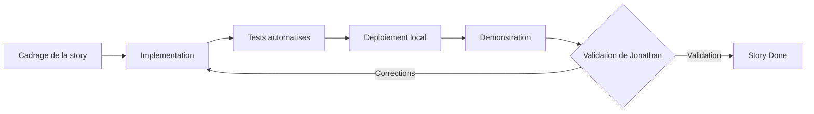

# Règles de contribution — eXalt Onboarding Digital

Ce document est le mode d'emploi du travail quotidien. La référence normative des branches,
commits, tags et versions est [`docs/operations/conventions-git-et-versions.md`](docs/operations/conventions-git-et-versions.md).

**Produit en :** LOT 0, sous-étape S3 — story `MVP-L00-US003`

---

## 1. Règle première : un lot à la fois

Le projet se construit **lot par lot**, avec validation explicite de Jonathan avant
l'ouverture du lot suivant (décision `ROAD-003`, arbitrage `ARB-BACK-003`).

- seul le lot explicitement ouvert par Jonathan peut contenir des stories `Ready` ou
  `In progress` ;
- les lots suivants restent `Planned`, même si le travail serait techniquement possible ;
- les stories V1 et V2 restent `Blocked` jusqu'aux conditions d'entrée de la roadmap
  (`ARB-BACK-004`, `BACKLOG-007`).

Une fonction explicitement exclue du MVP ne doit pas y être ajoutée silencieusement
(`ROAD-010`) : ni PWA, ni hors ligne, ni Entra ID, ni Graph, ni Teams, ni MFA, ni
Kubernetes, ni graphiques de reporting, ni médiathèque avancée.

---

## 2. Cycle d'une story



### 2.1 Définition de Ready

Une story ne démarre que si (backlog §3) :

- son besoin et son périmètre sont compris ;
- ses critères d'acceptation sont vérifiables ;
- ses dépendances obligatoires sont terminées ;
- les règles de droits et de données concernées sont identifiées ;
- les maquettes ou contenus indispensables sont disponibles, ou une solution provisoire
  validée existe ;
- une story `XL` a été découpée en tâches ou sous-stories (`BACKLOG-005`) ;
- Jonathan a ouvert le lot correspondant.

### 2.2 Définition de Done

Une story est terminée lorsque (backlog §4) :

- tous ses critères d'acceptation réussissent ;
- les tests unitaires, d'intégration, API, interface et sécurité pertinents sont présents ;
- les permissions autorisées **et refusées** sont testées ;
- les migrations et données de test sont incluses si nécessaire ;
- l'accessibilité et le responsive sont vérifiés pour toute interface ;
- les logs, audits, métriques et erreurs utiles sont ajoutés ;
- aucun secret ni donnée réelle n'est versionné ;
- la documentation d'exploitation ou d'usage est mise à jour ;
- l'intégration continue est verte ;
- la démonstration est acceptée dans la revue du lot.

Une fonctionnalité partiellement développée, masquée derrière l'interface ou non testée
**n'est pas terminée** (roadmap §2.2).

---

## 3. Circuit de contribution

**Décision `DEC-427` :** le circuit branche + pull request s'applique **à partir du premier
commit de code du LOT 1**. Les sous-étapes documentaires du LOT 0 se font en commits directs
sur `main`, chacune validée par Jonathan avant la suivante.

À partir du LOT 1 :

```bash
# 1. Partir de develop a jour
git switch develop && git pull

# 2. Creer la branche de travail
git switch -c feat/l02-us004-historisation-dsm

# 3. Travailler, en commits Conventional Commits
git commit

# 4. Publier et ouvrir la pull request vers develop
git push -u origin feat/l02-us004-historisation-dsm
```

La pull request cible **`develop`**, jamais `main` directement. La promotion vers `main`
intervient quand le lot est validé, puis un tag est posé.

---

## 3.1 Trois règles payées cher, et qui ne se devinent pas

### **Une branche de sous-étape part TOUJOURS de `develop`. Jamais empilée.**

Empiler la branche d'une sous-étape sur celle de la précédente, non encore fusionnée, paraît
raisonnable : le diff montre alors exactement le travail de la sous-étape. **Deux conséquences,
toutes deux mesurées le 24/08/2026 :**

| Conséquence | Mesure |
|---|---|
| **aucune intégration continue** | `ci.yml` filtre `branches: [develop, main]`. Une pull request visant une **autre** base n'en déclenche **aucune**. Ce n'était pas « pas encore là » — c'était **structurel** |
| **fermée d'office, sans avertissement** | la fusion de la base avec `--delete-branch` a **supprimé** la branche de base, et GitHub a **clos** la pull request empilée. `gh pr reopen` refuse ensuite : « Could not open the pull request » — **en sortant en 0** |

Si une sous-étape dépend d'un travail non fusionné, **attends la fusion**. Et si un rebasage est
nécessaire :

```bash
git rebase --onto origin/develop <ancienne-base>
git diff origin/develop...HEAD    # verifie le DIFF, jamais le verdict du rebase
```

### **`Closes #N` ne referme pas une issue depuis `develop`. Referme à la main.**

GitHub n'applique le mot-clé que pour une fusion dans la branche **par défaut**, ici `main`. Or
**toutes** les fusions de sous-étape vont dans `develop` : aucune ne referme son issue.

```bash
~/.local/bin/gh issue close <n> --comment "…"   # A LA MAIN, apres chaque fusion
```

**Le commentaire de fermeture est l'endroit où cocher les critères d'acceptation avec leurs
preuves**, ce que le backlog §11 exige. Et **une story qu'un seul lot n'achève pas ne se referme
pas** : `#92` du LOT 4 et `#120` du LOT 5 restent ouvertes, avec le commentaire qui dit ce qui est
prouvé **et ce qui manque**.

### **« Aucun conflit » ne veut pas dire « le résultat est celui que je veux ».**

Une résolution en `git merge -X theirs` **a réussi** — code 0, aucun conflit signalé — et avait
gardé, du côté abandonné, un fragment **non conflictuel** : 41 lignes dupliquées, et une réserve
technique réapparaissant *après* le texte qui la levait.

**Le succès de la fusion et sa justesse sont deux grandeurs différentes.** Le contrôle qui
discrimine ne porte pas sur le verdict de l'outil mais sur son **résultat** — l'arbre :

```bash
git rev-parse origin/main^{tree} origin/develop^{tree}   # doivent etre IDENTIQUES
git merge-base --is-ancestor origin/develop origin/main  # doit sortir en 0
git rev-parse origin/main^@ | wc -l                      # 2 = merge commit, 1 = squash
```

> **Et une contradiction documentaire a rendu cela nécessaire.** Les conventions Git posaient, à
> onze lignes d'intervalle, « historique linéaire requis » **et** « `develop` → `main` : merge
> commit ». **Aucune des deux n'est fausse**, et elles sont **incompatibles** : l'historique
> linéaire refuse tout merge commit. Les deux ont été appliquées, la fusion s'est rabattue sur le
> squash, et `main` s'est trouvée **coupée de l'histoire de `develop`** — neuf fichiers en conflit
> alors que le contenu ne divergeait pas.
>
> **Relire une règle ne suffit pas : il faut confronter les règles entre elles.** Et le défaut ne
> s'est manifesté qu'à la **seconde** fusion vers `main` — une contradiction peut rester invisible
> tant qu'une seule de ses branches a été exercée.

---

## 4. Ce qu'une pull request doit contenir

Le gabarit [`.github/pull_request_template.md`](.github/pull_request_template.md) est
appliqué automatiquement. Il exige :

| Élément | Pourquoi |
|---|---|
| Lot et identifiant de story | Traçabilité `BACKLOG-010` |
| Document ou décision source | Backlog §11 : lien obligatoire vers la décision ou le document source |
| Critères d'acceptation cochés | Définition de Done |
| Preuves de test | Backlog §11 : preuve de test dans la description |
| Permissions autorisées et refusées testées | Matrice §24, si la story touche aux droits |
| Vérification accessibilité et responsive | Cahier §13.4 et §14, si la story touche l'interface |
| Impact sur les registres | Décisions, risques, questions, écarts, dette |
| Confirmation d'absence de secret et de donnée réelle | Critère bloquant de porte |

---

## 5. Anomalies

Gravités (cahier §29.3) : **bloquante**, **critique**, **majeure**, **mineure**.

| Règle | Effet |
|---|---|
| Une anomalie bloquante ou critique | Interrompt la préparation de la porte |
| Une anomalie de sécurité, de données ou d'isolation | Devient prioritaire sur toute story fonctionnelle (`ARB-BACK-005`) |
| Une anomalie majeure sur un parcours central | Doit être corrigée dans le lot |
| Une anomalie mineure | Reportable uniquement selon les règles de recette validées, et seulement si elle ne touche ni la sécurité, ni les données, ni l'isolation, ni l'accessibilité essentielle |

Gabarit : [`.github/ISSUE_TEMPLATE/anomalie.md`](.github/ISSUE_TEMPLATE/anomalie.md).

---

## 6. Dette technique

Une dette créée volontairement doit être enregistrée avec **cause, impact, propriétaire et
lot de résolution** (backlog §9).

Aucune dette ne peut contourner une migration, un test, une règle de permission, une
sauvegarde ou un audit.

---

## 7. Sécurité et données : règles absolues

- aucun secret dans Git, ni dans un message de commit, ni dans un titre de branche, ni dans
  une description de pull request ;
- aucun fichier réel de collaborateurs, aucun CSV réel, aucune photo réelle versionnés ;
- aucune donnée personnelle dans les tests automatisés ;
- aucune règle de permission uniquement côté frontend : l'API est l'autorité finale
  (matrice §2.6, `RIGHTS-015`) ;
- l'isolation multi-entités est respectée dès les fondations ;
- aucun mécanisme de contournement de l'authentification, à aucun moment ;
- le prototype historique n'est jamais réutilisé comme code.

Le fichier [`.gitignore`](.gitignore) matérialise ces interdictions. Toute levée d'une de ses
règles exige une décision explicite et tracée.

---

## 8. Registres à tenir à jour

Une contribution qui produit une décision, un risque, une question ou un écart met à jour le
registre correspondant, dans la même pull request.

| Registre | Emplacement | Séquence |
|---|---|---|
| Décisions | `docs/decisions/registre-decisions.md` | `DEC-418+` |
| Écarts | `docs/decisions/registre-ecarts.md` | `ECART-nnn` |
| Questions ouvertes | `docs/operations/registre-questions-ouvertes.md` | `QO-106+` |
| Risques | `docs/operations/registre-risques.md` | `ROAD-RSK-013+` |
| Dépendances externes | `docs/operations/registre-dependances-externes.md` | `DEP-nnn` |

Un identifiant n'est **jamais** réutilisé. Une décision validée n'est **jamais** modifiée
silencieusement : elle est remplacée par une nouvelle décision qui référence l'ancienne.

Ces registres sont créés en sous-étape S4 du LOT 0.

---

## 9. Où trouver la vérité

| Question | Document |
|---|---|
| Que doit faire le produit ? | `docs/product/CAHIER_DES_CHARGES_EXALT_BORDEAUX.md` |
| Qui a le droit de faire quoi ? | `docs/product/MATRICE_ROLES_PERMISSIONS_EXALT.md` |
| Comment sont structurées les données ? | `docs/architecture/MODELE_DONNEES_EXALT.md` |
| Dans quel ordre construit-on ? | `docs/product/ROADMAP_MVP_V1_V2_EXALT.md` |
| Quelle est l'unité de travail ? | `docs/product/BACKLOG_INITIAL_PRIORISE_EXALT.md` |
| Comment travaille-t-on ? | ce fichier et `docs/operations/conventions-git-et-versions.md` |

En cas de contradiction : le cahier des charges prévaut, puis la décision validée la plus
récente. Aucune hypothèse ne remplace une décision explicite de Jonathan.
