# Cahier des charges complet — eXalt Onboarding Digital

**Nom de travail :** eXalt Bordeaux / eXalt Onboarding Digital  
**Version :** 1.0 — consolidation des ateliers 1 à 34  
**Date :** 25 juillet 2026  
**Statut :** cadrage fonctionnel et technique consolidé, soumis à validation finale de Jonathan  
**Périmètre :** MVP, V1 et orientations V2  
**Décideurs :** Léa pour le produit et le métier ; Jonathan pour la technique et l’exploitation  
**Mode de réalisation :** lots successifs, avec validation explicite de Jonathan avant ouverture du lot suivant

---

# 1. Objet du document

Ce cahier des charges définit la reconstruction complète d’une plateforme interne destinée à faciliter la découverte de l’organisation eXalt, l’intégration des nouveaux arrivants et le pilotage des parcours d’onboarding.

Il couvre :

- la vision et le périmètre du produit ;
- les utilisateurs, rôles, responsabilités et permissions ;
- l’organisation multi-entités ;
- les parcours utilisateurs et l’arborescence ;
- le trombinoscope, le Framework, les cercles et les bureaux ;
- les fiches d’arrivée, événements et parcours d’onboarding ;
- le back-office, les imports, le reporting et l’audit ;
- le modèle de données ;
- les API, le backend, le frontend et l’infrastructure ;
- l’authentification, la sécurité, le RGPD et l’accessibilité ;
- les performances, sauvegardes, déploiements et opérations ;
- la recette, les critères d’ouverture et le retour arrière ;
- la roadmap et le backlog initial priorisé.

Le document est la source de référence du projet. Les annexes spécialisées validées sont intégrées en fin de fichier et prévalent sur un résumé en cas de différence de niveau de détail.

---

# 2. Contexte et origine du projet

## 2.1 Situation actuelle

Un prototype d’organigramme et d’onboarding a été produit sous la forme d’un fichier HTML monolithique généré avec l’aide d’une IA par une personne ne travaillant pas dans le développement web.

Le prototype sert de référence visuelle et fonctionnelle, mais ne constitue pas une base de code réutilisable. Il présente notamment les limites suivantes :

- fichier HTML unique de plusieurs mégaoctets ;
- dépendances React, Babel et Tailwind chargées depuis des CDN ;
- données métier codées en dur ;
- images et ressources intégrées en Base64 ;
- stockage local dans le navigateur ;
- mot de passe administrateur intégré au code ;
- absence de backend, de base relationnelle et de contrôle d’accès serveur ;
- absence d’isolation multi-entités ;
- absence de migrations, tests, audit et sauvegardes applicatives ;
- module d’onboarding embarqué de manière non industrialisée.

## 2.2 Décision structurante

La totalité de l’application doit être reconstruite de zéro :

- architecture ;
- backend ;
- frontend ;
- données ;
- authentification ;
- infrastructure ;
- déploiement ;
- sécurité ;
- qualité ;
- supervision.

Le prototype pourra uniquement servir à :

- conserver l’intention visuelle ;
- identifier les fonctions utiles ;
- reprendre après relecture certains textes, descriptions de cercles, descriptions de bureaux et liens internes.

Les données collaborateurs du prototype ne seront jamais considérées comme une source officielle.

---

# 3. Vision produit

## 3.1 Problèmes à résoudre

Le produit doit répondre à trois difficultés principales :

1. la compréhension de l’organisation, de ses rôles et de ses communautés est difficile ;
2. les informations internes sont dispersées, hétérogènes ou obsolètes ;
3. l’onboarding est peu structuré et difficile à suivre.

## 3.2 Finalité

La plateforme doit devenir le point d’entrée interne permettant à un collaborateur de :

- comprendre eXalt et son organisation locale ;
- découvrir les personnes, métiers, cercles et bureaux ;
- identifier les responsabilités du Framework ;
- visualiser les événements et contenus utiles ;
- suivre son parcours d’arrivée ;
- accéder rapidement aux liens internes essentiels.

## 3.3 Cible prioritaire

Les nouveaux arrivants constituent la cible prioritaire, sans limiter la consultation aux seules personnes en onboarding.

La plateforme est également destinée :

- aux collaborateurs existants ;
- aux DSM ;
- aux ESM ;
- aux Boosters ;
- aux responsables de bureaux ;
- aux administrateurs d’entité ;
- aux super-administrateurs.

## 3.4 Principes produit

Le produit doit être :

- interne ;
- pédagogique ;
- simple à parcourir ;
- visuel et chaleureux ;
- mobile-first ;
- configurable ;
- réplicable entre plusieurs entités ;
- sécurisé par défaut ;
- exploitable sans dépendance au prototype historique.

---

# 4. Périmètre organisationnel

## 4.1 Organisation multi-entités

L’architecture doit permettre jusqu’à 25 entités sans refonte.

Le contenu initial concerne Bordeaux, mais la plateforme comporte dès le MVP :

- une page nationale après authentification ;
- une liste et une carte des entités ;
- la possibilité pour un super-administrateur de créer une nouvelle entité ;
- des configurations et contenus isolés par entité ;
- des modèles génériques eXalt pour initialiser une nouvelle entité.

## 4.2 Entité principale

Chaque personne possède une seule entité principale active.

Dans son entité principale, elle bénéficie des droits liés à ses responsabilités. Dans les autres entités, elle dispose uniquement d’un accès en lecture, sauf si elle est super-administratrice.

## 4.3 Données globales et locales

Sont globales :

- l’identité de la personne ;
- le catalogue des clients ;
- les paramètres de plateforme ;
- les rôles techniques globaux ;
- l’audit global.

Sont configurables par entité :

- métiers ;
- cercles ;
- bureaux ;
- responsables ;
- modèles d’onboarding ;
- textes ;
- vidéos ;
- événements ;
- liens internes ;
- contenus éditoriaux ;
- clients activés localement.

---

# 5. Gouvernance

## 5.1 Responsabilités de décision

| Domaine | Responsable principal |
|---|---|
| Arbitrages produit et métier | Léa |
| Architecture et choix techniques | Jonathan |
| Validation fonctionnelle et éditoriale | Tess |
| Validation métier des contenus et parcours | Diane |
| Validation technique, sécurité, sauvegardes et déploiement | Jonathan |
| Validation des consultants et missions | DSM concernés |
| Validation des cercles | Boosters concernés |
| Validation des bureaux | Responsables concernés |

Un problème critique de sécurité, d’intégrité, de confidentialité ou d’isolation multi-entités bloque la livraison jusqu’à résolution ou arbitrage documenté.

## 5.2 Validation séquentielle

La réalisation suit la règle suivante :


Aucun agent IA ne doit commencer un lot non ouvert explicitement par Jonathan.

---

# 6. Typologie des utilisateurs

## 6.1 Catégories professionnelles

- Direction générale ;
- ESM ;
- DSM ;
- consultant en mission ;
- consultant en intercontrat.

## 6.2 Responsabilités Framework

- DSM ;
- ESM ;
- Booster ;
- responsable de bureau.

Une personne peut cumuler plusieurs responsabilités dans son entité principale.

## 6.3 Rôles techniques

- administrateur d’entité ;
- super-administrateur ;
- compte de service.

Les rôles techniques sont séparés des responsabilités métier.

## 6.4 Règles particulières

- le DG reçoit automatiquement la responsabilité DSM dans son entité ;
- un cercle ne possède qu’un seul Booster actif ;
- une personne ne peut pas être Booster active dans plusieurs entités ;
- un bureau possède entre un et trois responsables ;
- l’administrateur d’entité ne peut pas attribuer les responsabilités Framework ;
- l’ESM et le super-administrateur peuvent attribuer ces responsabilités selon leur périmètre ;
- les droits se cumulent, mais la restriction la plus forte et les contraintes métier prévalent.

La matrice exhaustive figure en annexe A.

---

# 7. Authentification et accès

## 7.1 Accès anonyme

Les seules pages accessibles sans authentification sont :

- connexion ;
- informations légales et confidentialité ;
- pages d’erreur techniques nécessaires.

Tout contenu interne est protégé.

## 7.2 Collaborateurs

Les collaborateurs utilisent un magic link envoyé par e-mail.

Conditions :

- la personne doit déjà exister dans PostgreSQL ;
- son appartenance doit être active ;
- son adresse doit appartenir à un domaine autorisé ;
- le domaine initial confirmé est `@exalt-company.com` ;
- le magic link est valide 15 minutes ;
- il est utilisable une seule fois ;
- une nouvelle demande invalide le lien précédent.

## 7.3 Administrateurs

Les administrateurs utilisent des comptes locaux avec mot de passe stocké de manière sécurisée.

Aucun mot de passe ne doit être :

- intégré au code ;
- présent dans le frontend ;
- stocké en clair ;
- enregistré dans les logs.

## 7.4 Sessions

- expiration après 7 jours d’inactivité ;
- durée absolue maximale de 30 jours ;
- cookie `HttpOnly`, `Secure` et `SameSite` ;
- aucune donnée d’authentification durable dans `localStorage` ;
- protection CSRF ;
- révocation immédiate des sessions lors d’un départ ou retrait d’accès.

## 7.5 Risques acceptés

Le MVP et la V1 n’incluent pas :

- MFA ;
- réauthentification avant une action sensible.

Mesures compensatoires :

- permissions strictes ;
- confirmation explicite ;
- motif obligatoire pour certaines actions ;
- audit ;
- alertes ;
- idempotence ;
- verrouillage et limitation des tentatives.

## 7.6 Comptes de service

Les scripts internes utilisent des comptes de service :

- dotés de scopes limités ;
- révocables ;
- expirants ;
- audités ;
- distincts des utilisateurs humains.

La durée maximale des jetons reste à arbitrer avant leur création.

---

# 8. Arborescence fonctionnelle

## 8.1 Navigation principale

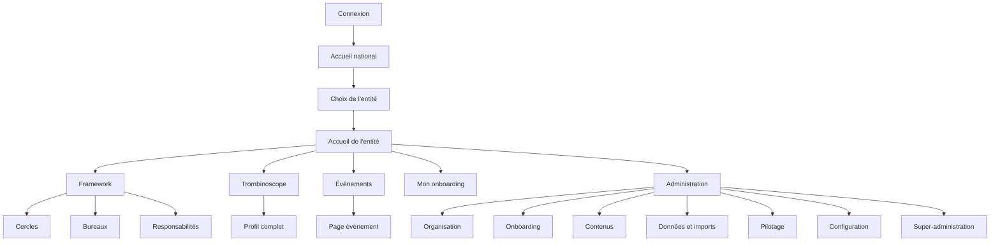

## 8.2 Menu principal

- Accueil ;
- Framework ;
- Trombinoscope ;
- Événements ;
- Mon onboarding, uniquement lorsqu’un parcours actif existe ;
- Administration, uniquement selon les permissions.

Sur mobile, une barre de navigation inférieure est utilisée. Les fonctions secondaires sont regroupées dans un accès « Plus » lorsque nécessaire.

## 8.3 Page nationale

La page nationale présente :

- une liste accessible des entités ;
- une carte de France ;
- un accès à chaque entité active.

Sur mobile, la liste précède la carte.

## 8.4 Accueil d’une entité

Ordre des sections :

1. présentation locale, avec contenu initial présenté par Omar pour Bordeaux ;
2. Framework, incluant cercles et bureaux ;
3. personnes récemment arrivées ;
4. événements à venir ;
5. cartes vers le Hub, eXalt Academy et SharePoint.

---

# 9. Parcours utilisateurs principaux

## 9.1 Première connexion d’un collaborateur

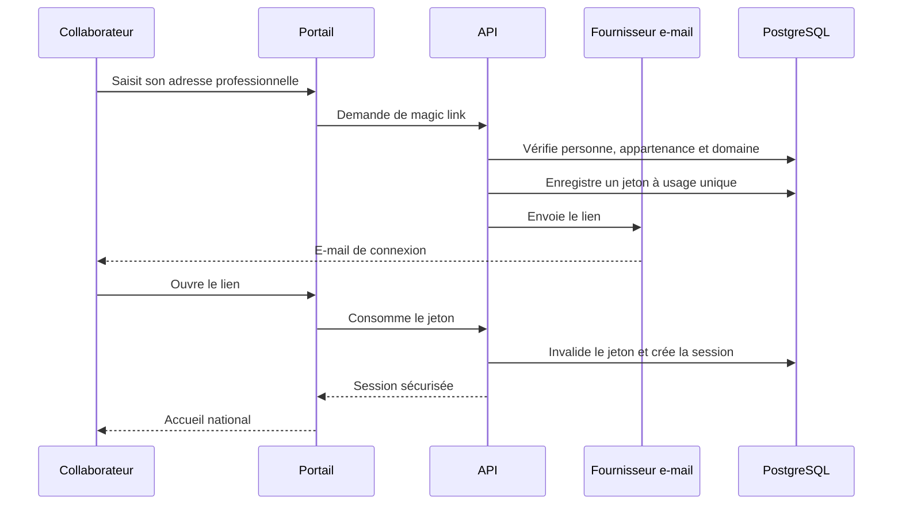

## 9.2 Découverte d’une entité

1. connexion ;
2. affichage de l’accueil national ;
3. sélection d’une entité ;
4. affichage clair de l’entité consultée ;
5. consultation de l’accueil, du Framework, du trombinoscope et des événements ;
6. retour possible à la liste des entités.

## 9.3 Recherche d’une personne

1. ouverture du trombinoscope ;
2. saisie avec recherche déclenchée à chaque frappe et temporisation d’environ 300 ms ;
3. filtrage par entité, métier, cercle, DSM, client ou statut selon le périmètre ;
4. affichage des cartes ;
5. retournement de la carte au clic, au toucher ou au clavier ;
6. ouverture du profil complet par « Voir plus ».

## 9.4 Parcours d’un nouvel arrivant

1. profil organisationnel prérempli ;
2. saisie d’une présentation courte obligatoire ;
3. ajout facultatif d’une photo et d’un fun fact ;
4. validation de la fiche d’arrivée ;
5. publication immédiate après validation ;
6. accès au parcours d’onboarding ;
7. consultation de la progression globale et de la prochaine étape ;
8. validation directe des tâches ;
9. possibilité d’annuler pendant cinq minutes ;
10. après cinq minutes, réouverture réservée à l’ESM, l’administrateur d’entité ou le super-administrateur ;
11. archivage du parcours terminé.

## 9.5 Import CSV

1. chargement du fichier ;
2. analyse complète sans écriture ;
3. prévisualisation des lignes valides, avertissements et rejets ;
4. validation humaine des rapprochements ;
5. confirmation explicite ;
6. import transactionnel des lignes valides ;
7. rapport complet ;
8. correction et rejeu des lignes rejetées.

## 9.6 Signalement d’un bug

1. clic sur « Reporter un bug » ;
2. description du problème et de l’action tentée ;
3. ajout automatique du contexte technique non sensible ;
4. création d’un signalement ;
5. suivi par Jonathan selon les états nouveau, en analyse, corrigé ou rejeté.

---

# 10. Exigences fonctionnelles

## 10.1 Trombinoscope

Le trombinoscope doit permettre :

- une vue paginée et responsive ;
- une recherche rapide ;
- des filtres combinables ;
- une carte recto-verso ;
- une ouverture du profil complet ;
- une navigation clavier ;
- un rendu adapté au tactile ;
- un avatar neutre en l’absence de photo autorisée.

Le recto présente principalement la photo et l’identité. Le verso présente les informations professionnelles principales.

La couleur du cercle peut être utilisée sur les bordures, arrière-plans légers et badges, mais jamais comme seul moyen de transmettre une information.

## 10.2 Profil collaborateur

Champs principaux :

- photo facultative ;
- prénom ;
- nom ;
- métier ;
- entité ;
- cercle principal ;
- cercles secondaires ;
- responsabilités Framework ;
- DSM ;
- statut mission ou intercontrat ;
- client actuel en mission ;
- présentation courte ;
- fun fact facultatif.

Pour un nouvel arrivant, les données organisationnelles sont préremplies et verrouillées :

- date d’arrivée ;
- métier ;
- statut ;
- DSM ;
- client ;
- cercle principal.

Après validation, le collaborateur ne modifie plus directement les données organisationnelles.

## 10.3 Framework

La page Framework fournit une vue synthétique sous forme de cartes et des pages détaillées pour :

- les responsabilités ;
- les cercles ;
- les bureaux.

Cercles initiaux de Bordeaux :

- Change ;
- Data ;
- Design ;
- Forge ;
- IT ;
- Produit ;
- Projet ;
- Shield.

Ils restent configurables en base de données.

Bureaux initiaux :

- BDS ;
- BDE ;
- BDG.

Ils restent entièrement configurables.

## 10.4 Onboarding

Deux familles initiales de modèles :

- mission ;
- intercontrat.

Règles :

- la date de référence est la date d’arrivée ;
- le collaborateur valide lui-même ses tâches ;
- les tâches proviennent d’un catalogue stable ;
- chaque tâche possède un identifiant fonctionnel immuable ;
- les versions publiées des modèles sont immuables ;
- une instance conserve un snapshot de ses tâches ;
- le changement mission/intercontrat remplace le chemin actif ;
- les tâches communes déjà terminées sont conservées grâce à leur référence stable ;
- les responsabilités de gestion restent limitées par le périmètre du rôle.

## 10.5 Fiche d’arrivée

Le MVP propose une page web de présentation du nouvel arrivant.

La fiche peut être publiée après validation, y compris avant la date d’arrivée. Le nouvel arrivant apparaît dans la section « Ils nous ont rejoints récemment » pendant un mois après sa date d’arrivée.

La version 16:9 pour écran et le texte Teams sont différés en V1.

## 10.6 Événements

Peuvent créer un événement :

- ESM ;
- DSM ;
- Booster ;
- responsable de bureau ;
- administrateur d’entité ;
- super-administrateur.

Le MVP est informatif :

- aucune inscription ;
- aucun suivi de participants ;
- aucune notification métier automatique.

L’application distingue :

- événements à venir ;
- événements passés.

Un événement est automatiquement déplacé vers les événements passés après sa fin. Un événement annulé reste visible avec un badge « Annulé ».

Les récurrences sont différées en V1.

## 10.7 Contenus et liens

Les contenus reposent sur un modèle hybride de pages et blocs autorisés. Aucun HTML arbitraire n’est stocké ou exécuté.

Le produit permet de gérer :

- titres ;
- textes ;
- cartes ;
- listes ;
- liens ;
- images ;
- vidéos ;
- blocs de présentation.

## 10.8 Administration

Le back-office comprend les groupes suivants :

- Organisation ;
- Onboarding ;
- Contenu ;
- Données ;
- Pilotage ;
- Configuration ;
- Super-administration.

Tableau de bord initial :

- profils actifs ;
- arrivées futures ;
- onboardings actifs ;
- tâches en retard ;
- profils incomplets ;
- derniers problèmes d’import CSV.

Fonctions principales :

- CRUD collaborateurs ;
- archivage et restauration ;
- changements unitaires et en masse ;
- import CSV ;
- gestion de la structure ;
- gestion des modèles d’onboarding ;
- gestion des contenus ;
- gestion simple des médias ;
- rapports ;
- audit ;
- configuration d’entité.

## 10.9 Super-administration

Le super-administrateur peut :

- créer une entité ;
- nommer un administrateur d’entité ;
- gérer les super-administrateurs ;
- gérer la configuration globale ;
- intervenir dans une entité avec traçabilité renforcée ;
- exécuter les purges définitives autorisées ;
- accéder aux audits globaux ;
- assurer le support transversal.

## 10.10 Reporting

Accès selon périmètre :

- DG ;
- ESM ;
- DSM pour ses consultants ;
- Booster pour son cercle ;
- administrateur d’entité ;
- super-administrateur.

MVP : compteurs et tableaux portant notamment sur :

- onboardings actifs ;
- onboardings terminés ;
- progression moyenne ;
- tâches en retard ;
- progression par personne ;
- durée moyenne ;
- arrivées dans les 30 jours ;
- profils actifs ;
- profils incomplets ;
- répartitions par cercle, client et DSM.

Graphiques et exports de reporting sont différés en V1.

## 10.11 Audit

Sont notamment audités :

- connexions réussies et échouées ;
- demandes et consommation de magic links ;
- invitations ;
- créations, modifications, archivages et restaurations ;
- changements de rôle, DSM, cercle, client, statut ou entité ;
- imports ;
- médias ;
- exports ;
- purges ;
- interventions inter-entités.

Chaque événement comprend :

- un résumé lisible ;
- des données structurées ;
- les valeurs anciennes et nouvelles pertinentes ;
- l’acteur ;
- le périmètre ;
- un identifiant de corrélation ;
- un motif lorsqu’il est obligatoire.

Ne sont jamais enregistrés :

- mots de passe ;
- secrets ;
- jetons ;
- liens magiques complets ;
- CSV complets ;
- corps complets d’e-mails.

Durée de conservation : un an.

## 10.12 Support

Le bouton « Reporter un bug » est disponible depuis :

- le pied de page ;
- les pages d’erreur ;
- le menu mobile ;
- éventuellement le back-office.

Les informations techniques jointes automatiquement sont limitées au contexte nécessaire et ne reprennent pas le contenu métier saisi.

---

# 11. Règles métier structurantes

## 11.1 Personnes et organisation

- l’e-mail normalisé est l’identifiant fonctionnel unique ;
- chaque personne possède un UUID interne immuable ;
- une personne ne possède qu’une appartenance principale active ;
- une affectation structurante est clôturée puis recréée, jamais écrasée ;
- une personne en mission doit avoir un client actif ;
- une personne en intercontrat ne doit pas avoir de client actif ;
- un consultant actif doit avoir un DSM ;
- une personne possède un cercle principal et éventuellement plusieurs cercles secondaires ;
- un DSM peut ne pas avoir de cercle principal ;
- un cercle ne peut pas être archivé tant qu’il contient des membres actifs ;
- le changement d’entité clôture l’ancienne appartenance et les responsabilités incompatibles.

## 11.2 Onboarding

- les tâches sont référencées par des identifiants stables ;
- les modèles sont versionnés ;
- une version publiée est immuable ;
- les instances conservent les tâches nécessaires à leur exécution ;
- une validation de tâche peut être annulée pendant cinq minutes ;
- la réouverture ultérieure est réservée aux rôles confirmés ;
- un parcours terminé est archivé ;
- les droits DSM et Booster sont strictement limités à leur périmètre.

## 11.3 Archivage et suppression

- l’archivage fonctionnel est privilégié ;
- la purge physique est exceptionnelle ;
- les opérations sensibles exigent un motif ;
- une purge, un retrait d’accès sensible, une intervention inter-entités ou un changement de rôle critique sont audités ;
- la suppression physique est réservée au super-administrateur lorsque les conditions sont réunies.

---

# 12. Données et import initial

## 12.1 Source officielle

Le premier chargement des collaborateurs utilise un CSV validé comme source principale.

Le prototype ne fournit que :

- textes de présentation ;
- descriptions de cercles ;
- descriptions de bureaux ;
- liens internes.

## 12.2 E-mail obligatoire

Une ligne sans adresse e-mail professionnelle officielle est bloquée jusqu’à correction.

## 12.3 Clients et alias

Les rapprochements de valeurs proches sont proposés, mais toute fusion ou création d’alias exige une validation humaine.

## 12.4 Import partiel

Après prévisualisation, seules les lignes valides peuvent être importées. Les autres restent rejetées et documentées.

États possibles :

- valide ;
- valide avec avertissement ;
- à confirmer ;
- rejetée ;
- importée ;
- mise à jour.

## 12.5 Validation initiale

Avant l’import final :

1. correction du CSV ;
2. date limite ;
3. contrôle métier ;
4. gel du fichier ;
5. calcul de l’empreinte SHA-256 ;
6. répétition complète en recette ;
7. correction ;
8. import en production ;
9. contrôles post-import ;
10. validation de Léa et Jonathan.

## 12.6 Critères de qualité

- aucun doublon d’e-mail ;
- aucun profil actif sans entité ;
- aucun consultant actif sans DSM ;
- aucun profil en mission sans client ;
- aucun intercontrat avec client actif ;
- aucun cercle principal invalide ;
- aucun Booster multiple ;
- total des lignes réconcilié avec les créations, mises à jour et rejets.

---

# 13. UX, design et responsive

## 13.1 Identité visuelle

L’application utilise :

- le logo officiel eXalt ;
- la charte graphique ;
- la police officielle lorsque sa licence web le permet ;
- un design identique pour toutes les entités ;
- des couleurs de cercles propres à chaque entité.

## 13.2 Direction artistique

Le rendu reste proche de l’intention du prototype :

- visuel ;
- coloré ;
- ludique ;
- cartes arrondies ;
- ombres douces ;
- dégradés bleu, rose et violet ;
- portraits ronds ;
- badges ;
- icônes, emojis et illustrations maîtrisés ;
- animations courtes et non essentielles.

## 13.3 Design system

Les composants visuels eXalt sont construits au-dessus de primitives accessibles, notamment Radix UI.

Le design system couvre :

- boutons ;
- champs ;
- cartes ;
- badges ;
- menus ;
- modales ;
- onglets ;
- tableaux ;
- alertes ;
- carrousels ;
- lecteurs vidéo ;
- états vides et chargements.

## 13.4 Responsive

L’ensemble des fonctionnalités du portail et de l’administration doit être disponible sur mobile.

Largeurs de recette :

- 320 px ;
- 390 px ;
- 768 px ;
- 1 280 px ;
- 1 920 px et plus.

## 13.5 Vidéos

- aucune lecture automatique ;
- commandes de lecture ;
- contrôle du volume ;
- déclenchement par l’utilisateur ;
- sous-titres facultatifs dans le MVP et potentiellement dans la V1.

L’absence de sous-titres sur une vidéo parlée est un écart d’accessibilité documenté et empêche de revendiquer une conformité WCAG AA complète pour le parcours concerné.

---

# 14. Accessibilité

## 14.1 Cible

Cible : WCAG 2.2 niveau AA sur les parcours essentiels, sous réserve de la dérogation vidéo explicitement acceptée.

## 14.2 Exigences principales

- navigation intégrale au clavier ;
- focus visible ;
- ordre de tabulation cohérent ;
- libellés de formulaires ;
- erreurs proches des champs et résumé lorsque nécessaire ;
- conservation des valeurs en cas d’erreur ;
- contrastes suffisants, quitte à ajuster certaines couleurs de la charte ;
- information jamais portée uniquement par la couleur ;
- prise en charge de `prefers-reduced-motion` ;
- alternatives aux animations ;
- modales, menus, onglets et carrousels accessibles ;
- tests automatisés avec axe et tests manuels.

---

# 15. Architecture cible

## 15.1 Principes

L’architecture retenue est un monolithe modulaire conteneurisé.

Stack :

- frontend React et TypeScript ;
- API Python FastAPI ;
- PostgreSQL ;
- Redis ;
- worker Python Dramatiq ;
- stockage objet MinIO compatible S3 ;
- Caddy ;
- Docker Compose.

## 15.2 Vue d’ensemble

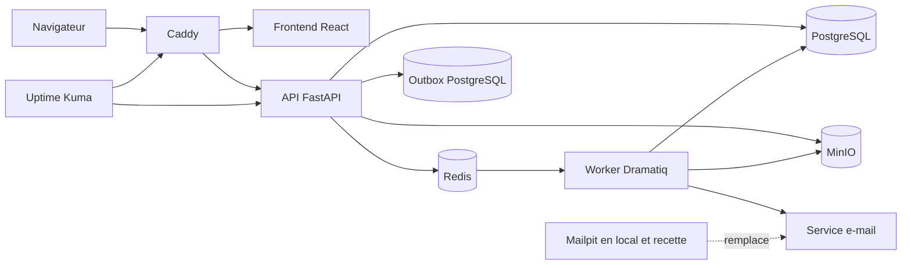

## 15.3 Monorepo

```text
/apps/web
/apps/api
/apps/worker
/packages/ui
/packages/contracts
/infra
/docs
```

## 15.4 Services Docker

- web ;
- api ;
- worker ;
- db ;
- redis ;
- minio ;
- caddy ;
- Mailpit en développement et recette ;
- outils de tests selon environnement.

## 15.5 Isolation multi-entités

Toutes les ressources locales comportent un `entity_id` ou une relation vérifiable vers une entité.

L’isolation est assurée par :

- contrôles d’autorisation FastAPI ;
- services métier ;
- contraintes SQL ;
- clés étrangères composites lorsque nécessaire ;
- tests systématiques de non-fuite ;
- possibilité d’ajouter PostgreSQL RLS après validation de son calendrier d’introduction.

---

# 16. Architecture backend

## 16.1 Organisation modulaire

```text
apps/api/app/
├── auth/
├── entities/
├── people/
├── organization/
├── onboarding/
├── events/
├── media/
├── imports/
├── reporting/
├── audit/
├── administration/
├── jobs/
├── configuration/
├── shared/
└── main.py
```

Chaque domaine contient :

- routes ;
- schémas Pydantic ;
- modèles SQLAlchemy ;
- repositories ;
- services ;
- permissions ;
- exceptions ;
- tests.

Les routes ne contiennent pas les règles métier complexes.

## 16.2 Base et migrations

- SQLAlchemy ;
- Alembic ;
- aucune création automatique de tables en production ;
- migration explicite lors du déploiement ;
- validation des migrations en CI ;
- sauvegarde avant migration sensible.

## 16.3 Transactions

Les opérations complexes sont atomiques : départ, changement d’entité, remplacement de parcours, changement de statut, import cohérent, anonymisation et autres opérations sensibles.

Les effets externes sont coordonnés par une outbox transactionnelle afin d’éviter de conserver une transaction SQL ouverte pendant l’envoi d’un e-mail ou le traitement d’un média.

## 16.4 Worker et planification

Dramatiq et Redis gèrent les files :

- default ;
- emails ;
- imports ;
- media ;
- exports ;
- maintenance ;
- security.

Les jobs sont persistés dans PostgreSQL. Ils sont idempotents, suivis et rejouables sans duplication.

Tâches planifiées :

- expiration des invitations et sessions ;
- classement des événements passés ;
- conservation et anonymisation ;
- purge de l’audit ;
- détection des jobs bloqués ;
- nettoyage des fichiers temporaires ;
- contrôle des médias orphelins.

Une réservation ou un verrou distribué empêche une double exécution logique.

## 16.5 E-mails

Le métier utilise une interface d’envoi indépendante du fournisseur.

- Mailpit en développement et recette ;
- fournisseur SMTP ou transactionnel validé en production ;
- aucun contournement manuel de l’authentification en production ;
- modèles versionnés, responsives et accompagnés d’une version texte.

---

# 17. Architecture frontend

## 17.1 Stack

- React ;
- TypeScript strict ;
- Vite ;
- React Router ;
- TanStack Query ;
- React Hook Form ;
- Zod ;
- Radix UI ;
- design system eXalt ;
- Vitest ;
- Testing Library ;
- Playwright ;
- axe.

## 17.2 Type d’application

Application web responsive classique :

- pas de PWA ;
- pas de mode métier hors ligne ;
- pas de synchronisation locale.

Après perte de connexion sur une page déjà chargée, l’utilisateur voit un état explicite et aucune action n’est déclarée enregistrée sans confirmation de l’API.

## 17.3 Gestion des données

TanStack Query gère les données serveur. L’état global est limité à :

- session ;
- permissions calculées ;
- entité sélectionnée ;
- préférences d’interface ;
- navigation ;
- notifications temporaires.

Aucune base métier n’est persistée dans le navigateur.

## 17.4 Erreurs

- pages 403, 404 et erreur générale ;
- error boundary React ;
- messages de champs ;
- notifications ;
- possibilité de réessayer ;
- identifiant de corrélation copiable ;
- aucun écran blanc silencieux.

---

# 18. API

## 18.1 Principes

- REST JSON interne ;
- `/api/v1` ;
- OpenAPI généré ;
- documentation interactive uniquement en développement et recette ;
- aucun accès public externe dans le MVP.

## 18.2 Pagination

- 25 éléments par défaut ;
- options 25, 50 et 100 ;
- maximum 100.

## 18.3 Erreurs

Format cohérent comprenant :

- code ;
- message ;
- champ ;
- détails ;
- identifiant de corrélation.

## 18.4 Concurrence

Les modifications sensibles utilisent une concurrence optimiste. Une version obsolète produit une réponse HTTP 409 sans écrasement silencieux.

## 18.5 Traitements longs

Un traitement asynchrone retourne un identifiant et un état parmi :

- queued ;
- running ;
- succeeded ;
- failed ;
- cancelled.

## 18.6 Idempotence

Requise pour :

- invitations ;
- imports ;
- création d’entité ;
- purge ;
- exports ;
- opérations en masse.

## 18.7 Santé

- `/health/live` ;
- `/health/ready` ;
- `/health/version`.

---

# 19. Médias

## 19.1 Stockage

Les fichiers sont stockés dans MinIO. PostgreSQL conserve uniquement les métadonnées et relations.

Interdictions :

- Base64 en base ;
- média dans le dépôt Git ;
- média durable dans un conteneur ;
- chemin fourni directement par l’utilisateur.

## 19.2 Contrôles

- taille ;
- type MIME déclaré ;
- signature réelle ;
- extension ;
- dimensions ;
- durée vidéo ;
- checksum ;
- nom généré côté serveur ;
- autorisation ;
- rattachement à l’entité.

États :

- pending ;
- processing ;
- ready ;
- rejected ;
- archived ;
- deleted.

Seuls les médias `ready` sont diffusables.

## 19.3 Limites MVP

- photo : 10 Mo ;
- image : 20 Mo ;
- vidéo : 1 Go ;
- vidéo : 20 minutes maximum ;
- miniatures automatiques ;
- aucune vidéo complète chargée avant interaction.

---

# 20. Sécurité

## 20.1 Principes

- refus par défaut ;
- moindre privilège ;
- contrôles côté API ;
- validation stricte des entrées ;
- séparation des secrets ;
- protection CSRF ;
- limitation des requêtes ;
- réponses génériques pour les demandes de magic link ;
- audit des actions sensibles ;
- détection de secrets en CI.

## 20.2 Seuils initiaux

- 5 échecs administrateur en 15 minutes : alerte ;
- 10 demandes de magic link par adresse et par heure : limitation ;
- 50 demandes depuis une même origine en une heure : alerte ;
- toute attribution de super-administrateur : alerte ;
- toute purge définitive : alerte ;
- plus de 5 exports d’audit en une heure : alerte.

## 20.3 Configuration

- variables d’environnement ;
- `.env` local non versionné ;
- `.env.example` sans secret ;
- validation au démarrage ;
- refus de démarrer en production lorsqu’un secret est absent ou qu’une option de développement est active.

---

# 21. RGPD et conservation

## 21.1 Principes

- chaque entité contrôle les données de son périmètre, sous réserve de la désignation juridique exacte ;
- collecte limitée ;
- transparence ;
- droits d’accès, rectification, effacement et limitation ;
- conservation documentée ;
- aucune publicité, aucun tracker social, aucun outil d’analytics marketing ;
- uniquement des cookies strictement nécessaires.

## 21.2 Photo

- facultative ;
- autorisation explicite ;
- retrait possible ;
- avatar neutre sinon.

Aucune exigence esthétique particulière n’empêche la reprise d’une photo, mais une photo techniquement dangereuse ou inutilisable peut être rejetée.

## 21.3 Départ

- révocation immédiate des accès ;
- masquage du profil ;
- archivage maximal de trois mois ;
- suppression ou anonymisation ensuite ;
- traitement coordonné des historiques et sauvegardes.

## 21.4 Notice

La notice de confidentialité est :

- affichée à la première connexion ;
- accessible ensuite ;
- versionnée ;
- datée ;
- accompagnée d’une preuve d’affichage ou de prise de connaissance, sans présenter abusivement cette preuve comme un consentement général.

## 21.5 Demandes de droits

- canal officiel RGPD ;
- suivi par dossier ;
- vérification d’identité adaptée ;
- export structuré ;
- clôture traçable.

Les personnes morales responsables, le contact RGPD, la base légale, la nécessité d’une AIPD et l’effacement dans les sauvegardes restent à confirmer avant la production générale.

---

# 22. Infrastructure locale et environnements

## 22.1 Machine initiale

- MacBook Pro 2026 ;
- puce Apple M5 ;
- macOS ;
- développement, recette et production temporaire locale.

La mémoire vive et l’espace disque exacts restent à mesurer avant installation complète.

## 22.2 Environnements

Chaque environnement possède :

- projet Docker distinct ;
- base PostgreSQL distincte ;
- bucket MinIO distinct ;
- volumes distincts ;
- secrets distincts ;
- réseau distinct ;
- ports distincts.

Exemples :

- `onboarding-dev` ;
- `onboarding-recette` ;
- `onboarding-prod-local`.

Aucun domaine public n’est nécessaire pendant la phase locale.

## 22.3 Architectures CPU

Les images doivent fonctionner sur :

- `linux/arm64` pour le Mac M5 ;
- `linux/amd64` pour un futur serveur x86.

Les images sont construites avec Buildx et publiées dans GHCR privé.

## 22.4 Limite de la production temporaire

La production locale sert à valider le MVP. Elle n’est pas l’hébergement final ouvert à tous les employés.

L’ouverture générale exige une machine disponible en permanence, un domaine, HTTPS, un fournisseur d’e-mails réel, des sauvegardes externes et une supervision extérieure.

---

# 23. CI/CD et qualité

## 23.1 Pull request

Une pull request exécute :

- formatage ;
- lint ;
- typage ;
- tests unitaires ;
- tests d’intégration PostgreSQL ;
- tests API ;
- tests frontend ;
- contrôle Alembic ;
- détection de secrets ;
- audit de dépendances ;
- construction des images.

Aucun déploiement ne part d’une pull request.

## 23.2 Recette

Une fusion sur `develop` :

- construit les images ;
- les publie dans GHCR ;
- déploie la recette locale.

## 23.3 Production temporaire

Un tag versionné déclenche :

- contrôles complets ;
- build multiarchitecture ;
- publication GHCR ;
- validation manuelle ;
- déploiement local.

La production utilise des références immuables, jamais uniquement `latest`.

## 23.4 Déploiement

1. vérification CI ;
2. contrôle d’espace disque ;
3. sauvegarde ;
4. téléchargement des images ;
5. validation de la configuration ;
6. migration ;
7. démarrage ;
8. readiness ;
9. smoke tests ;
10. vérification du worker ;
11. enregistrement de la version.

## 23.5 Outils candidats

- `uv` ;
- Ruff ;
- mypy ou pyright ;
- Pytest ;
- pytest-cov ;
- Alembic ;
- Gitleaks ;
- pip-audit ;
- Trivy ;
- Vitest ;
- Playwright ;
- axe ;
- k6 ou Locust pour la charge, à arbitrer.

---

# 24. Tests

## 24.1 Backend

- tests unitaires ;
- tests d’intégration sur PostgreSQL réel ;
- tests API ;
- tests de transactions ;
- tests de migration ;
- tests d’isolation ;
- tests de permissions.

Cible :

- couverture globale minimale de 80 % ;
- couverture complète des règles de permissions ;
- couverture complète des opérations sensibles ;
- couverture complète de l’isolation multi-entités.

## 24.2 Frontend

- Vitest ;
- Testing Library ;
- Playwright ;
- tests axe ;
- tests visuels sur les composants critiques ;
- tests responsive ;
- tests sur appareils réels ou équivalents.

## 24.3 Navigateurs

Deux dernières versions stables de :

- Chrome ;
- Edge ;
- Firefox ;
- Safari ;
- Safari iOS ;
- Chrome Android.

Internet Explorer est exclu.

---

# 25. Performance et scalabilité

## 25.1 Volumétrie cible

- 25 entités ;
- 5 000 collaborateurs actifs et archivés ;
- 100 utilisateurs simultanés dans le MVP ;
- augmentation possible sans refonte.

## 25.2 Objectifs au P95

| Opération | Objectif |
|---|---:|
| Page courante utilisable | moins de 2,5 s |
| Lecture API simple | moins de 500 ms |
| Recherche trombinoscope | moins de 800 ms |
| Modification ordinaire | moins de 1 s |
| Acceptation d’un job | moins de 2 s |

## 25.3 Budgets frontend

- JavaScript initial compressé inférieur à 350 Ko ;
- miniature de trombinoscope inférieure à 100 Ko ;
- Lighthouse mobile au moins 80 en recette ;
- Core Web Vitals dans les seuils recommandés ;
- aucun téléchargement complet d’une vidéo avant lecture.

## 25.4 Stratégie de montée en charge

1. optimiser PostgreSQL et les requêtes ;
2. optimiser les médias ;
3. augmenter les ressources ;
4. multiplier les workers ;
5. répliquer web et API derrière le proxy ;
6. externaliser base ou stockage si nécessaire ;
7. adopter des services managés si les besoins le justifient.

Aucun Kubernetes n’est prévu dans le MVP.

---

# 26. Sauvegarde et reprise

## 26.1 Objectif

Perte de données maximale acceptable : 24 heures.

Objectif recommandé de restauration : moins de quatre heures après décision d’intervention, à confirmer pour l’hébergement final.

## 26.2 Contenu

- dump PostgreSQL ;
- objets MinIO ;
- configuration nécessaire ;
- versions d’images ;
- documentation de restauration ;
- secrets indispensables dans une archive chiffrée séparée.

## 26.3 Solution candidate

Restic :

- chiffrement ;
- déduplication ;
- contrôle d’intégrité ;
- rétention ;
- restauration sélective.

## 26.4 Rétention

- 14 quotidiennes ;
- 8 hebdomadaires ;
- 6 mensuelles.

## 26.5 Copies

Avec des données réelles :

1. données actives sur l’hôte ;
2. sauvegarde chiffrée quotidienne sur support distinct ;
3. copie chiffrée hors site.

Le support et la destination hors site restent à définir.

## 26.6 Restauration

Test obligatoire :

- avant données réelles ;
- mensuellement ;
- avant migration importante ;
- après modification du dispositif de sauvegarde.

---

# 27. Monitoring, alertes et support

## 27.1 Outil

Uptime Kuma est le canal principal. Jonathan est l’unique destinataire pendant la phase locale.

## 27.2 Contrôles

- interface HTTPS lorsque disponible ;
- liveness et readiness ;
- version ;
- PostgreSQL ;
- Redis ;
- MinIO ;
- workers ;
- jobs bloqués ;
- envois d’e-mails ;
- disque ;
- certificats ;
- sauvegardes ;
- restauration.

## 27.3 Niveaux

- INFO ;
- WARNING ;
- ERROR ;
- CRITICAL.

## 27.4 Seuils initiaux

- disque > 80 % : warning ;
- disque > 90 % : critical ;
- sauvegarde > 26 h : error ;
- sauvegarde > 48 h : critical ;
- tâche sans worker depuis 10 min : error ;
- job sans progression depuis 30 min : error ;
- 3 échecs e-mail consécutifs : error ;
- readiness en échec pendant 5 min : critical ;
- erreurs HTTP > 5 % pendant 10 min : error.

## 27.5 Cycle d’une alerte

- ouverte ;
- acquittée ;
- commentée ;
- résolue ;
- rouverte automatiquement en cas de récidive.

## 27.6 Mode maintenance

Aucun mode maintenance applicatif n’est prévu.

Pour une opération sensible, la stack ou l’accès Caddy est temporairement arrêté afin d’empêcher les écritures.

## 27.7 Disponibilité cible

Future production générale : 99,5 % par mois, hors maintenances annoncées.

---

# 28. Logs

## 28.1 Format

Logs JSON structurés avec :

- date ;
- niveau ;
- service ;
- environnement ;
- version ;
- identifiant de corrélation ;
- route ou tâche ;
- durée ;
- résultat ;
- code d’erreur.

## 28.2 Confidentialité

Aucune donnée sensible, aucun secret, aucun jeton, aucun magic link complet, aucun CSV complet et aucun corps complet d’e-mail.

## 28.3 Conservation

- logs techniques : 30 jours ;
- audit fonctionnel : un an ;
- rotation et limite de taille obligatoires.

---

# 29. Recette et mise en production

## 29.1 Séquence

1. tests CI ;
2. build ;
3. recette locale ;
4. recette technique ;
5. recette métier ;
6. correction ;
7. répétition des parcours critiques ;
8. validation ;
9. tag ;
10. production temporaire ;
11. smoke tests.

## 29.2 Données de recette

Le véritable CSV peut être utilisé localement si :

- FileVault est actif ;
- la session macOS est protégée ;
- l’accès est restreint ;
- le CSV ne se trouve ni dans Git ni dans une image ;
- les sauvegardes sont chiffrées ;
- Mailpit empêche les envois réels ;
- les copies temporaires sont supprimées.

## 29.3 Gravité des anomalies

- bloquante ;
- critique ;
- majeure ;
- mineure.

## 29.4 Blocage de mise en production

La mise en production est interdite lorsqu’il existe :

- une anomalie bloquante ;
- une anomalie critique ;
- une anomalie majeure sur un parcours central ;
- un échec de permission ou d’isolation ;
- une migration non validée ;
- une sauvegarde ou restauration non validée ;
- un défaut essentiel d’accessibilité ;
- une vulnérabilité critique non arbitrée.

## 29.5 Anomalies mineures

Acceptables uniquement si elles :

- sont recensées ;
- sont priorisées ;
- ne touchent ni la sécurité, ni les données, ni l’isolation, ni l’accessibilité essentielle ;
- sont planifiées après lancement.

## 29.6 Validation

Aucun procès-verbal formel n’est exigé. Une trace légère doit identifier :

- version ;
- date ;
- environnement ;
- scénarios ;
- anomalies restantes ;
- validateurs.

## 29.7 Ouverture

Après validation complète, l’ouverture se fait immédiatement à tous les employés concernés, sans pilote progressif.

## 29.8 Retour arrière

Déclencheurs :

- authentification en panne ;
- fuite inter-entités ;
- perte ou corruption suspectée ;
- indisponibilité durable ;
- erreurs répétées d’une fonction essentielle ;
- migration incorrecte.

Un rollback applicatif doit vérifier la compatibilité du schéma avant redémarrage d’une ancienne image.

---

# 30. Périmètre MVP, V1 et V2

## 30.1 MVP

Le MVP comprend :

- portail national multi-entités ;
- création d’une nouvelle entité par le super-administrateur ;
- authentification par magic link et comptes administrateurs locaux ;
- page d’accueil d’entité ;
- Framework, cercles et bureaux ;
- trombinoscope et profils ;
- fiches d’arrivée web ;
- parcours d’onboarding mission et intercontrat ;
- événements simples ;
- back-office ;
- import CSV avec prévisualisation et rejet partiel ;
- médias simples ;
- reporting tabulaire ;
- audit ;
- support ;
- worker ;
- sauvegardes ;
- monitoring ;
- production temporaire locale ;
- préparation de la production générale.

## 30.2 V1

- événements récurrents ;
- médiathèque avancée ;
- rollback complet des imports ;
- graphiques et exports CSV/PDF ;
- fiche d’arrivée 16:9 ;
- texte Teams ;
- compléments de vidéos et contenus ;
- quotas médias si nécessaires.

La V1 ne commence qu’après mise en production du MVP et exécution d’au moins un véritable parcours d’arrivée.

## 30.3 V2

Sous réserve de validation DSI :

- Microsoft Entra ID ;
- Microsoft Graph ;
- synchronisation des collaborateurs ;
- publication Teams ;
- automatisation des arrivées et départs ;
- intégrations Hub et eXalt Academy ;
- renforcement de l’authentification, éventuellement MFA.

---

# 31. Dépendances bloquant l’ouverture générale

- hébergement permanent ;
- domaine web officiel ;
- HTTPS ;
- fournisseur d’e-mails réel ;
- domaine e-mail configuré ;
- charte, logo et police exploitables ;
- CSV final validé ;
- responsables juridiques identifiés ;
- contact RGPD ;
- sauvegarde extérieure ;
- supervision depuis une machine distincte ;
- restauration testée ;
- recette complète ;
- tests de sécurité et de charge.

Les intégrations Microsoft ne bloquent ni le MVP ni la V1.

---

# 32. Questions ouvertes consolidées

## 32.1 Bloquantes avant données réelles ou production générale

| ID | Question | Responsable |
|---|---|---|
| QO-072 | Durée maximale des jetons de comptes de service | Jonathan / sécurité |
| QO-073 | Personnes morales exactes responsables de traitement | eXalt / juridique |
| QO-074 | Contact RGPD ou DPO | eXalt |
| QO-076 | Base légale exacte des traitements | eXalt / juridique |
| QO-077 | Nécessité d’une AIPD | eXalt / RGPD |
| QO-078 | Modalités d’effacement dans les sauvegardes | Architecture / RGPD |
| QO-081 | Hébergement permanent de production | Jonathan / eXalt |
| QO-083 | Emplacement de sauvegarde local | Jonathan |
| QO-085 | RAM et espace disque exacts du Mac M5 | Jonathan |
| QO-087 | SSD externe de sauvegarde | Jonathan |
| QO-088 | Destination chiffrée hors site | Jonathan / eXalt |
| QO-096 | Schéma définitif des colonnes du CSV | Jonathan / ESM |
| QO-097 | Personne remettant formellement le CSV final | Léa / ESM |
| QO-098 | Preuves disponibles d’autorisation des photos | RH / ESM |
| QO-099 | Nombre maximal de lignes rejetées acceptable au lancement | Léa / Jonathan |
| QO-100 | Durée de conservation du CSV source | RGPD / architecture |
| QO-101 | Configuration matérielle de l’hébergement final | Jonathan / eXalt |

## 32.2 Non bloquantes pour commencer le développement

| ID | Question | Responsable |
|---|---|---|
| QO-084 | Introduction immédiate ou différée de PostgreSQL RLS | Architecture |
| QO-086 | Installation actuelle de Docker Desktop ou moteur alternatif | Jonathan |
| QO-089 | Confirmation du RTO de quatre heures | Exploitation |
| QO-091 | Supervision du Mac par Tailscale ou moniteurs Push | Jonathan |
| QO-092 | Destination des signalements de bugs | Jonathan / eXalt |
| QO-093 | Pièce jointe de capture d’écran dans les bugs | Produit |
| QO-094 | Second référent technique avant production | eXalt |
| QO-095 | Suivi des maintenances annoncées dans Uptime Kuma | Exploitation |
| QO-102 | Volumétrie vidéo annuelle attendue | Tess / ESM |
| QO-103 | Limites médias configurables dès la V1 | Produit |
| QO-104 | Outil de charge : k6 ou Locust | Architecture |
| QO-105 | Taux d’erreur maximal contractuel | Produit / technique |

---

# 33. Registre synthétique des risques majeurs

| Risque | Impact | Réponse principale |
|---|---|---|
| Fuite entre entités | Critique | Contrôles API, contraintes SQL et tests systématiques |
| Perte ou corruption de données | Critique | Transactions, sauvegardes et restauration testée |
| Secret intégré au code | Critique | Scan de secrets et configuration externe |
| Authentification indisponible | Élevé | Healthchecks, fournisseur validé et rollback |
| CSV réel exposé | Critique | FileVault, accès restreint, hors Git et sauvegardes chiffrées |
| Photo publiée sans autorisation | Élevé | Autorisation enregistrée et avatar par défaut |
| Mac local indisponible | Élevé | Production temporaire uniquement et migration vers hôte permanent |
| Sauvegarde inutilisable | Critique | Test mensuel de restauration |
| Migration empêchant le rollback | Critique | Migrations progressives et compatibilité temporaire |
| Jonathan seul référent | Élevé | Documentation, automatisation et second référent futur |
| Sous-titres absents | Accessibilité | Écart documenté et ajout progressif |
| Périmètre complet retardant l’ouverture | Calendrier | Lots séquentiels, sans sacrifice des exigences centrales |

Le registre détaillé se trouve réparti dans les sections spécialisées et les annexes.

---

# 34. Critères globaux d’acceptation du MVP

Le MVP est accepté lorsque :

- toutes les stories P0 des lots 0 à 14 sont terminées ;
- les fonctionnalités Must sont démontrées ;
- Léa valide le produit ;
- Tess et Diane valident les contenus et parcours concernés ;
- Jonathan valide la technique ;
- un onboarding réel a pu être exécuté ;
- le CSV réel est importé et réconcilié ;
- les permissions sont testées ;
- aucune fuite inter-entités n’est observée ;
- les performances atteignent les cibles retenues ;
- la recette mobile est réussie ;
- la sauvegarde et la restauration sont validées ;
- les healthchecks sont au vert ;
- le rollback est testé ;
- aucune anomalie bloquante ou critique ne reste ouverte ;
- la version déployée est identifiable.

---

# 35. Documents contractuels intégrés

Les annexes suivantes font partie intégrante du cahier des charges :

- annexe A : matrice détaillée des rôles et permissions, version 1.1 validée ;
- annexe B : modèle de données et diagrammes Mermaid, version 1.0 validée ;
- annexe C : roadmap MVP, V1 et V2, version 1.0 validée ;
- annexe D : backlog initial priorisé, version 1.0 validée.

En cas d’évolution :

1. une décision explicite est enregistrée ;
2. le document spécialisé concerné change de version ;
3. l’impact sur le modèle, la roadmap, le backlog et les tests est évalué ;
4. le cahier des charges est mis à jour.

---

# 36. Statut de cette consolidation

Cette version consolide les décisions prises pendant les ateliers 1 à 34 et les quatre livrables spécialisés validés.

Elle est destinée à devenir la référence complète avant production du dernier livrable de cadrage : le prompt du premier agent IA de réalisation.


---

# Annexe A — Matrice détaillée des rôles et permissions

## Matrice détaillée des rôles et permissions — eXalt Onboarding Digital

**Version :** 1.1 — livrable de cadrage 1/6  
**Date :** 25 juillet 2026  
**Statut :** validé par Jonathan le 25 juillet 2026  
**Périmètre :** MVP et règles structurantes V1/V2

---

### 1. Objet du document

Cette matrice définit :

- les rôles fonctionnels et techniques de la plateforme ;
- leur périmètre géographique et organisationnel ;
- les droits de consultation, création, modification, publication, archivage, restauration, export et suppression ;
- les règles de cumul entre les fonctions professionnelles et les responsabilités du Framework ;
- les restrictions applicables lors de la consultation d’une autre entité ;
- les contrôles obligatoires à appliquer côté API.

La matrice applique un principe de **refus par défaut** : une action non explicitement autorisée est interdite.

---

### 2. Principes structurants

#### 2.1 Une seule entité principale

Chaque personne possède une seule entité principale active.

Dans cette entité, elle peut cumuler plusieurs responsabilités métier ou techniques. Dans toutes les autres entités, elle dispose uniquement d’un accès de consultation, sauf si elle est super-administratrice de plateforme.

#### 2.2 Séparation des dimensions

Les notions suivantes ne doivent jamais être fusionnées dans un champ unique `role` :

| Dimension | Exemples |
|---|---|
| Catégorie professionnelle | Consultant, DG |
| Situation professionnelle | Mission, intercontrat |
| Métier | Data Analyst, Product Owner, développeur |
| Responsabilité Framework | DSM, ESM, Booster, responsable de bureau |
| Autorisation technique | Administrateur d’entité, super-administrateur |
| Rattachement organisationnel | Entité, cercle, bureau, client |

#### 2.3 Cumuls autorisés

Une même personne peut notamment être :

- consultante et Booster ;
- consultante et responsable de bureau ;
- consultante, Booster et responsable de bureau ;
- consultante et ESM ;
- ESM et responsable de bureau ;
- administratrice d’entité et consultante ;
- DG et DSM.

Les permissions accordées dans l’entité principale correspondent à l’union des droits associés aux responsabilités actives de la personne.

#### 2.4 Cas du DG

Un DG reçoit automatiquement la responsabilité DSM dans sa propre entité.

Le DG n’est pas un rôle technique global. Il ne reçoit aucun droit spécial sur les autres entités.

#### 2.5 Booster

Une personne ne peut pas être Booster active simultanément dans plusieurs entités.

Un cercle ne peut avoir qu’un seul Booster actif à un instant donné.

#### 2.6 Contrôle côté serveur

Le frontend peut masquer ou afficher les actions pour améliorer l’expérience, mais l’API reste l’autorité finale.

Chaque requête sensible doit vérifier :

1. l’identité de la personne ;
2. l’état actif du compte ;
3. l’entité principale ;
4. l’entité actuellement consultée ;
5. les responsabilités actives ;
6. le périmètre exact de la ressource ;
7. l’état de la ressource ;
8. les éventuelles contraintes métier supplémentaires.

---

### 3. Typologie des utilisateurs

| Code | Type | Description | Périmètre principal |
|---|---|---|---|
| `ANON` | Visiteur non authentifié | Accès aux seules pages publiques techniques | Connexion, mentions légales, erreurs |
| `EMP` | Employé authentifié | Collaborateur actif présent dans la base | Lecture de toutes les entités |
| `NEW` | Nouvel arrivant | Employé disposant d’une fiche d’arrivée ou d’un onboarding actif | Lecture générale + actions sur ses propres objets |
| `DSM` | DSM | Responsable des consultants qui lui sont rattachés | Ses consultants dans son entité |
| `ESM` | ESM | Responsable fonctionnel de l’entité | Ensemble de son entité |
| `BOOST` | Booster | Responsable d’un cercle | Son cercle et ses membres |
| `OFFICE` | Responsable de bureau | Responsable d’un bureau interne | Son bureau |
| `ADM-E` | Administrateur d’entité | Administrateur fonctionnel et support local | Ensemble de son entité |
| `SUPER` | Super-administrateur | Administration globale de la plateforme | Toutes les entités |
| `SERVICE` | Compte de service | Identité technique utilisée par un script interne | Scopes explicitement accordés |

#### 3.1 Types qui ne constituent pas un rôle d’autorisation autonome

Les éléments suivants ne donnent pas, seuls, des droits supplémentaires :

- consultant en mission ;
- consultant en intercontrat ;
- métier ;
- client ;
- cercle principal ou secondaire ;
- membre du Framework sans responsabilité active ;
- ancien collaborateur archivé.

---

### 4. Légende des permissions

| Symbole | Signification |
|---|---|
| `✓` | Autorisé dans le périmètre indiqué |
| `—` | Interdit |
| `Soi` | Uniquement sur ses propres données ou tâches |
| `Consultants` | Uniquement pour les consultants rattachés au DSM |
| `Cercle` | Uniquement pour le cercle du Booster |
| `Bureau` | Uniquement pour le bureau du responsable |
| `Entité` | Ensemble de l’entité principale |
| `Global` | Ensemble de la plateforme |
| `Lecture` | Consultation uniquement, sans modification |
| `Conditionnel` | Autorisé si une règle métier complémentaire est satisfaite |

---

## 5. Matrice générale de consultation

| Ressource | ANON | EMP | NEW | DSM | ESM | BOOST | OFFICE | ADM-E | SUPER |
|---|---:|---:|---:|---:|---:|---:|---:|---:|---:|
| Page nationale et carte des entités | — | ✓ | ✓ | ✓ | ✓ | ✓ | ✓ | ✓ | ✓ |
| Accueil d’une entité | — | Lecture | Lecture | Lecture | Lecture | Lecture | Lecture | Lecture | Lecture |
| Présentation de l’entité | — | Lecture | Lecture | Lecture | Lecture | Lecture | Lecture | Lecture | Lecture |
| Framework | — | Lecture | Lecture | Lecture | Lecture | Lecture | Lecture | Lecture | Lecture |
| Cercles | — | Lecture | Lecture | Lecture | Lecture | Lecture | Lecture | Lecture | Lecture |
| Bureaux | — | Lecture | Lecture | Lecture | Lecture | Lecture | Lecture | Lecture | Lecture |
| Trombinoscope | — | Lecture | Lecture | Lecture | Lecture | Lecture | Lecture | Lecture | Lecture |
| Fiches collaborateur | — | Lecture | Lecture | Lecture | Lecture | Lecture | Lecture | Lecture | Lecture |
| Statut mission/intercontrat | — | Lecture | Lecture | Lecture | Lecture | Lecture | Lecture | Lecture | Lecture |
| Client actif | — | Lecture | Lecture | Lecture | Lecture | Lecture | Lecture | Lecture | Lecture |
| Événements | — | Lecture | Lecture | Lecture | Lecture | Lecture | Lecture | Lecture | Lecture |
| Arrivées récentes | — | Lecture | Lecture | Lecture | Lecture | Lecture | Lecture | Lecture | Lecture |
| Liens Hub/Academy/SharePoint | — | Lecture | Lecture | Lecture | Lecture | Lecture | Lecture | Lecture | Lecture |
| Onboarding personnel | — | — | Soi | — | — | — | — | — | — |
| Onboardings d’autres personnes | — | — | — | Consultants | Entité | Cercle | — | Entité | Global |
| Reporting collaborateurs | — | — | — | Consultants | Entité | Cercle | — | Entité | Global |
| Audit | — | — | — | Consultants | Modifications fonctionnelles de l’entité | Cercle | Bureau | Entité | Global |
| Supervision technique | — | — | — | — | Consultation fonctionnelle limitée | — | — | Entité | Global |
| Administration | — | — | — | Périmètre métier | Entité | Cercle | Bureau | Entité | Global |

#### 5.1 Accès inter-entités

Lorsqu’une personne consulte une entité différente de son entité principale :

- elle possède uniquement les droits `EMP` ;
- ses responsabilités DSM, ESM, Booster, responsable de bureau ou administrateur d’entité ne s’appliquent pas ;
- aucune action de création, modification, publication, archivage, restauration ou export n’est proposée ;
- les contrôles côté API utilisent l’entité de la ressource, et non uniquement l’entité sélectionnée dans le frontend.

Le super-administrateur constitue la seule exception globale.

---

## 6. Collaborateurs et profils

### 6.1 Consultation et gestion des profils

| Action | EMP | NEW | DSM | ESM | BOOST | OFFICE | ADM-E | SUPER |
|---|---:|---:|---:|---:|---:|---:|---:|---:|
| Consulter un profil actif | ✓ | ✓ | ✓ | ✓ | ✓ | ✓ | ✓ | ✓ |
| Créer manuellement un profil | — | — | Consultants | Entité | Cercle | — | Entité | Global |
| Modifier les données organisationnelles | — | — | Consultants | Entité | Cercle | — | Entité | Global |
| Modifier métier, statut, DSM, client ou cercle principal | — | — | Consultants | Entité | Cercle, hors changement de DSM | — | Entité | Global |
| Gérer les cercles secondaires | — | — | Consultants | Entité | Cercle | — | Entité | Global |
| Modifier la courte présentation après validation | — | — | Consultants | Entité | Cercle | — | Entité | Global |
| Modifier ou retirer un fun fact | — | Soi avant validation | Consultants | Entité | Cercle | — | Entité | Global |
| Ajouter ou remplacer une photo | — | Soi avant validation | Consultants | Entité | Cercle | — | Entité | Global |
| Enregistrer l’autorisation photo | Soi lors de l’action | Soi | — | Support | Support | — | Support | Support |
| Retirer l’autorisation photo | Soi sur demande | Soi | — | Support | Support | — | Support | Support |
| Archiver un profil | — | — | — | Entité | — | — | Entité | Global |
| Réactiver un profil archivé | — | — | — | Conditionnel | — | — | Entité | Global |
| Consulter un profil archivé | — | — | — | Entité, besoin fonctionnel | — | — | Entité | Global |
| Purger définitivement | — | — | — | — | — | — | — | Global |

#### 6.2 Règles complémentaires

- Le nouvel arrivant ne modifie que la photo, la présentation et le fun fact avant validation.
- La date d’arrivée, le métier, le statut, le DSM, le client et le cercle principal sont préremplis et verrouillés pour le nouvel arrivant.
- Après validation de la fiche d’arrivée, le collaborateur ne peut plus modifier directement son profil.
- Un DSM ne peut modifier que les consultants ayant un rattachement DSM actif vers lui.
- Un Booster ne peut modifier que les membres actifs de son cercle. Pour un membre secondaire, ses actions doivent rester limitées aux données du cercle et ne pas permettre de modifier un autre cercle principal sans autorisation supérieure.
- Un responsable de bureau n’obtient aucun droit général sur les profils du seul fait de sa responsabilité de bureau.
- L’archivage d’un collaborateur est réservé à l’ESM, à l’administrateur d’entité et au super-administrateur.
- La purge définitive est réservée au super-administrateur.

---

## 7. Fiches d’arrivée

| Action | NEW | DSM | ESM | BOOST | OFFICE | ADM-E | SUPER |
|---|---:|---:|---:|---:|---:|---:|---:|
| Consulter sa fiche non publiée | Soi | — | Entité | Cercle | — | Entité | Global |
| Compléter photo, présentation et fun fact | Soi | — | Support | Support cercle | — | Support | Support |
| Consulter les informations préremplies | Soi | — | Entité | Cercle | — | Entité | Global |
| Modifier les informations organisationnelles | — | Consultants | Entité | Cercle limité | — | Entité | Global |
| Prévisualiser | Soi | Consultants | Entité | Cercle | — | Entité | Global |
| Valider et publier | Soi | — | Support | — | — | Support | Support |
| Corriger après publication | — | Consultants | Entité | Cercle | — | Entité | Global |
| Archiver | — | — | Entité | — | — | Entité | Global |
| Export image 16:9 | V1 | V1 périmètre | V1 Entité | V1 Cercle | — | V1 Entité | V1 Global |
| Générer le texte Teams | V1 | V1 périmètre | V1 Entité | V1 Cercle | — | V1 Entité | V1 Global |

#### 7.1 Publication

La fiche est publiée automatiquement lorsque le nouvel arrivant la valide. La validation ne nécessite pas une approbation préalable d’un responsable.

#### 7.2 Affichage

La fiche reste mise en avant dans la section « Ils nous ont rejoints récemment » jusqu’à un mois après la date d’arrivée.

---

## 8. Onboarding individuel

### 8.1 Consultation et actions

| Action | NEW | DSM | ESM | BOOST | OFFICE | ADM-E | SUPER |
|---|---:|---:|---:|---:|---:|---:|---:|
| Consulter son parcours | Soi | — | — | — | — | — | — |
| Consulter le parcours d’un collaborateur | — | Consultants | Entité | Cercle | — | Entité | Global |
| Marquer une tâche comme terminée | Soi | — | — | — | — | — | — |
| Annuler la complétion dans les 5 minutes | Soi | — | — | — | — | — | — |
| Réouvrir après le délai de 5 minutes | — | — | Entité | — | — | Entité | Global |
| Affecter un parcours | — | Consultants | Entité | Cercle | — | Entité | Global |
| Remplacer le parcours après changement de statut | — | Consultants | Entité | Cercle | — | Entité | Global |
| Modifier une échéance individuelle | — | Consultants | Entité | Cercle | — | Entité | Global |
| Consulter les tâches en retard | Soi | Consultants | Entité | Cercle | — | Entité | Global |
| Archiver un parcours terminé | Automatique | — | Entité | — | — | Entité | Global |
| Restaurer un parcours archivé | — | — | Conditionnel | — | — | Entité | Global |
| Exporter le suivi | V1 | V1 Consultants | V1 Entité | V1 Cercle | — | V1 Entité | V1 Global |

#### 8.2 Règles métier

- Le parcours est déterminé par la situation mission ou intercontrat.
- En cas de changement de situation, le parcours est remplacé par le nouveau modèle.
- Les tâches communes déjà terminées sont conservées grâce à une référence métier stable.
- Le parcours est terminé lorsque toutes les tâches obligatoires sont terminées.
- Aucun commentaire ni document joint n’est prévu dans le MVP.
- Aucun tiers ne valide les tâches dans le MVP.
- Les responsables ne peuvent pas marquer une tâche comme terminée à la place du nouvel arrivant, sauf correction technique explicitement auditée par l’administrateur ou le super-administrateur.

#### 8.3 Réouverture après cinq minutes

Après le délai de cinq minutes, une tâche terminée ne peut être réouverte que par :

- l’ESM de l’entité ;
- l’administrateur de l’entité ;
- le super-administrateur.

La réouverture exige un motif et génère un événement d’audit. Le DSM et le Booster ne peuvent pas effectuer cette correction.

---

## 9. Modèles d’onboarding

| Action | DSM | ESM | BOOST | OFFICE | ADM-E | SUPER |
|---|---:|---:|---:|---:|---:|---:|
| Consulter les modèles publiés | ✓ | ✓ | ✓ | Lecture | ✓ | ✓ |
| Créer un modèle | Consultants | Entité | Cercle | — | Entité | Global |
| Créer une nouvelle version | Consultants | Entité | Cercle | — | Entité | Global |
| Ajouter ou réordonner des tâches | Consultants | Entité | Cercle | — | Entité | Global |
| Réutiliser une tâche de référence | Consultants | Entité | Cercle | — | Entité | Global |
| Créer une tâche de référence | Consultants | Entité | Cercle | — | Entité | Global |
| Prévisualiser | Consultants | Entité | Cercle | — | Entité | Global |
| Publier une version | Consultants | Entité | Cercle | — | Entité | Global |
| Archiver une version | Consultants | Entité | Cercle | — | Entité | Global |
| Restaurer une version | — | Conditionnel | — | — | Entité | Global |

#### 9.1 Limitation de périmètre

- Un modèle créé par un DSM doit être destiné à ses consultants ou partir d’un modèle d’entité autorisé.
- Un modèle créé par un Booster doit être explicitement rattaché à son cercle.
- L’ESM et l’administrateur d’entité peuvent créer des modèles transverses à l’entité.
- Le super-administrateur peut créer les modèles génériques eXalt utilisés lors de l’initialisation d’une nouvelle entité.

---

## 10. Framework, cercles et bureaux

### 10.1 Structure Framework

| Action | DSM | ESM | BOOST | OFFICE | ADM-E | SUPER |
|---|---:|---:|---:|---:|---:|---:|
| Consulter la page Framework | ✓ | ✓ | ✓ | ✓ | ✓ | ✓ |
| Modifier la présentation générale | — | Entité | — | — | Entité | Global |
| Modifier la page DSM | Entité ou propre contenu | Entité | — | — | Entité | Global |
| Modifier la page ESM | — | Entité | — | — | Entité | Global |
| Gérer les vidéos Framework | — | Entité | — | — | Entité | Global |
| Publier les modifications | — | Entité | — | — | Entité | Global |
| Archiver/restaurer une page | — | Conditionnel | — | — | Entité | Global |

### 10.2 Cercles

| Action | DSM | ESM | BOOST | OFFICE | ADM-E | SUPER |
|---|---:|---:|---:|---:|---:|---:|
| Consulter tous les cercles | ✓ | ✓ | ✓ | ✓ | ✓ | ✓ |
| Créer un cercle | — | Entité | — | — | Entité | Global |
| Modifier la structure d’un cercle | — | Entité | — | — | Entité | Global |
| Modifier le contenu du cercle | — | Entité | Cercle | — | Entité | Global |
| Modifier description, ressources et vidéo | — | Entité | Cercle | — | Entité | Global |
| Gérer les membres principaux | Consultants limités | Entité | Cercle limité | — | Entité | Global |
| Gérer les membres secondaires | Consultants limités | Entité | Cercle | — | Entité | Global |
| Affecter ou remplacer le Booster | — | Entité | — | — | — | Global |
| Archiver un cercle | — | Entité, si aucun membre actif | — | — | Entité, si aucun membre actif | Global |
| Restaurer un cercle | — | Conditionnel | — | — | Entité | Global |

L’attribution des responsabilités Framework est réservée à l’ESM et au super-administrateur. L’administrateur d’entité ne peut pas attribuer ces responsabilités.

### 10.3 Bureaux

| Action | DSM | ESM | BOOST | OFFICE | ADM-E | SUPER |
|---|---:|---:|---:|---:|---:|---:|
| Consulter tous les bureaux | ✓ | ✓ | ✓ | ✓ | ✓ | ✓ |
| Créer un bureau | — | Entité | — | — | Entité | Global |
| Modifier la structure du bureau | — | Entité | — | Bureau, contenu uniquement | Entité | Global |
| Modifier description, vidéo et ressources | — | Entité | — | Bureau | Entité | Global |
| Gérer la galerie | — | Entité | — | Bureau | Entité | Global |
| Affecter les responsables | — | Entité | — | — | — | Global |
| Archiver un bureau | — | Entité | — | — | Entité | Global |
| Restaurer un bureau | — | Conditionnel | — | — | Entité | Global |

---

## 11. Événements

| Action | EMP | DSM | ESM | BOOST | OFFICE | ADM-E | SUPER |
|---|---:|---:|---:|---:|---:|---:|---:|
| Consulter | ✓ | ✓ | ✓ | ✓ | ✓ | ✓ | ✓ |
| Créer | — | Entité ou consultants | Entité | Cercle | Bureau | Entité | Global |
| Modifier | — | Événements créés ou rattachés à son périmètre | Entité | Cercle | Bureau | Entité | Global |
| Publier | — | Périmètre | Entité | Cercle | Bureau | Entité | Global |
| Ajouter une image ou vidéo | — | Périmètre | Entité | Cercle | Bureau | Entité | Global |
| Rattacher à plusieurs cercles ou bureaux | — | Périmètre autorisé | Entité | Cercle + autres seulement si autorisé | Bureau + autres seulement si autorisé | Entité | Global |
| Annuler | — | Périmètre | Entité | Cercle | Bureau | Entité | Global |
| Archiver | — | Périmètre | Entité | Cercle | Bureau | Entité | Global |
| Restaurer | — | — | Conditionnel | — | — | Entité | Global |
| Créer une récurrence | V1 | V1 Périmètre | V1 Entité | V1 Cercle | V1 Bureau | V1 Entité | V1 Global |

#### 11.1 Règles

- Les événements sont informatifs : aucune inscription, liste de participants ou notification métier dans le MVP.
- Un événement annulé reste visible avec un badge « Annulé ».
- Un événement passe automatiquement dans l’onglet « Passés » après son heure de fin.
- La modification et la publication sont immédiates en un clic et toujours auditées.

---

## 12. Médias

### 12.1 MVP

| Action | DSM | ESM | BOOST | OFFICE | ADM-E | SUPER |
|---|---:|---:|---:|---:|---:|---:|
| Charger un média | Périmètre | Entité | Cercle | Bureau | Entité | Global |
| Remplacer un média | Périmètre | Entité | Cercle | Bureau | Entité | Global |
| Consulter les médias liés | Périmètre | Entité | Cercle | Bureau | Entité | Global |
| Archiver un média non partagé | Périmètre | Entité | Cercle | Bureau | Entité | Global |
| Remplacer un média partagé | Conditionnel | Entité | Conditionnel | Conditionnel | Entité | Global |
| Restaurer | — | Conditionnel | — | — | Entité | Global |
| Purger définitivement | — | — | — | — | — | Global |

### 12.2 V1 — médiathèque avancée

| Action | DSM | ESM | BOOST | OFFICE | ADM-E | SUPER |
|---|---:|---:|---:|---:|---:|---:|---:|
| Rechercher et filtrer | Périmètre | Entité | Cercle | Bureau | Entité | Global |
| Réutiliser un média | Périmètre | Entité | Cercle | Bureau | Entité | Global |
| Voir les usages | Périmètre | Entité | Cercle | Bureau | Entité | Global |
| Détecter les médias inutilisés | — | Entité | Cercle | Bureau | Entité | Global |
| Opération multiple | — | Entité | Cercle limité | Bureau limité | Entité | Global |

#### 12.3 Sécurité

Le droit de chargement ne contourne jamais :

- la validation du type réel du fichier ;
- les limites de taille et de durée ;
- la quarantaine ;
- le rattachement à l’entité ;
- les règles d’autorisation photo.

---

## 13. Contenus éditoriaux et liens internes

| Action | DSM | ESM | BOOST | OFFICE | ADM-E | SUPER |
|---|---:|---:|---:|---:|---:|---:|
| Consulter | ✓ | ✓ | ✓ | ✓ | ✓ | ✓ |
| Créer un contenu général | — | Entité | — | — | Entité | Global |
| Modifier la présentation de l’entité | — | Entité | — | — | Entité | Global |
| Modifier un contenu de cercle | — | Entité | Cercle | — | Entité | Global |
| Modifier un contenu de bureau | — | Entité | — | Bureau | Entité | Global |
| Gérer les cartes Hub/Academy/SharePoint | — | Entité | — | — | Entité | Global |
| Publier immédiatement | — | Périmètre | Cercle | Bureau | Entité | Global |
| Archiver | — | Périmètre | Cercle | Bureau | Entité | Global |
| Restaurer | — | Conditionnel | — | — | Entité | Global |

---

## 14. Imports CSV

| Action | DSM | ESM | BOOST | OFFICE | ADM-E | SUPER |
|---|---:|---:|---:|---:|---:|---:|
| Charger un CSV | — | Entité | — | — | Entité | Global |
| Prévisualiser et corriger les correspondances | Consultants en validation métier | Entité | Cercle en validation métier | — | Entité | Global |
| Valider les rapprochements clients | Consultants | Entité | — | — | Entité | Global |
| Lancer l’import | — | Entité | — | — | Entité | Global |
| Consulter le rapport | Consultants | Entité | Cercle limité | — | Entité | Global |
| Rejouer les lignes rejetées | — | Entité | — | — | Entité | Global |
| Réactiver un profil archivé | — | Confirmation explicite | — | — | Confirmation explicite | Global |
| Rollback complet | V1 — | V1 selon décision | — | — | V1 Entité | V1 Global |
| Exporter le rapport | — | Entité | — | — | Entité | Global |

#### 14.1 Validation métier

- L’ESM valide les collaborateurs, statuts, arrivées et contenus généraux.
- Les DSM valident les consultants, missions et clients de leur périmètre.
- Les Boosters valident les membres de leur cercle.
- Les responsables de bureau valident les contenus de leur bureau, hors import collaborateur.
- Jonathan valide la structure technique et le rapport.
- Léa et Jonathan valident le chargement final.

---

## 15. Reporting et exports

### 15.1 MVP

| Action | DSM | ESM | BOOST | OFFICE | ADM-E | SUPER |
|---|---:|---:|---:|---:|---:|---:|
| Consulter les compteurs | Consultants | Entité | Cercle | — | Entité | Global |
| Consulter le détail onboarding | Consultants | Entité | Cercle | — | Entité | Global |
| Consulter les profils incomplets | Consultants | Entité | Cercle | — | Entité | Global |
| Consulter les arrivées à 30 jours | Consultants | Entité | Cercle | — | Entité | Global |
| Filtrer par période, DSM, cercle, client | Périmètre | Entité | Cercle | — | Entité | Global |
| Consulter les événements | Périmètre | Entité | Cercle | Bureau | Entité | Global |

### 15.2 V1

| Action | DSM | ESM | BOOST | OFFICE | ADM-E | SUPER |
|---|---:|---:|---:|---:|---:|---:|
| Afficher les graphiques | Consultants | Entité | Cercle | Bureau | Entité | Global |
| Exporter un tableau CSV | Consultants | Entité | Cercle | Bureau | Entité | Global |
| Exporter une synthèse PDF | Consultants | Entité | Cercle | Bureau | Entité | Global |

Les exports doivent respecter exactement le même périmètre que la consultation à l’écran.

---

## 16. Audit

| Action | DSM | ESM | BOOST | OFFICE | ADM-E | SUPER |
|---|---:|---:|---:|---:|---:|---:|
| Consulter | Consultants | Modifications fonctionnelles de l’entité | Historique du cercle | Historique du bureau | Entité | Global |
| Rechercher et filtrer | Consultants | Périmètre | Cercle | Bureau | Entité | Global |
| Voir ancien/nouveau contenu | Périmètre | Périmètre | Cercle | Bureau | Entité | Global |
| Exporter en CSV | — | — | — | — | Entité | Global |
| Consulter les détails techniques non sensibles | Limité | Limité | Limité | Limité | Entité | Global |
| Purger les audits arrivés à échéance | — | — | — | — | — | Traitement global automatique/supervision |

#### 16.1 Durée

Les journaux d’audit sont conservés un an.

#### 16.2 Contenu interdit

Aucun rôle ne peut consulter depuis l’audit :

- mots de passe ;
- jetons de session ;
- magic links complets ;
- secrets ;
- fichiers CSV complets ;
- contenu brut complet des e-mails.

---

## 17. Alertes, supervision et support

| Action | DSM | ESM | BOOST | OFFICE | ADM-E | SUPER |
|---|---:|---:|---:|---:|---:|---:|
| Reporter un bug | ✓ | ✓ | ✓ | ✓ | ✓ | ✓ |
| Consulter ses signalements | Soi | Soi | Soi | Soi | Entité | Global |
| Consulter les signalements de l’entité | — | Lecture fonctionnelle | — | — | Entité | Global |
| Modifier l’état d’un signalement | — | — | — | — | Entité | Global |
| Consulter les KPI techniques | — | Limité | — | — | Entité | Global |
| Consulter les alertes de sécurité | — | Limité fonctionnel | — | — | Entité | Global |
| Acquitter une alerte | — | — | — | — | Entité | Global |
| Résoudre ou commenter une alerte | — | — | — | — | Entité | Global |
| Modifier les seuils | — | — | — | — | — | Global |

Pendant la phase locale, Jonathan est l’unique destinataire des alertes Uptime Kuma.

---

## 18. Archives, restauration et purge

| Ressource/action | DSM | ESM | BOOST | OFFICE | ADM-E | SUPER |
|---|---:|---:|---:|---:|---:|---:|
| Archiver un collaborateur | — | Entité | — | — | Entité | Global |
| Archiver un contenu dans son périmètre | Périmètre | Entité | Cercle | Bureau | Entité | Global |
| Archiver un événement | Périmètre | Entité | Cercle | Bureau | Entité | Global |
| Archiver un cercle ou bureau | — | Entité | — | — | Entité | Global |
| Restaurer un collaborateur | — | Entité, restauration fonctionnelle | — | — | Entité | Global |
| Restaurer un contenu | — | Entité, restauration fonctionnelle | — | — | Entité | Global |
| Restaurer un cercle ou bureau | — | Entité, restauration fonctionnelle | — | — | Entité | Global |
| Restaurer un import complet | V1 — | V1 conditionnel | — | — | V1 Entité | V1 Global |
| Purger définitivement une donnée | — | — | — | — | — | Global |
| Lancer l’anonymisation RGPD | — | — | — | — | Entité contrôlée | Global |

#### 18.1 Motif obligatoire

Un motif est obligatoire pour :

- purge définitive ;
- révocation manuelle d’un accès actif ;
- changement sensible de rôle ;
- rollback d’import ;
- intervention du super-administrateur dans une entité.

---

## 19. Configuration d’entité

| Action | ESM | ADM-E | SUPER |
|---|---:|---:|---:|
| Consulter les paramètres | Entité | Entité | Global |
| Modifier nom d’affichage, ville et contenus locaux | Entité fonctionnel | Entité | Global |
| Modifier les liens internes | Entité | Entité | Global |
| Modifier le présentateur et la vidéo d’accueil | Entité | Entité | Global |
| Modifier les modèles génériques locaux | Entité | Entité | Global |
| Modifier la charte graphique globale | — | — | Global uniquement |
| Ajouter un domaine e-mail autorisé | — | — | Global uniquement |
| Modifier les paramètres d’authentification | — | — | Global uniquement |
| Modifier les seuils de sécurité | — | — | Global uniquement |
| Renseigner les informations RGPD de l’entité | Entité fonctionnel | Entité | Global |

L’identité visuelle eXalt reste identique dans toutes les entités. Les entités ne peuvent pas modifier librement le logo, la typographie ou les couleurs principales du design system.

---

## 20. Rôles, responsabilités et comptes administrateurs

| Action | ESM | ADM-E | SUPER |
|---|---:|---:|---:|
| Affecter une responsabilité DSM | Entité | — | Global |
| Affecter une responsabilité ESM | Entité, sauf auto-attribution sensible | — | Global |
| Affecter ou remplacer un Booster | Entité | — | Global |
| Affecter un responsable de bureau | Entité | — | Global |
| Retirer une responsabilité Framework | Entité | — | Global |
| Créer un administrateur d’entité | — | — | Global |
| Retirer un administrateur d’entité | — | — | Global |
| Créer ou retirer un super-administrateur | — | — | Global |
| Consulter l’historique des rôles | Entité | Entité | Global |
| Révoquer les sessions après retrait de rôle | Automatique | Automatique | Automatique |

L’administrateur d’entité n’attribue ni ne retire les responsabilités DSM, ESM, Booster ou responsable de bureau. Ces opérations sont réservées à l’ESM et au super-administrateur.

#### 20.1 Règles

- Toute modification de rôle est auditée.
- L’attribution d’un super-administrateur déclenche une alerte de sécurité.
- Aucune MFA ni réauthentification n’est prévue dans le MVP ou la V1.
- Les confirmations renforcées, le motif et l’audit compensent partiellement ce risque accepté.

---

## 21. Super-administration

Seul le rôle `SUPER` peut :

- créer une entité ;
- activer ou désactiver une entité ;
- nommer le premier administrateur de l’entité ;
- créer ou retirer un super-administrateur ;
- gérer les domaines e-mail globaux ;
- gérer les paramètres d’authentification ;
- gérer les modèles génériques eXalt ;
- intervenir dans toutes les entités ;
- consulter l’audit global ;
- exporter l’audit global ;
- effectuer une purge définitive ;
- gérer les comptes de service ;
- gérer les seuils de sécurité et paramètres globaux ;
- consulter les alertes globales et la supervision globale.

Toute intervention du super-administrateur dans une entité doit :

- être auditée ;
- comporter un motif lorsqu’elle modifie des données ;
- rester visible par l’administrateur de l’entité concernée dans son audit local ;
- déclencher une alerte pour les opérations les plus sensibles.

---

## 22. Comptes de service et scripts internes

Les comptes de service ne correspondent à aucun rôle humain.

Chaque compte de service possède des scopes explicites, par exemple :

```text
people:read
people:import
media:process
email:send
reports:generate
```

### 22.1 Règles obligatoires

- aucun compte personnel n’est utilisé par un script ;
- aucun compte de service ne reçoit automatiquement les droits de super-administrateur ;
- les scopes sont limités au besoin exact ;
- les jetons sont révocables et expirables ;
- chaque appel sensible est audité ;
- un compte de service est rattaché à une entité sauf besoin global documenté ;
- un script interne ne contourne jamais les règles d’intégrité métier ;
- aucune session manuelle d’employé ne peut être créée par un script en production.

---

## 23. Règles d’héritage et de résolution des conflits

### 23.1 Union des droits

Dans l’entité principale, les droits de plusieurs responsabilités se cumulent.

Exemple :

- une consultante est Booster du cercle Data et responsable du BDE ;
- elle peut gérer le contenu du cercle Data ;
- elle peut gérer le contenu du BDE ;
- elle ne peut pas gérer le cercle Forge ni le BDG ;
- elle conserve les droits de lecture générale du rôle `EMP`.

### 23.2 Restriction la plus forte

Une interdiction liée à la ressource ou à l’état prévaut sur le cumul des rôles.

Exemples :

- un cercle avec des membres actifs ne peut pas être archivé, même par une personne disposant du droit d’archivage ;
- une photographie ne peut pas être publiée sans autorisation ;
- un utilisateur archivé ne peut pas recevoir de magic link ;
- une opération inter-entités reste interdite à un administrateur local.

### 23.3 Changement d’entité

Le changement d’entité sélectionnée :

- ne modifie pas l’entité principale de la personne ;
- ne transfère pas ses responsabilités ;
- recharge les permissions ;
- annule les requêtes et caches associés à l’entité précédente ;
- doit être visible dans l’en-tête de l’application.

### 23.4 Historisation

Toutes les responsabilités importantes possèdent une date de début et une date de fin.

La suppression d’un rôle actif clôture la relation au lieu d’effacer l’historique.

---

## 24. Contrôles d’acceptation obligatoires

La matrice sera considérée correctement implémentée lorsque les tests démontreront notamment que :

1. un employé consulte toutes les entités mais ne modifie aucune autre entité ;
2. un DSM ne consulte les onboardings que de ses consultants ;
3. un DSM ne modifie pas un consultant rattaché à un autre DSM ;
4. un Booster ne modifie que son cercle et ses membres autorisés ;
5. un responsable de bureau ne modifie que son bureau ;
6. un ESM administre les données fonctionnelles de son entité ;
7. un administrateur d’entité n’accède pas aux autres entités ;
8. un super-administrateur accède à toutes les entités et ses interventions sont auditées ;
9. un nouvel arrivant ne modifie pas ses données organisationnelles ;
10. un collaborateur ne modifie plus sa fiche après validation ;
11. un profil archivé ne reçoit plus de magic link ;
12. un rôle clôturé ne continue pas à accorder des permissions ;
13. la sélection d’une autre entité ne conserve aucune permission locale ;
14. un cercle avec des membres actifs ne peut pas être archivé ;
15. une personne ne peut pas être Booster active dans plusieurs entités ;
16. un cercle ne peut pas avoir plusieurs Boosters actifs ;
17. la purge définitive est refusée à tous les rôles sauf `SUPER` ;
18. l’export d’audit est refusé à tous les rôles sauf `ADM-E` et `SUPER` ;
19. les exports de reporting respectent le même périmètre que l’écran ;
20. les actions interdites sont refusées côté API, même si la requête est construite manuellement.

La couverture automatisée des règles d’autorisation et d’isolation doit être complète.

---

## 25. Arbitrages validés par Jonathan

Les cinq arbitrages ont été validés le 25 juillet 2026.

### ARB-DROIT-001 — Réouverture d’une tâche après cinq minutes

Seuls l’ESM, l’administrateur d’entité et le super-administrateur peuvent réouvrir la tâche. Un motif et un audit sont obligatoires.

### ARB-DROIT-002 — Attribution des responsabilités

L’attribution et le retrait des responsabilités DSM, ESM, Booster et responsable de bureau sont réservés à l’ESM et au super-administrateur. L’administrateur d’entité n’en dispose pas.

### ARB-DROIT-003 — Restauration fonctionnelle par l’ESM

L’ESM peut restaurer dans son entité un profil, un contenu, un événement, un cercle ou un bureau. Les restaurations techniques, massives ou liées aux imports restent réservées à l’administrateur d’entité et au super-administrateur.

### ARB-DROIT-004 — Membres secondaires d’un cercle

Le Booster peut gérer l’appartenance secondaire à son cercle ainsi que les contenus et onboardings liés à ce cercle. Il ne peut pas modifier le cercle principal, le DSM, le client ou le statut d’un membre seulement secondaire.

### ARB-DROIT-005 — Modèles d’onboarding

- le DSM crée des modèles limités à ses consultants ;
- le Booster crée des modèles limités à son cercle ;
- l’ESM, l’administrateur d’entité et le super-administrateur créent des modèles transverses à l’entité ;
- le super-administrateur gère les modèles génériques globaux.

---

## 26. Décisions de droits consolidées

| ID | Décision |
|---|---|
| RIGHTS-001 | Toute permission est refusée par défaut si elle n’est pas explicitement accordée. |
| RIGHTS-002 | Une personne possède une seule entité principale active. |
| RIGHTS-003 | Les autres entités sont accessibles en lecture seule aux employés authentifiés. |
| RIGHTS-004 | Les responsabilités se cumulent dans l’entité principale. |
| RIGHTS-005 | Le DG reçoit automatiquement la responsabilité DSM dans son entité. |
| RIGHTS-006 | Le DSM est limité à ses consultants. |
| RIGHTS-007 | Le Booster est limité à son cercle. |
| RIGHTS-008 | Le responsable de bureau est limité à son bureau. |
| RIGHTS-009 | L’ESM dispose des pouvoirs fonctionnels transverses de son entité. |
| RIGHTS-010 | L’administrateur d’entité administre et supporte son entité uniquement. |
| RIGHTS-011 | Le super-administrateur possède les droits globaux et la purge définitive. |
| RIGHTS-012 | Les collaborateurs ne modifient plus leur profil après validation. |
| RIGHTS-013 | Le nouvel arrivant modifie uniquement les informations personnelles autorisées avant validation. |
| RIGHTS-014 | Les exports respectent toujours le périmètre de consultation. |
| RIGHTS-015 | Les permissions sont recalculées côté API pour chaque requête. |
| RIGHTS-016 | Les changements de rôle, archivages, restaurations et purges sont audités. |
| RIGHTS-017 | Une intervention globale du super-administrateur dans une entité exige une traçabilité renforcée. |
| RIGHTS-018 | Les comptes de service utilisent des scopes limités et ne remplacent pas un utilisateur humain. |
| RIGHTS-019 | La clôture d’une responsabilité révoque immédiatement les permissions associées. |
| RIGHTS-020 | Les contraintes métier peuvent interdire une action pourtant autorisée par le rôle. |
| RIGHTS-021 | Après cinq minutes, seules l’ESM, l’administrateur d’entité et le super-administrateur peuvent réouvrir une tâche. |
| RIGHTS-022 | L’administrateur d’entité ne peut pas attribuer les responsabilités Framework. |
| RIGHTS-023 | L’ESM peut effectuer les restaurations fonctionnelles de son entité. |
| RIGHTS-024 | Le Booster ne peut pas modifier les données hors cercle d’un membre secondaire. |
| RIGHTS-025 | Les modèles DSM et Booster restent limités à leur périmètre. |

---

## 27. Statut du livrable

Cette matrice a été validée par Jonathan le 25 juillet 2026. Elle constitue désormais une référence fonctionnelle verrouillée. Toute modification future devra faire l’objet d’une nouvelle décision explicite et d’un changement de version.

Elle sert d’entrée obligatoire pour :

1. le modèle de données complet ;
2. les diagrammes Mermaid ;
3. les règles d’autorisation FastAPI ;
4. les tests de permissions et d’isolation ;
5. la roadmap et le backlog de réalisation.


---

# Annexe B — Modèle de données complet et diagrammes Mermaid

## Modèle de données complet et diagrammes Mermaid — eXalt Onboarding Digital

**Version :** 1.0 — livrable de cadrage 2/6  
**Date :** 25 juillet 2026  
**Statut :** validé par Jonathan le 25 juillet 2026  
**Entrée de référence :** `MATRICE_ROLES_PERMISSIONS_EXALT.md` version 1.1 validée  
**Périmètre :** MVP, avec structures préparant la V1 et la V2

---

## 1. Objet du document

Ce document définit le modèle de données cible de la plateforme eXalt Onboarding Digital.

Il couvre :

- les personnes et leur identité globale ;
- les appartenances aux entités ;
- les métiers, statuts, clients, DSM, cercles et bureaux ;
- les responsabilités Framework et rôles techniques ;
- les comptes, sessions, magic links et comptes de service ;
- les fiches d’arrivée ;
- les modèles et instances d’onboarding ;
- les contenus éditoriaux, liens, médias et événements ;
- les imports CSV ;
- les traitements asynchrones ;
- les audits, alertes, signalements et exports ;
- les obligations RGPD et politiques de conservation ;
- les contraintes d’isolation multi-entités ;
- les index, historiques et règles d’intégrité.

Le modèle vise un **monolithe modulaire** utilisant PostgreSQL comme source de vérité.

---

## 2. Principes structurants

### 2.1 Identité globale, contexte local

Une personne existe une seule fois dans la plateforme, dans la table `person`.

Ses informations propres à une entité sont portées par `entity_membership` :

- date d’arrivée ;
- date de départ ;
- métier ;
- catégorie professionnelle ;
- statut mission ou intercontrat ;
- client actif ;
- DSM ;
- cercles ;
- responsabilités locales ;
- profil local et onboarding.

Cette séparation évite de dupliquer une personne lorsqu’elle change d’entité.

### 2.2 Une seule entité principale active

Une personne peut avoir plusieurs appartenances historiques, mais une seule appartenance active à une entité principale.

Une consultation d’une autre entité ne crée pas une appartenance supplémentaire.

### 2.3 Historisation plutôt qu’écrasement

Les relations importantes comportent une période de validité :

- appartenance à une entité ;
- métier ;
- situation mission/intercontrat ;
- client ;
- DSM ;
- cercle principal ou secondaire ;
- responsabilité Framework ;
- rôle technique ;
- responsabilité de bureau.

Une modification clôture la relation active et crée une nouvelle relation.

### 2.4 Archivage fonctionnel

Les ressources métier sont archivées par `archived_at` et `archived_by`.

La suppression physique est réservée :

- aux données temporaires ;
- aux purges RGPD ;
- aux opérations explicitement autorisées au super-administrateur.

### 2.5 Refus par défaut et isolation multi-entités

Toutes les tables propres à une entité portent un `entity_id` non nul.

Les références entre deux ressources locales doivent vérifier que les deux ressources appartiennent à la même entité.

Le modèle prévoit :

- des clés étrangères composites lorsque pertinent ;
- des contraintes SQL ;
- des validations de service ;
- des tests d’isolation ;
- une compatibilité future avec PostgreSQL Row-Level Security.

### 2.6 Source de vérité PostgreSQL

Redis ne stocke aucune donnée métier durable.

MinIO stocke les fichiers, mais PostgreSQL conserve :

- les métadonnées ;
- les droits ;
- les usages ;
- les états ;
- les historiques ;
- les empreintes ;
- les traitements associés.

### 2.7 Transactions et effets externes

Une action métier écrit dans une transaction PostgreSQL :

- la modification métier ;
- l’audit ;
- les messages à envoyer dans une table d’outbox ;
- les traitements à déclencher si nécessaire.

Le worker exécute ensuite les effets externes sans garder une transaction SQL ouverte.

---

## 3. Conventions techniques

| Élément | Convention |
|---|---|
| Clé primaire | UUID immuable |
| Horodatage | `timestamptz` en UTC |
| Nom SQL | `snake_case` |
| E-mail | stocké original + version normalisée unique |
| Archivage | `archived_at`, `archived_by_person_id`, `archive_reason` |
| Concurrence optimiste | colonne `version` entière |
| Audit | `created_at`, `created_by`, `updated_at`, `updated_by` selon ressource |
| Période active | `starts_at`, `ends_at`, avec `ends_at IS NULL` pour l’état courant |
| Énumérations | contraintes PostgreSQL ou tables de référence selon configurabilité |
| Fichiers | objets MinIO référencés par `object_key`, jamais Base64 |
| Données flexibles | `jsonb` uniquement pour métadonnées non structurantes |

### 3.1 Champs communs recommandés

Les principales tables métier utilisent :

```text
id uuid primary key
entity_id uuid not null              -- si la ressource est locale
created_at timestamptz not null
created_by_person_id uuid null
updated_at timestamptz not null
updated_by_person_id uuid null
version integer not null default 1
archived_at timestamptz null
archived_by_person_id uuid null
archive_reason text null
```

`jsonb` ne doit pas remplacer une vraie relation métier.

---

## 4. Carte des domaines

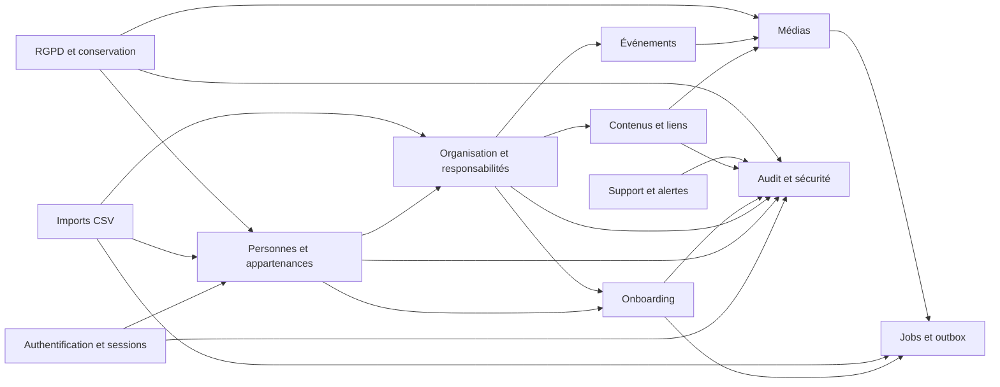

---

## 5. Référentiels globaux et entités

### 5.1 `entity`

Représente une implantation eXalt.

| Champ | Type | Règle |
|---|---|---|
| `id` | UUID | Clé primaire |
| `code` | texte | Unique, stable, par exemple `BORDEAUX` |
| `display_name` | texte | Nom présenté à l’utilisateur |
| `city` | texte | Ville principale |
| `country_code` | texte | `FR` dans le MVP |
| `status` | enum | `draft`, `active`, `suspended`, `archived` |
| `timezone` | texte | IANA, par exemple `Europe/Paris` |
| `created_at` | timestamptz | Obligatoire |
| `activated_at` | timestamptz | Nullable |
| `archived_at` | timestamptz | Nullable |

Contraintes :

- `code` immuable après activation ;
- une entité suspendue reste consultable par le super-administrateur ;
- une entité archivée ne reçoit plus de nouveaux membres.

### 5.2 `platform_setting`

Paramètres globaux :

- identité visuelle ;
- domaines e-mail autorisés ;
- durées de session ;
- seuils de sécurité ;
- versions des mentions légales ;
- paramètres de conservation.

Les secrets ne sont jamais enregistrés dans cette table.

### 5.3 `entity_setting`

Paramètres locaux :

- textes d’accueil ;
- présentateur ;
- liens internes ;
- contact RGPD ;
- informations juridiques ;
- options fonctionnelles activées ;
- configuration locale de l’onboarding.

Chaque clé est validée par un schéma connu. Aucun stockage arbitraire de secrets.

### 5.4 `allowed_email_domain`

| Champ | Règle |
|---|---|
| `domain` | Normalisé sans `@`, par exemple `exalt-company.com` |
| `entity_id` | Nullable pour un domaine global |
| `active` | Contrôle l’usage lors de l’authentification |
| `starts_at`, `ends_at` | Historisation |

---

## 6. Personnes et appartenance aux entités

### 6.1 `person`

Identité globale de la personne.

| Champ | Type | Règle |
|---|---|---|
| `id` | UUID | Interne et immuable |
| `email` | texte | Valeur d’affichage |
| `email_normalized` | texte | Unique globalement |
| `first_name` | texte | Obligatoire |
| `last_name` | texte | Obligatoire |
| `preferred_name` | texte | Facultatif |
| `account_state` | enum | `pending`, `active`, `suspended`, `departed`, `anonymized` |
| `created_at` | timestamptz | Obligatoire |
| `anonymized_at` | timestamptz | Nullable |

Contraintes :

- unicité insensible à la casse de `email_normalized` ;
- une personne anonymisée ne peut pas être réactivée sans création d’une nouvelle identité ;
- le nom et l’e-mail ne sont pas dupliqués dans les tables d’appartenance.

### 6.2 `entity_membership`

Profil d’une personne dans une entité.

| Champ | Type | Règle |
|---|---|---|
| `id` | UUID | Clé primaire |
| `person_id` | UUID | FK `person` |
| `entity_id` | UUID | FK `entity` |
| `arrival_date` | date | Référence de l’onboarding |
| `departure_date` | date | Nullable |
| `membership_state` | enum | `future`, `active`, `departed`, `archived` |
| `professional_category` | enum | `consultant`, `dg`, autre catégorie configurable ultérieure |
| `short_bio` | texte | Présentation professionnelle |
| `fun_fact` | texte | Facultatif |
| `profile_visibility` | enum | `draft`, `published`, `hidden` |
| `profile_published_at` | timestamptz | Nullable |
| `version` | entier | Concurrence optimiste |

Contraintes :

- une seule appartenance active ou future principale par personne ;
- pas de chevauchement temporel entre deux appartenances principales ;
- `departure_date >= arrival_date` ;
- l’archivage d’une appartenance révoque les accès et clôture les relations actives.

### 6.3 `job_catalog`

Catalogue de métiers configurable par entité.

Champs principaux :

- `entity_id` ;
- `code` stable ;
- `label` ;
- `description` ;
- `display_order` ;
- `active`.

### 6.4 `membership_job_assignment`

Historise le métier d’une appartenance.

Contraintes :

- une seule affectation métier active ;
- le métier appartient à la même entité que l’appartenance ;
- les périodes ne se chevauchent pas.

### 6.5 `professional_status_assignment`

Historise la situation professionnelle.

| Champ | Règle |
|---|---|
| `status` | `mission` ou `intercontract` |
| `client_id` | Obligatoire en mission, nul en intercontrat |
| `starts_at`, `ends_at` | Période |
| `reason` | Facultatif, audit fonctionnel |

Contraintes :

- une seule situation active par appartenance ;
- `mission` exige un client actif pour l’entité ;
- `intercontract` interdit un client actif ;
- un changement de statut déclenche l’évaluation du parcours d’onboarding.

---

## 7. Clients et alias

### 7.1 `client`

Référentiel global des clients.

| Champ | Règle |
|---|---|
| `canonical_name` | Nom officiel unique selon normalisation |
| `display_name` | Nom présenté |
| `status` | `active` ou `archived` |

### 7.2 `entity_client`

Active un client global dans une entité.

Cette table permet :

- de partager le même client entre plusieurs entités ;
- de ne pas afficher tous les clients partout ;
- d’archiver localement une relation sans supprimer le client global.

### 7.3 `client_alias`

| Champ | Règle |
|---|---|
| `alias_normalized` | Valeur détectée dans un import |
| `client_id` | Client canonique |
| `entity_id` | Nullable si alias global |
| `validated_by_person_id` | Validation humaine obligatoire |
| `validated_at` | Obligatoire avant usage automatique |

Aucune proposition de rapprochement n’écrit directement dans cette table sans validation humaine.

---

## 8. Organisation, cercles, bureaux et responsabilités

### 8.1 `circle`

| Champ | Règle |
|---|---|
| `entity_id` | Obligatoire |
| `code` | Unique dans l’entité |
| `name` | Nom affiché |
| `color_token` | Référence de couleur locale |
| `description` | Contenu court |
| `display_order` | Ordre |
| `archived_at` | Nullable |

Contraintes :

- impossible d’archiver avec des membres actifs ;
- la couleur ne constitue jamais la seule information visuelle.

### 8.2 `circle_membership`

Historise l’appartenance d’une personne à un cercle.

| Champ | Règle |
|---|---|
| `entity_membership_id` | Appartenance de la personne |
| `circle_id` | Cercle de la même entité |
| `membership_type` | `principal` ou `secondary` |
| `starts_at`, `ends_at` | Période |

Contraintes :

- un seul cercle principal actif par appartenance ;
- plusieurs cercles secondaires actifs autorisés ;
- une même personne ne peut pas avoir deux relations actives identiques au même cercle ;
- le Booster d’un cercle secondaire ne modifie pas le cercle principal, le DSM, le client ou le statut de la personne.

### 8.3 `office`

| Champ | Règle |
|---|---|
| `entity_id` | Obligatoire |
| `code` | Unique dans l’entité |
| `name` | Nom affiché |
| `description` | Contenu |
| `location_text` | Facultatif |
| `display_order` | Ordre |

### 8.4 `framework_responsibility_assignment`

Table générique historisant les responsabilités Framework.

| Champ | Règle |
|---|---|
| `person_id` | Personne responsable |
| `entity_id` | Entité de responsabilité |
| `responsibility_type` | `DSM`, `ESM`, `BOOSTER`, `OFFICE_MANAGER` |
| `circle_id` | Obligatoire uniquement pour `BOOSTER` |
| `office_id` | Obligatoire uniquement pour `OFFICE_MANAGER` |
| `starts_at`, `ends_at` | Période |
| `assigned_by_person_id` | ESM ou super-administrateur |
| `assignment_reason` | Obligatoire pour changement sensible |

Contraintes :

- `BOOSTER` exige `circle_id` et interdit `office_id` ;
- `OFFICE_MANAGER` exige `office_id` et interdit `circle_id` ;
- `DSM` et `ESM` interdisent les deux scopes ;
- un cercle possède un seul Booster actif ;
- un bureau possède entre un et trois responsables actifs lorsqu’il est publié ;
- une personne peut être Booster de plusieurs cercles d’une même entité ;
- une personne ne peut pas être Booster active dans plusieurs entités simultanément ;
- l’administrateur d’entité ne peut pas créer ou clôturer ces affectations ;
- un DG reçoit automatiquement une responsabilité DSM dans la même transaction que son attribution de catégorie.

### 8.5 `dsm_assignment`

Relation entre un consultant et son DSM.

| Champ | Règle |
|---|---|
| `consultant_membership_id` | Appartenance du consultant |
| `dsm_person_id` | Personne possédant une responsabilité DSM active |
| `entity_id` | Même entité |
| `starts_at`, `ends_at` | Période |

Contraintes :

- un consultant actif possède un seul DSM actif ;
- le DSM doit avoir une responsabilité DSM active dans la même entité ;
- un DSM peut suivre plusieurs consultants ;
- les périodes ne se chevauchent pas pour le consultant.

### 8.6 `technical_role_assignment`

Rôles techniques séparés du Framework.

| `role_type` | Portée |
|---|---|
| `ENTITY_ADMIN` | Une entité |
| `SUPER_ADMIN` | Globale, `entity_id` nul |

Toute création ou clôture est auditée. L’attribution d’un super-administrateur déclenche une alerte de sécurité.

---

## 9. Diagramme personnes et organisation

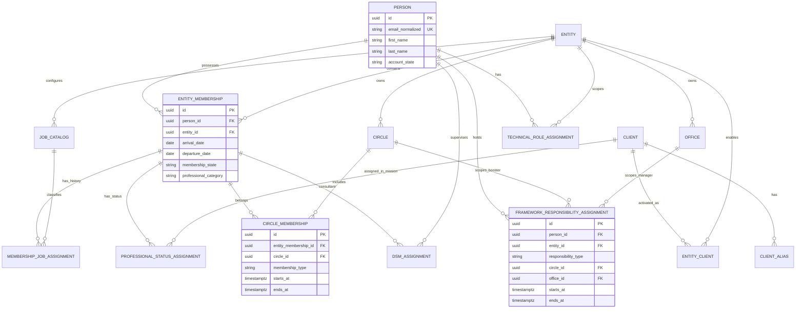

---

## 10. Authentification et sécurité

### 10.1 `user_account`

Compte permettant l’authentification.

| Champ | Règle |
|---|---|
| `person_id` | Obligatoire pour les comptes humains |
| `account_type` | `EMPLOYEE_MAGIC_LINK` ou `ADMIN_LOCAL` |
| `state` | `active`, `locked`, `disabled` |
| `last_login_at` | Nullable |
| `failed_login_count` | Compteur courant |
| `locked_until` | Nullable |

Une personne peut disposer d’un compte employé et, si nécessaire, d’un compte administrateur local distinct, sans multiplier son identité métier.

### 10.2 `admin_password_credential`

Réservé aux comptes `ADMIN_LOCAL`.

Champs :

- `user_account_id` ;
- `password_hash` ;
- `algorithm` ;
- `parameters` ;
- `changed_at` ;
- `must_change` ;
- `revoked_at`.

Aucun mot de passe brut ni historique réversible.

### 10.3 `magic_link_request`

| Champ | Règle |
|---|---|
| `person_id` | Personne active existante |
| `token_hash` | Hash uniquement |
| `requested_at` | Obligatoire |
| `expires_at` | 15 minutes après émission |
| `used_at` | Nullable |
| `invalidated_at` | Nullable |
| `request_origin_hash` | Valeur minimisée pour la limitation |

Contraintes :

- usage unique ;
- le dernier lien invalide les précédents encore actifs ;
- réponse publique générique, que l’e-mail existe ou non ;
- aucun lien complet dans les logs ou l’audit.

### 10.4 `user_session`

| Champ | Règle |
|---|---|
| `session_token_hash` | Unique |
| `person_id` | Compte humain |
| `created_at` | Début |
| `last_activity_at` | Expiration inactive après 7 jours |
| `absolute_expires_at` | Maximum 30 jours |
| `revoked_at` | Nullable |
| `revoke_reason` | Nullable |

Le départ d’un collaborateur ou le retrait d’un rôle sensible peut révoquer immédiatement les sessions concernées.

### 10.5 `service_account` et `service_token`

`service_account` porte :

- un nom ;
- une description ;
- une entité facultative ;
- un état ;
- un propriétaire technique.

`service_token` porte :

- un hash du jeton ;
- une expiration ;
- une révocation ;
- les scopes ;
- la dernière utilisation.

La durée maximale des jetons reste configurable avant leur création réelle.

### 10.6 `auth_event`

Historique spécialisé des événements d’authentification :

- succès ;
- échec ;
- magic link demandé ;
- magic link utilisé ;
- compte verrouillé ;
- session révoquée ;
- mot de passe administrateur modifié.

Les données sensibles sont exclues.

---

## 11. Diagramme authentification

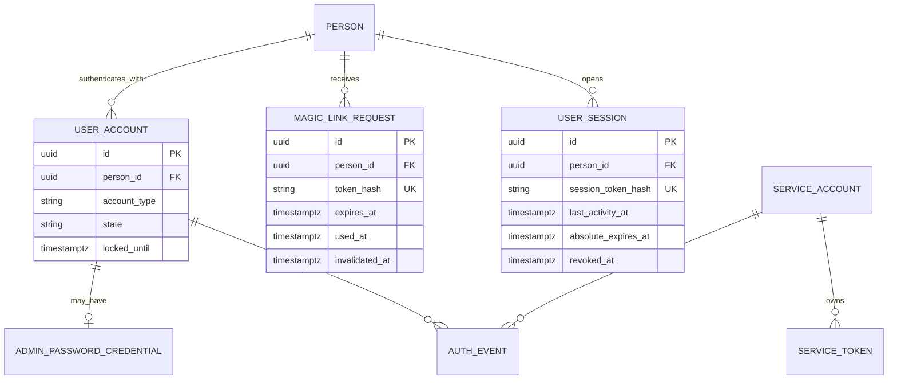

---

## 12. Fiche d’arrivée et profil publié

### 12.1 `arrival_profile`

| Champ | Règle |
|---|---|
| `entity_membership_id` | Une fiche par appartenance |
| `state` | `draft`, `validated`, `published`, `archived` |
| `short_intro` | Obligatoire avant validation |
| `fun_fact` | Facultatif |
| `photo_media_id` | Facultatif |
| `validated_at` | Date de validation par le nouvel arrivant |
| `published_at` | Publication immédiate après validation |
| `recent_until` | Un mois après la date d’arrivée |

Les données organisationnelles affichées sont lues depuis les relations actives de l’appartenance et ne sont pas dupliquées dans la fiche.

### 12.2 `photo_authorization`

| Champ | Règle |
|---|---|
| `person_id` | Personne concernée |
| `media_asset_id` | Photo autorisée |
| `granted_at` | Autorisation explicite |
| `withdrawn_at` | Retrait éventuel |
| `source` | `self_service`, `admin_support`, `migration` |
| `evidence_reference` | Référence minimale, sans document sensible inutile |

Une photo ne peut être utilisée publiquement sans autorisation active.

---

## 13. Onboarding

### 13.1 `onboarding_task_reference`

Catalogue stable des tâches réutilisables.

| Champ | Règle |
|---|---|
| `entity_id` | Nullable pour une tâche générique globale |
| `code` | Stable et unique dans son périmètre |
| `title` | Libellé |
| `description` | Instructions |
| `category` | Catégorie d’affichage |
| `active` | État |

Le `code` ou l’UUID permet de reconnaître une tâche commune lors d’un changement de parcours.

### 13.2 `onboarding_template`

Conteneur logique d’un modèle.

| Champ | Règle |
|---|---|
| `entity_id` | Nullable uniquement pour les modèles globaux |
| `name` | Nom |
| `target_status` | `mission` ou `intercontract` |
| `scope_type` | `GLOBAL`, `ENTITY`, `DSM`, `CIRCLE` |
| `scope_person_id` | DSM si scope `DSM` |
| `scope_circle_id` | Cercle si scope `CIRCLE` |
| `state` | `draft`, `active`, `archived` |

Contraintes :

- un scope `DSM` exige un DSM actif dans l’entité ;
- un scope `CIRCLE` exige un cercle de la même entité ;
- un modèle global est géré uniquement par le super-administrateur ;
- les modèles DSM et Booster ne deviennent pas transverses sans recréation par un rôle autorisé.

### 13.3 `onboarding_template_version`

Chaque publication crée une version immuable.

Champs :

- `template_id` ;
- `version_number` ;
- `state` : `draft`, `published`, `retired` ;
- `published_at` ;
- `published_by_person_id` ;
- `change_summary`.

Une instance existante garde sa version, sauf remplacement métier explicite.

### 13.4 `onboarding_template_task`

Associe une tâche à une version.

| Champ | Règle |
|---|---|
| `template_version_id` | Version |
| `task_reference_id` | Tâche stable |
| `display_order` | Unique dans la version |
| `required` | Obligatoire ou facultative |
| `due_offset_days` | Échéance relative à l’arrivée |
| `title_override` | Facultatif |
| `description_override` | Facultatif |

### 13.5 `onboarding_instance`

Parcours affecté à une appartenance.

| Champ | Règle |
|---|---|
| `entity_membership_id` | Nouvel arrivant |
| `template_version_id` | Version d’origine |
| `reference_date` | Date d’arrivée |
| `state` | `active`, `completed`, `archived`, `replaced` |
| `started_at` | Début |
| `completed_at` | Nullable |
| `replaced_by_instance_id` | Nullable |
| `replacement_reason` | Nullable |

Contraintes :

- une seule instance active par appartenance ;
- le statut cible du modèle correspond au statut professionnel actif ;
- l’archivage automatique intervient après complétion totale des tâches obligatoires.

### 13.6 `onboarding_instance_task`

Snapshot des tâches affectées.

| Champ | Règle |
|---|---|
| `onboarding_instance_id` | Instance |
| `task_reference_id` | Référence stable |
| `title_snapshot` | Texte au moment de l’affectation |
| `description_snapshot` | Texte au moment de l’affectation |
| `required` | Snapshot |
| `due_at` | Échéance calculée |
| `state` | `todo`, `completed`, `reopened`, `cancelled` |
| `completed_at` | Nullable |
| `completed_by_person_id` | Le nouvel arrivant |
| `reopened_at` | Nullable |
| `reopened_by_person_id` | ESM, administrateur d’entité ou super-administrateur après 5 minutes |
| `reopen_reason` | Obligatoire après 5 minutes |

### 13.7 `onboarding_task_event`

Journal métier détaillé des changements d’état :

- affectation ;
- complétion ;
- annulation dans les cinq minutes ;
- réouverture administrative ;
- conservation lors d’un remplacement ;
- annulation lors d’un changement de parcours.

Cette table complète l’audit global et permet de reconstruire la progression.

---

## 14. Diagramme onboarding

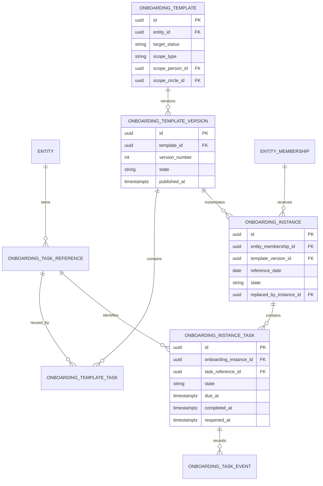

### 14.1 Changement mission/intercontrat

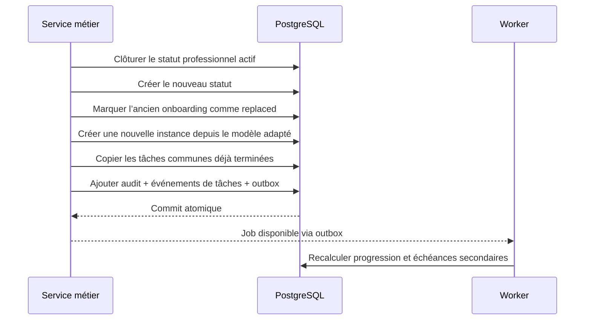

---

## 15. Contenus éditoriaux et liens

Le produit n’a pas besoin d’un CMS généraliste. Le modèle retenu est hybride :

- tables métier explicites pour les ressources structurées ;
- pages typées et blocs éditoriaux limités pour les contenus variables.

### 15.1 `content_page`

| Champ | Règle |
|---|---|
| `entity_id` | Entité |
| `page_type` | `HOME`, `FRAMEWORK`, `CIRCLE`, `OFFICE`, `LEGAL`, autre type contrôlé |
| `circle_id` | Requis pour une page de cercle |
| `office_id` | Requis pour une page de bureau |
| `title` | Titre |
| `slug` | Unique dans l’entité et le type |
| `state` | `draft`, `published`, `archived` |
| `published_at` | Nullable |

### 15.2 `content_block`

Blocs autorisés :

- texte riche limité ;
- titre ;
- image ;
- vidéo ;
- carte de lien ;
- citation ;
- liste ;
- appel à l’action interne.

Chaque bloc possède :

- `content_page_id` ;
- `block_type` ;
- `display_order` ;
- des champs structurés ;
- un `payload_json` validé par type lorsque nécessaire.

Aucun HTML arbitraire ni script n’est accepté.

### 15.3 `internal_link`

Liens Hub, Academy, SharePoint ou autres ressources internes.

Champs :

- `entity_id` ;
- `label` ;
- `url` ;
- `link_type` ;
- `description` ;
- `icon_reference` ;
- `display_order` ;
- `active`.

Les URL sont validées selon une liste de protocoles autorisés.

---

## 16. Médias

### 16.1 `media_asset`

| Champ | Règle |
|---|---|
| `entity_id` | Entité propriétaire |
| `uploaded_by_person_id` | Auteur |
| `state` | `pending`, `processing`, `ready`, `rejected`, `archived`, `deleted` |
| `media_type` | `image`, `video`, `document` si autorisé ultérieurement |
| `original_filename` | Valeur d’affichage nettoyée |
| `object_key` | Nom généré côté serveur |
| `mime_declared` | MIME reçu |
| `mime_detected` | MIME réel |
| `size_bytes` | Taille |
| `checksum_sha256` | Empreinte |
| `width`, `height` | Images et vidéos |
| `duration_seconds` | Vidéos |
| `rejection_code` | Nullable |
| `ready_at` | Nullable |

Contraintes :

- aucun `object_key` fourni par le client ;
- seuls les médias `ready` peuvent être affichés ;
- photo 10 Mo maximum ;
- image 20 Mo maximum ;
- vidéo 1 Go et 20 minutes maximum ;
- vérification du contenu réel obligatoire.

### 16.2 `media_variant`

Versions générées :

- miniature trombinoscope ;
- carte ;
- pleine largeur ;
- aperçu vidéo ;
- format optimisé.

Chaque variante porte :

- dimensions ;
- format ;
- taille ;
- checksum ;
- `object_key` propre.

### 16.3 `media_usage`

Référence les usages d’un média afin d’empêcher une suppression invalide.

| Champ | Exemple |
|---|---|
| `usage_type` | `PROFILE_PHOTO`, `CONTENT_BLOCK`, `EVENT`, `ENTITY_HERO`, `CIRCLE`, `OFFICE` |
| `resource_id` | UUID de la ressource |
| `field_name` | Champ logique |

Une purge est interdite tant que des usages actifs existent, sauf opération globale contrôlée remplaçant ou supprimant les références.

---

## 17. Événements

### 17.1 `event`

| Champ | Règle |
|---|---|
| `entity_id` | Entité |
| `title` | Obligatoire |
| `description` | Facultatif |
| `starts_at`, `ends_at` | Date et heure |
| `location_text` | Facultatif |
| `state` | `draft`, `published`, `cancelled`, `archived` |
| `cancelled_at` | Nullable |
| `cancellation_reason` | Facultatif |
| `created_by_person_id` | Auteur |

L’état « passé » est dérivé de `ends_at`, pas stocké comme état métier principal.

### 17.2 `event_circle_scope` et `event_office_scope`

Relations facultatives permettant de rattacher un événement :

- à toute l’entité ;
- à un ou plusieurs cercles ;
- à un ou plusieurs bureaux.

Le périmètre doit rester dans la même entité.

### 17.3 `event_media`

Associe un ou plusieurs médias, avec un ordre et un rôle d’affichage.

La récurrence sera ajoutée en V1 avec une règle et des occurrences matérialisées, sans modifier la table principale.

---

## 18. Diagramme contenus, médias et événements

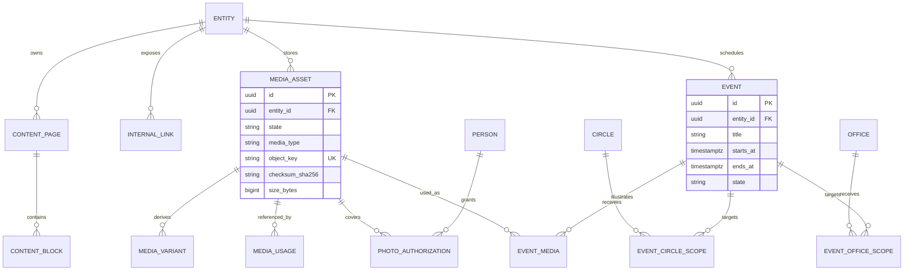

---

## 19. Imports CSV et qualité des données

### 19.1 `import_batch`

| Champ | Règle |
|---|---|
| `entity_id` | Entité cible |
| `source_filename` | Nom nettoyé |
| `source_checksum_sha256` | Empreinte du fichier |
| `state` | `uploaded`, `analyzing`, `preview_ready`, `approved`, `importing`, `completed`, `failed`, `cancelled` |
| `total_rows` | Nombre total |
| `valid_rows` | Nombre valide |
| `warning_rows` | Nombre avec avertissement |
| `rejected_rows` | Nombre rejeté |
| `created_by_person_id` | Auteur |
| `approved_by_person_id` | Validation du lancement |

Le CSV brut est conservé temporairement dans MinIO avec un usage restreint, puis supprimé selon la durée de conservation validée.

### 19.2 `import_row`

| Champ | Règle |
|---|---|
| `import_batch_id` | Lot |
| `row_number` | Numéro du CSV |
| `raw_data` | `jsonb` temporaire et minimisé |
| `normalized_data` | Valeurs normalisées |
| `state` | `valid`, `warning`, `needs_decision`, `rejected`, `imported`, `updated` |
| `target_person_id` | Nullable |
| `target_membership_id` | Nullable |
| `error_codes` | Liste structurée |

Le contenu ne doit jamais être recopié dans les logs.

### 19.3 `import_row_issue`

Une erreur ou un avertissement par ligne :

- code stable ;
- champ ;
- message utilisateur ;
- niveau ;
- valeur normalisée éventuellement sûre ;
- résolution.

### 19.4 `import_decision`

Décisions humaines :

- fusion avec une personne ;
- réactivation d’un profil archivé ;
- création d’un alias client ;
- sélection du client canonique ;
- rejet volontaire.

La décision conserve l’auteur, la date et le motif.

### 19.5 Atomicité

L’import des lignes valides utilise des transactions par lot maîtrisé, tout en garantissant pour chaque ligne :

- aucune mise à jour partielle ;
- audit cohérent ;
- identifiant de résultat ;
- capacité de rejouer une ligne rejetée.

Le rollback intégral reste V1.

---

## 20. Jobs, planification et outbox

### 20.1 `async_job`

Source durable de suivi des traitements.

| Champ | Règle |
|---|---|
| `entity_id` | Nullable pour job global |
| `job_type` | Import, média, export, purge, e-mail, maintenance |
| `state` | `queued`, `running`, `succeeded`, `failed`, `cancelled` |
| `progress_current`, `progress_total` | Facultatifs |
| `requested_by_person_id` | Nullable pour tâche système |
| `idempotency_key` | Unique dans son périmètre |
| `attempt_count` | Nombre d’essais |
| `max_attempts` | Limite |
| `started_at`, `finished_at` | Suivi |
| `last_heartbeat_at` | Détection des jobs bloqués |
| `error_code` | Nullable |
| `result_reference` | Nullable |

### 20.2 `outbox_message`

Message technique enregistré dans la même transaction que l’action métier.

Types :

- envoi d’e-mail ;
- génération de média ;
- recalcul de progression ;
- notification de supervision ;
- préparation d’export.

Champs :

- `topic` ;
- `payload_json` validé ;
- `available_at` ;
- `processed_at` ;
- `attempt_count` ;
- `last_error_code` ;
- `deduplication_key`.

### 20.3 `scheduled_task_run`

Historique des exécutions périodiques :

- expiration des liens ;
- sessions ;
- événements passés ;
- anonymisation à trois mois ;
- purge d’audit à un an ;
- nettoyage ;
- contrôle des jobs bloqués.

Un verrou PostgreSQL ou distribué garantit une seule exécution logique.

---

## 21. Audit, alertes, signalements et exports

### 21.1 `audit_event`

| Champ | Règle |
|---|---|
| `entity_id` | Nullable pour événement global |
| `actor_person_id` | Nullable pour système |
| `actor_service_account_id` | Nullable |
| `action_code` | Code stable |
| `resource_type` | Type de ressource |
| `resource_id` | UUID concerné |
| `summary` | Résumé lisible |
| `old_values` | `jsonb` filtré |
| `new_values` | `jsonb` filtré |
| `reason` | Obligatoire pour actions sensibles |
| `correlation_id` | Traçabilité technique |
| `occurred_at` | Date |
| `retention_until` | Un an par défaut |

Exclusions absolues : mots de passe, jetons, magic links complets, secrets, CSV brut, e-mail brut complet.

### 21.2 `operational_alert`

Représentation interne des alertes importantes, distincte d’Uptime Kuma.

| Champ | Règle |
|---|---|
| `severity` | `INFO`, `WARNING`, `ERROR`, `CRITICAL` |
| `source` | API, worker, security, backup, Uptime Kuma |
| `state` | `open`, `acknowledged`, `resolved` |
| `assigned_to_person_id` | Jonathan pendant la phase locale |
| `opened_at`, `acknowledged_at`, `resolved_at` | Cycle |
| `fingerprint` | Permet la réouverture et la déduplication |

### 21.3 `alert_comment`

Commentaires d’acquittement et de résolution.

### 21.4 `bug_report`

| Champ | Règle |
|---|---|
| `reported_by_person_id` | Auteur |
| `entity_id` | Entité consultée |
| `state` | `new`, `investigating`, `fixed`, `rejected` |
| `description` | Saisie utilisateur |
| `reproduction_steps` | Facultatif |
| `page_path` | Ajout automatique |
| `application_version` | Ajout automatique |
| `environment` | Ajout automatique |
| `browser_summary` | Minimisé |
| `correlation_id` | Facultatif |

Aucun contenu de formulaire métier n’est joint automatiquement.

### 21.5 `export_request`

Suit les exports CSV/PDF :

- type d’export ;
- filtre et périmètre normalisés ;
- demandeur ;
- job ;
- média ou objet généré ;
- date d’expiration ;
- audit.

---

## 22. RGPD et conservation

### 22.1 `privacy_notice_version`

Versionne les notices d’information :

- numéro de version ;
- date d’effet ;
- contenu ;
- entité juridique responsable ;
- contact RGPD ;
- état publié.

### 22.2 `privacy_notice_acknowledgement`

Trace la présentation et la prise de connaissance d’une version, sans présenter cette action comme un consentement global.

### 22.3 `data_subject_request`

Suit les demandes d’accès, rectification, effacement ou opposition :

- personne concernée ;
- type ;
- canal ;
- date de réception ;
- vérification d’identité ;
- responsable ;
- échéance ;
- état ;
- réponse ;
- date de clôture.

### 22.4 `retention_action`

Journal des actions automatiques ou manuelles :

- masquage au départ ;
- archivage ;
- anonymisation à trois mois ;
- purge d’audit à un an ;
- suppression d’un export expiré ;
- suppression d’un CSV temporaire.

### 22.5 Départ d’un collaborateur

Transaction métier immédiate :

1. clôture de l’appartenance ;
2. révocation des sessions ;
3. invalidation des magic links ;
4. clôture des rôles, DSM, client, métier et cercles ;
5. masquage du profil ;
6. archivage de l’onboarding ;
7. planification de l’anonymisation à trois mois ;
8. audit.

L’anonymisation doit préserver uniquement les agrégats nécessaires et supprimer ou remplacer les identifiants personnels.

---

## 23. Diagramme imports, jobs et audit

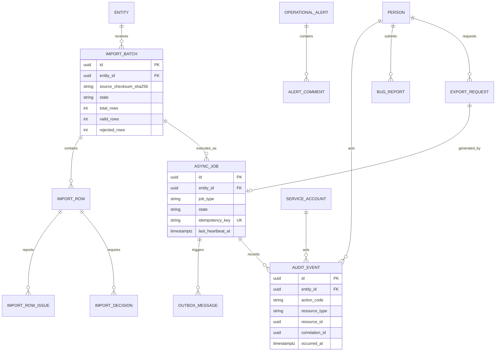

---

## 24. États principaux

### 24.1 Appartenance à une entité

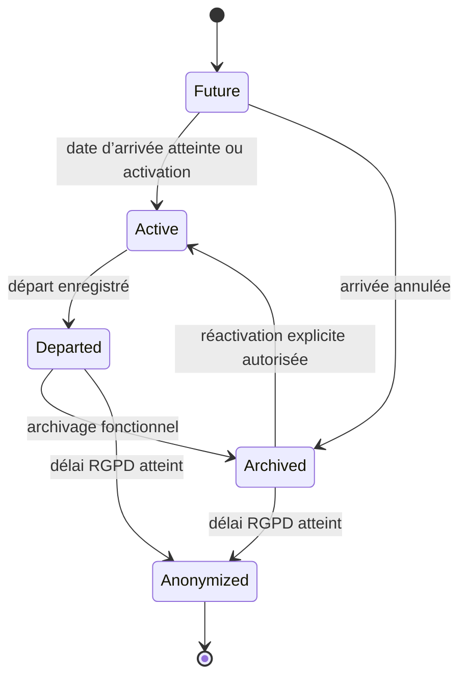

### 24.2 Tâche d’onboarding

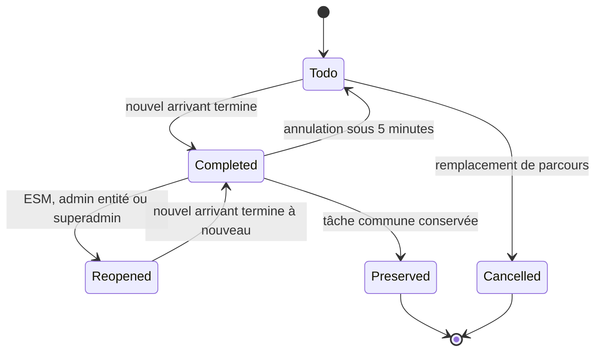

### 24.3 Média

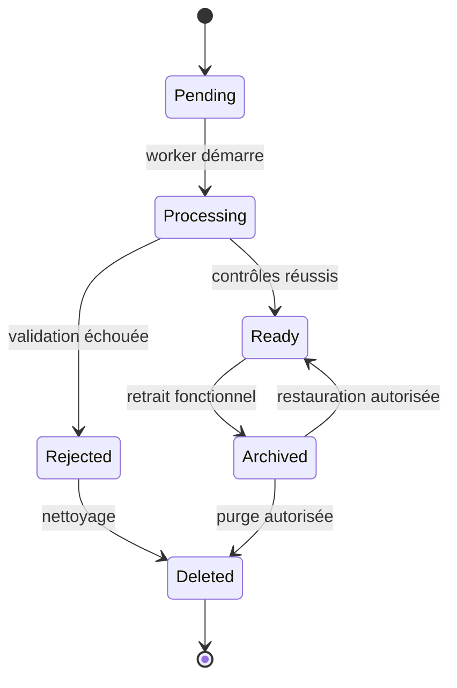

### 24.4 Import

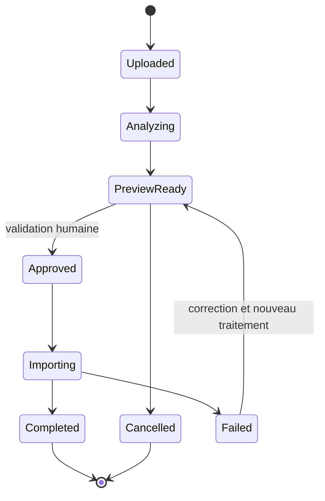

---

## 25. Contraintes SQL critiques

### 25.1 Index uniques partiels

À prévoir notamment :

```text
person(email_normalized) UNIQUE
entity(code) UNIQUE
job_catalog(entity_id, code) UNIQUE WHERE archived_at IS NULL
circle(entity_id, code) UNIQUE WHERE archived_at IS NULL
office(entity_id, code) UNIQUE WHERE archived_at IS NULL
entity_membership(person_id) UNIQUE WHERE membership_state IN ('future','active')
circle_membership(entity_membership_id) UNIQUE WHERE membership_type='principal' AND ends_at IS NULL
dsm_assignment(consultant_membership_id) UNIQUE WHERE ends_at IS NULL
framework_responsibility_assignment(circle_id) UNIQUE WHERE responsibility_type='BOOSTER' AND ends_at IS NULL
onboarding_instance(entity_membership_id) UNIQUE WHERE state='active'
magic_link_request(token_hash) UNIQUE
user_session(session_token_hash) UNIQUE
media_asset(entity_id, checksum_sha256) INDEX
async_job(entity_id, idempotency_key) UNIQUE
```

### 25.2 Contraintes temporelles

Pour empêcher les chevauchements historiques, PostgreSQL pourra utiliser des contraintes d’exclusion sur des plages temporelles, avec contrôle complémentaire dans les services.

Relations concernées :

- appartenance à une entité ;
- métier ;
- statut professionnel ;
- DSM ;
- cercle principal ;
- responsabilités Framework ;
- rôles techniques.

### 25.3 Clés étrangères composites

Pour empêcher les références inter-entités accidentelles, les tables locales exposent un couple unique `(id, entity_id)`.

Exemple : une relation entre un événement et un cercle porte `event_id`, `circle_id` et `entity_id`, avec deux clés étrangères composites garantissant que l’événement et le cercle appartiennent à cette même entité.

### 25.4 Contraintes métier nécessitant service ou trigger contrôlé

Certaines règles ne sont pas exprimables par une simple contrainte :

- une personne Booster dans une seule entité mais éventuellement plusieurs cercles de cette entité ;
- un bureau publié avec un à trois responsables actifs ;
- l’attribution automatique DSM au DG ;
- la vérification du rôle actif du DSM cible ;
- la conservation des tâches communes lors d’un changement de parcours ;
- le refus d’archiver un cercle comportant des membres actifs ;
- la publication d’une photo uniquement avec autorisation active.

Elles seront appliquées par un service transactionnel et couvertes par des tests d’intégration. Une contrainte ou un trigger défensif pourra être ajouté lorsque le risque le justifie.

---

## 26. Index de recherche et performance

### 26.1 Trombinoscope

Index recommandés :

- `person.email_normalized` ;
- normalisation et index de recherche sur prénom et nom ;
- `entity_membership(entity_id, membership_state)` ;
- affectation métier active ;
- statut professionnel actif ;
- DSM actif ;
- cercle principal actif ;
- client actif.

Une colonne de recherche dénormalisée ou un index PostgreSQL adapté pourra être utilisé pour la recherche tolérante, sans remplacer les données sources.

### 26.2 Événements

Index :

- `(entity_id, starts_at)` ;
- `(entity_id, ends_at)` ;
- état publié/annulé ;
- scopes cercle et bureau.

### 26.3 Onboarding

Index :

- instance active par appartenance ;
- tâches par échéance ;
- tâches en retard ;
- progression par DSM, cercle et entité.

### 26.4 Audit

Partitionnement temporel envisageable si le volume le justifie. Il n’est pas obligatoire au lancement.

---

## 27. Données dérivées et non stockées

Les éléments suivants doivent être calculés, sauf mesure de performance contraire :

- statut « événement passé » depuis `ends_at` ;
- progression d’un onboarding depuis les tâches ;
- rôle effectif d’une personne depuis ses affectations actives ;
- droits effectifs depuis les rôles et le périmètre ;
- affichage « arrivée récente » depuis `arrival_date` et `recent_until` ;
- nombre de profils par cercle, client ou DSM ;
- indicateurs de reporting.

Des vues SQL ou vues matérialisées pourront être ajoutées après mesure, sans devenir la source de vérité.

---

## 28. Ordre recommandé des migrations initiales

1. extensions PostgreSQL strictement nécessaires ;
2. `entity`, paramètres globaux et domaines e-mail ;
3. `person` et authentification ;
4. `entity_membership` ;
5. métiers et statuts ;
6. clients et alias ;
7. cercles et bureaux ;
8. responsabilités et rôles techniques ;
9. médias ;
10. contenus et événements ;
11. fiches d’arrivée ;
12. tâches, modèles et instances d’onboarding ;
13. imports ;
14. jobs et outbox ;
15. audit, alertes, support et RGPD ;
16. index de recherche et contraintes temporelles ;
17. vues de reporting.

Chaque migration devra être testée :

- sur une base vide ;
- depuis la version précédente ;
- avec un rollback applicatif compatible lorsque possible.

---

## 29. Tables MVP, V1 et V2

### 29.1 MVP

Tables indispensables :

- entités et paramètres ;
- personnes et appartenances ;
- métiers, statuts, clients, DSM, cercles, bureaux ;
- responsabilités Framework et rôles techniques ;
- authentification, magic links, sessions ;
- fiches d’arrivée et autorisations photo ;
- médias et variantes ;
- contenus et liens ;
- événements ;
- onboarding complet ;
- imports CSV et décisions ;
- jobs, outbox et planification ;
- audit ;
- signalements de bugs ;
- notices RGPD et conservation.

### 29.2 V1

Extensions :

- récurrence des événements ;
- médiathèque avancée ;
- rollback complet d’import ;
- exports CSV/PDF avancés ;
- exports 16:9 et texte Teams ;
- tableaux et vues matérialisées de reporting si nécessaires.

### 29.3 V2

Extensions :

- identités Microsoft Entra ID ;
- synchronisation Graph ;
- publication Teams ;
- synchronisation automatisée des arrivées et départs ;
- intégrations Hub et Academy ;
- MFA éventuelle.

Les tables MVP sont conçues pour recevoir ces extensions sans refonte des identités ou de l’organisation.

---

## 30. Contrôles de recette du modèle

Le modèle sera accepté si les tests démontrent notamment que :

1. un e-mail normalisé ne peut correspondre qu’à une personne ;
2. une personne ne peut avoir qu’une entité principale active ;
3. les historiques ne se chevauchent pas ;
4. un consultant actif possède un DSM actif ;
5. une mission possède un client et un intercontrat n’en possède pas ;
6. un cercle possède au maximum un Booster actif ;
7. une personne n’est pas Booster active dans plusieurs entités ;
8. un bureau publié possède entre un et trois responsables ;
9. une personne possède au maximum un cercle principal actif ;
10. un cercle avec des membres actifs ne peut être archivé ;
11. un profil archivé ne reçoit pas de magic link ;
12. une photo sans autorisation ne peut pas être publiée ;
13. une seule instance d’onboarding est active ;
14. les tâches communes sont conservées lors d’un changement de statut ;
15. une réouverture après cinq minutes exige un acteur autorisé et un motif ;
16. une référence d’une entité vers une autre est refusée ;
17. un import n’écrit aucune ligne avant approbation ;
18. une ligne invalide n’empêche pas les lignes valides d’être importées ;
19. un job rejoué avec la même clé ne crée pas de doublon ;
20. une action métier et son audit sont atomiques ;
21. une purge ne laisse aucun média ou lien orphelin ;
22. le départ révoque immédiatement les sessions et rôles ;
23. l’anonymisation respecte les durées validées ;
24. les exports respectent le même périmètre que la consultation ;
25. les 5 000 profils et 25 entités restent exploitables avec les index définis.

---

## 31. Arbitrages validés par Jonathan

### ARB-DATA-001 — Séparation `person` / `entity_membership`

**Décision validée :** conserver une identité globale unique et placer toutes les données locales dans l’appartenance à l’entité.

Cela facilite les changements d’entité, l’historisation et la future synchronisation Microsoft.

### ARB-DATA-002 — Table générique des responsabilités Framework

**Décision validée :** utiliser une table unique `framework_responsibility_assignment` avec un type et un scope contrôlés, plutôt que quatre tables totalement séparées.

Les contraintes spécifiques restent explicites et testées.

### ARB-DATA-003 — Modèle éditorial hybride

**Décision validée :** éviter un CMS libre et utiliser des pages typées composées de blocs autorisés, associées aux tables métier `circle`, `office`, `event` et `internal_link`.

Cela préserve la créativité visuelle sans permettre de HTML arbitraire.

### ARB-DATA-004 — Historisation temporelle systématique

**Décision validée :** ne jamais écraser les affectations structurantes. Les relations actives sont clôturées puis recréées, avec contraintes empêchant les chevauchements.

### ARB-DATA-005 — Outbox transactionnelle et jobs PostgreSQL

**Décision validée :** enregistrer l’audit, les messages d’outbox et les jobs dans PostgreSQL dans la même transaction que l’action métier. Redis sert uniquement au transport et à l’exécution.

---

## 32. Décisions de modèle validées

| ID | Décision validée |
|---|---|
| DATA-001 | Une personne possède une identité globale unique. |
| DATA-002 | Les données propres à une entité sont portées par une appartenance historisée. |
| DATA-003 | Les responsabilités Framework et les rôles techniques sont séparés. |
| DATA-004 | Les clients sont globaux et activés par entité. |
| DATA-005 | Les alias clients exigent une validation humaine. |
| DATA-006 | Les modèles d’onboarding sont versionnés et les versions publiées sont immuables. |
| DATA-007 | Les instances conservent des snapshots des tâches. |
| DATA-008 | Les fichiers sont stockés dans MinIO et leurs métadonnées dans PostgreSQL. |
| DATA-009 | Les contenus utilisent un modèle hybride typé, sans HTML arbitraire. |
| DATA-010 | Les imports passent par une zone d’analyse avant écriture. |
| DATA-011 | Les jobs sont persistés dans PostgreSQL et exécutés par Dramatiq. |
| DATA-012 | Une outbox transactionnelle coordonne les effets externes. |
| DATA-013 | Les actions sensibles produisent un audit atomique. |
| DATA-014 | Les références locales sont protégées contre les liens inter-entités. |
| DATA-015 | Les suppressions physiques sont rares et contrôlées. |
| DATA-016 | Les historiques utilisent des périodes de validité. |
| DATA-017 | Les données dérivées ne deviennent pas la source de vérité. |
| DATA-018 | Le schéma reste compatible avec Entra ID et Graph en V2. |

---

## 33. Statut du livrable

Les cinq arbitrages `ARB-DATA-001` à `ARB-DATA-005` ont été validés par Jonathan le 25 juillet 2026.

Ce document constitue désormais la référence pour :

1. les modèles SQLAlchemy ;
2. les migrations Alembic ;
3. les schémas Pydantic ;
4. les routes et services FastAPI ;
5. les règles de transactions ;
6. les tests d’intégrité et d’isolation ;
7. la roadmap MVP/V1/V2 ;
8. le backlog technique et fonctionnel.

Toute modification structurante ultérieure devra être enregistrée comme une nouvelle décision et ne devra pas écraser silencieusement les règles validées.


---

# Annexe C — Roadmap MVP, V1 et V2

## Roadmap MVP, V1 et V2 — eXalt Onboarding Digital

**Version :** 1.0 — livrable de cadrage 3/6 validé  
**Date :** 25 juillet 2026  
**Statut :** validé par Jonathan le 25 juillet 2026  
**Références :**

- `MATRICE_ROLES_PERMISSIONS_EXALT.md` version 1.1 validée ;
- `MODELE_DONNEES_EXALT.md` version 1.0 validée ;
- décisions `DEC-001` à `DEC-417` issues des ateliers de cadrage.

---

## 1. Objet du document

Cette roadmap transforme le cadrage fonctionnel et technique de la plateforme eXalt Onboarding Digital en une séquence de réalisation contrôlable.

Elle définit :

- le contenu exact du MVP, de la V1 et de la V2 ;
- les lots de réalisation ;
- les dépendances entre les lots ;
- les livrables attendus ;
- les critères de sortie de chaque lot ;
- les validations obligatoires ;
- les fonctions explicitement différées ;
- les conditions de passage à la production générale.

La roadmap ne constitue pas encore le backlog détaillé. Le backlog sera produit après validation de ce document et décomposera chaque lot en epics, fonctionnalités, user stories et tâches techniques.

---

## 2. Principe de réalisation validé

### 2.1 Construction séquentielle

Le projet est construit **un lot à la fois**.

Chaque lot suit le cycle suivant :

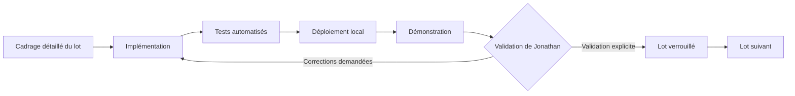

Aucun lot dépendant ne commence avant validation explicite du lot précédent.

Une correction urgente de sécurité, de données ou d’architecture peut rouvrir un lot déjà validé. Cette réouverture doit être tracée et accompagnée d’une analyse d’impact sur les lots suivants.

### 2.2 Définition d’un lot terminé

Un lot est terminé uniquement lorsque :

- son périmètre fonctionnel est développé ;
- ses migrations sont applicables depuis l’état précédent ;
- ses permissions sont contrôlées par l’API ;
- ses tests obligatoires réussissent ;
- ses interfaces principales sont utilisables sur mobile et ordinateur ;
- ses erreurs et états vides sont traités ;
- son audit est présent lorsqu’il est requis ;
- sa documentation technique est mise à jour ;
- une démonstration a été réalisée ;
- Jonathan a explicitement validé le lot.

Une fonctionnalité partiellement développée, masquée derrière l’interface ou non testée n’est pas considérée comme terminée.

### 2.3 Refus des raccourcis structurants

Les contraintes suivantes s’appliquent à tous les lots :

- aucune donnée métier durable dans `localStorage` ;
- aucune donnée ou image en Base64 dans PostgreSQL ou le code ;
- aucune règle de permission uniquement côté frontend ;
- aucun secret dans Git ;
- aucune création automatique de table en production ;
- aucune utilisation de données Bordeaux dans une autre entité ;
- aucun contournement manuel du magic link en production ;
- aucune dépendance essentielle à un CDN public ;
- aucune exigence Must supprimée sans décision explicite.

---

## 3. Vue globale des versions

| Version | Finalité | Résultat attendu |
|---|---|---|
| MVP | Mettre à disposition le portail interne complet de découverte et d’onboarding | Produit exploitable pour Bordeaux, architecture multi-entités, administration, sécurité, import et exploitation validés |
| V1 | Enrichir la production, l’administration et le pilotage | Récurrences, médiathèque avancée, exports, reporting visuel et outils éditoriaux supplémentaires |
| V2 | Intégrer la plateforme au système d’information eXalt | Entra ID, Microsoft Graph, Teams, synchronisations automatiques et intégrations internes |

### 3.1 Règle de version

- Le MVP doit constituer un produit cohérent et exploitable, pas une maquette.
- La V1 ajoute des fonctions importantes mais non indispensables à l’usage initial.
- La V2 dépend de décisions et autorisations externes de la DSI.
- Une fonctionnalité V1 ou V2 peut être préparée dans le modèle ou l’architecture sans être exposée dans le MVP.

---

## 4. Carte des dépendances

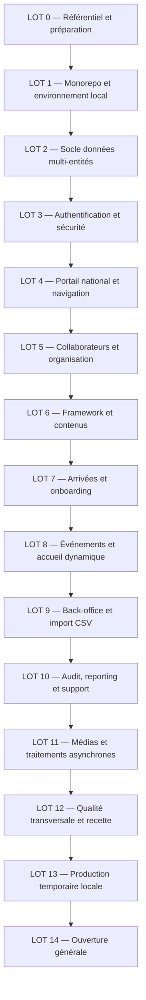

Le séquencement est volontairement strict pour respecter la décision de validation lot par lot. Certains composants transversaux sont amorcés tôt puis complétés dans leur lot spécialisé.

---

## 5. Roadmap du MVP

## LOT 0 — Référentiel projet et préparation

### Objectif

Créer le point de départ documentaire et décisionnel utilisé par tous les agents et développeurs.

### Inclus

- dépôt GitHub privé ;
- arborescence documentaire ;
- règles de contribution ;
- registre des décisions ;
- registre des risques ;
- conventions de branches et versions ;
- matrice des rôles validée ;
- modèle de données validé ;
- roadmap validée ;
- futur backlog validé ;
- inventaire des ressources du prototype à reprendre ;
- schéma initial du CSV ;
- liste des dépendances externes.

### Livrables

- `/docs/product/` ;
- `/docs/architecture/` ;
- `/docs/decisions/` ;
- `/docs/operations/` ;
- modèle de fichier `.env.example` sans secrets ;
- conventions de nommage et de version.

### Critères de sortie

- les documents de cadrage sont présents dans le dépôt ;
- chaque décision possède un identifiant stable ;
- les responsabilités produit et techniques sont identifiées ;
- aucun fichier réel de collaborateurs n’est versionné ;
- Jonathan valide le référentiel.

### Dépendances

Aucune.

### Validation

**Validateur principal :** Jonathan.  
**Contributrices :** Léa, Tess et Diane pour les éléments métier et éditoriaux.

---

## LOT 1 — Monorepo, qualité et environnement local

### Objectif

Obtenir une plateforme vide mais exécutable localement sur le MacBook Pro M5, avec une chaîne de qualité opérationnelle.

### Inclus

- monorepo :
  - `/apps/web` ;
  - `/apps/api` ;
  - `/apps/worker` ;
  - `/packages/ui` ;
  - `/packages/contracts` ;
  - `/infra` ;
  - `/docs` ;
- React, TypeScript strict et Vite ;
- FastAPI, SQLAlchemy et Alembic ;
- PostgreSQL ;
- Redis ;
- MinIO ;
- Dramatiq ;
- Caddy ;
- Mailpit ;
- Docker Compose pour développement et recette ;
- images ARM64 et AMD64 ;
- healthchecks `live`, `ready` et `version` ;
- logs JSON avec corrélation ;
- CI GitHub : formatage, lint, types, tests, migrations, secrets et vulnérabilités ;
- publication de premières images techniques dans GHCR privé.

### Hors périmètre

- écrans métier ;
- authentification fonctionnelle ;
- données collaborateurs ;
- déploiement général.

### Démonstration attendue

- lancement complet avec une commande documentée ;
- page web de statut ;
- API répondant aux trois healthchecks ;
- PostgreSQL, Redis, MinIO, worker et Mailpit sains ;
- arrêt et redémarrage sans perte des volumes ;
- pipeline CI réussi.

### Critères de sortie

- tous les services démarrent sur le Mac M5 ;
- les images multiarchitectures sont construites ;
- aucun secret réel n’est présent ;
- une migration Alembic vide ou initiale s’exécute ;
- les logs possèdent un identifiant de corrélation ;
- la CI bloque volontairement une erreur de lint, de test et de secret ;
- Jonathan valide le socle.

### Dépendances

LOT 0.

---

## LOT 2 — Socle de données et isolation multi-entités

### Objectif

Implémenter le noyau relationnel validé avant d’ajouter les écrans métier.

### Inclus

- entités ;
- paramètres globaux et locaux ;
- domaines e-mail autorisés ;
- personnes ;
- appartenances aux entités ;
- métiers ;
- statuts professionnels ;
- clients globaux, clients activés et alias ;
- cercles ;
- bureaux ;
- affectations DSM ;
- responsabilités Framework ;
- rôles techniques ;
- archivage et historisation ;
- contraintes temporelles ;
- contraintes d’unicité ;
- protection des références inter-entités ;
- repositories et services de base ;
- factories de données fictives ;
- jeu de test jusqu’à 25 entités et 5 000 profils.

### Démonstration attendue

- création de Bordeaux et d’une seconde entité fictive ;
- création d’une personne et de son appartenance principale ;
- changement historisé de DSM, client et cercle ;
- refus d’une seconde entité principale active ;
- refus d’un Booster actif dans deux entités ;
- refus d’une relation croisée entre entités.

### Critères de sortie

- toutes les migrations s’appliquent sur une base vide ;
- les migrations sont rejouables dans un environnement de test ;
- les contraintes critiques disposent de tests PostgreSQL ;
- les relations structurantes sont historisées ;
- les tests d’isolation réussissent ;
- aucune dépendance à SQLite n’existe pour les tests d’intégration ;
- Jonathan valide le modèle implémenté.

### Dépendances

LOTS 0 et 1.

---

## LOT 3 — Authentification, sessions et sécurité applicative

### Objectif

Permettre l’accès sécurisé des employés et des administrateurs selon les règles validées.

### Inclus

- comptes utilisateurs liés aux personnes ;
- comptes administrateurs locaux ;
- demande et consommation de magic links ;
- durée de 15 minutes ;
- usage unique ;
- invalidation des anciens liens ;
- domaine `@exalt-company.com` configurable ;
- réponse générique anti-énumération ;
- sessions de 7 jours d’inactivité et 30 jours absolus ;
- cookies `HttpOnly`, `Secure` et `SameSite` ;
- protection CSRF ;
- limitation de débit ;
- verrouillage des comptes administrateurs ;
- révocation immédiate lors d’un départ ;
- comptes de service et scopes ;
- événements d’authentification ;
- Mailpit en développement et recette ;
- aucun contournement de session utilisateur en production.

### Interfaces incluses

- page de connexion ;
- confirmation de demande de lien ;
- lien expiré ou déjà consommé ;
- connexion administrateur ;
- déconnexion ;
- pages `403`, `404` et erreur générale.

### Démonstration attendue

- demande d’un magic link pour une personne active ;
- réception dans Mailpit ;
- connexion avec le lien ;
- rejet d’un second usage ;
- refus d’une adresse absente de la base ;
- révocation d’une session après archivage du collaborateur ;
- verrouillage après échecs administrateur répétés.

### Critères de sortie

- tous les scénarios autorisés et refusés sont testés ;
- aucun jeton n’est stocké dans `localStorage` ;
- aucune adresse absente de la base ne peut se connecter ;
- les magic links ne figurent pas dans les logs ;
- les limites de débit produisent les résultats attendus ;
- Jonathan valide l’authentification.

### Dépendances

LOT 2.

---

## LOT 4 — Portail national, sélection d’entité et navigation

### Objectif

Fournir le squelette utilisateur final et la consultation inter-entités en lecture seule.

### Inclus

- page nationale après authentification ;
- liste accessible des entités ;
- carte de France illustrative ;
- choix de l’entité consultée ;
- visibilité permanente de l’entité active ;
- changement d’entité ;
- layouts desktop, tablette et mobile ;
- navigation principale ;
- barre inférieure mobile ;
- affichage conditionnel de l’administration et de l’onboarding ;
- route guards uniquement ergonomiques ;
- contrôles d’autorisation systématiques dans l’API ;
- page d’absence de connexion après chargement ;
- design tokens et premiers composants du design system.

### Démonstration attendue

- un employé de Bordeaux consulte Bordeaux puis une autre entité ;
- ses responsabilités ne s’appliquent que dans son entité principale ;
- une tentative de modification dans l’autre entité est refusée par l’API ;
- la navigation fonctionne à 320, 390, 768, 1 280 et 1 920 pixels.

### Critères de sortie

- la liste précède la carte sur mobile ;
- la navigation est intégralement utilisable au clavier ;
- l’entité active est visible sur toutes les pages internes ;
- les menus reflètent les permissions sans les remplacer ;
- les erreurs réseau n’indiquent jamais à tort qu’une action est sauvegardée ;
- Jonathan valide les parcours de navigation.

### Dépendances

LOT 3.

---

## LOT 5 — Collaborateurs, profils et organisation

### Objectif

Créer le référentiel humain et le trombinoscope utilisable par tous les employés authentifiés.

### Inclus

- liste des collaborateurs ;
- pagination de 25, 50 ou 100 éléments ;
- recherche avec délai d’environ 300 ms ;
- filtres par entité, cercle, DSM, client, métier et statut ;
- cartes retournables accessibles ;
- page de profil complète ;
- photo facultative et avatar neutre ;
- présentation courte ;
- fun fact facultatif ;
- métier ;
- statut mission ou intercontrat ;
- client actif ;
- DSM ;
- cercle principal et cercles secondaires ;
- responsabilités Framework ;
- gestion des autorisations de photo ;
- création, modification, archivage et restauration selon la matrice ;
- historique des affectations ;
- règles Booster et DG ;
- composants d’administration contextuels du périmètre.

### Démonstration attendue

- affichage du trombinoscope avec données fictives ;
- recherche à chaque frappe ;
- ouverture au clavier d’une carte et d’un profil ;
- modification autorisée par un DSM sur son consultant ;
- refus sur un autre consultant ;
- ajout d’un membre secondaire par un Booster ;
- impossibilité pour le Booster de modifier son cercle principal ou son client ;
- restauration d’un profil par l’ESM.

### Critères de sortie

- les miniatures sont inférieures à la cible de 100 Ko ;
- aucune photo non autorisée n’est publiée ;
- les permissions suivent intégralement la matrice ;
- les recherches respectent l’objectif de performance avec 5 000 profils ;
- aucune requête N+1 critique n’est détectée ;
- les affectations structurantes ne sont jamais écrasées ;
- Jonathan valide le trombinoscope et les profils.

### Dépendances

LOT 4.

---

## LOT 6 — Framework, cercles, bureaux et contenus éditoriaux

### Objectif

Reproduire la dimension de découverte de l’organisation avec un contenu administrable et visuellement cohérent.

### Inclus

- page Framework synthétique ;
- catégories et responsabilités ;
- huit cercles initiaux configurables ;
- pages détaillées des cercles ;
- bureaux initiaux BDS, BDE et BDG configurables ;
- pages détaillées des bureaux ;
- un à trois responsables actifs par bureau ;
- présentation de l’entité ;
- modèle éditorial hybride par pages et blocs ;
- textes, images, vidéos et liens autorisés ;
- liens Hub, eXalt Academy et SharePoint ;
- reprise relue des textes et liens du prototype ;
- édition selon ESM, Booster, responsable de bureau, administrateur et super-administrateur ;
- archivage et restauration des contenus ;
- aucun HTML arbitraire.

### Démonstration attendue

- accueil d’une entité contenant la présentation et les accès au Framework ;
- édition d’un cercle par son Booster ;
- édition d’un bureau par son responsable ;
- refus d’une modification hors périmètre ;
- création d’une nouvelle entité depuis des modèles génériques sans contenu Bordeaux.

### Critères de sortie

- les contenus de Bordeaux sont relus avant publication ;
- le modèle générique ne contient aucune donnée locale ;
- les composants respectent le design system ;
- les couleurs de cercle ne sont jamais l’unique information ;
- les animations respectent `prefers-reduced-motion` ;
- aucun contenu arbitraire ne peut injecter du code ;
- Jonathan valide l’organisation et l’édition.

### Dépendances

LOT 5.

---

## LOT 7 — Fiches d’arrivée et onboarding

### Objectif

Mettre en œuvre le parcours prioritaire des nouveaux arrivants.

### Inclus

#### Fiche d’arrivée

- préremplissage des données organisationnelles ;
- champs verrouillés : arrivée, métier, statut, DSM, client et cercle principal ;
- photo facultative ;
- présentation courte obligatoire ;
- fun fact facultatif ;
- validation par le nouvel arrivant ;
- publication immédiate après validation ;
- affichage récent pendant un mois ;
- corrections ultérieures par les rôles autorisés.

#### Modèles d’onboarding

- catalogue de références de tâches ;
- modèles mission et intercontrat ;
- versions immuables publiées ;
- duplication, ordre, archivage et restauration ;
- périmètres DSM, Booster et entité conformément à la matrice.

#### Instances d’onboarding

- création depuis la date d’arrivée ;
- progression globale ;
- prochaine étape ;
- tâches à terminer ;
- complétion directe ;
- annulation par le nouvel arrivant pendant cinq minutes ;
- réouverture après cinq minutes par ESM, administrateur d’entité ou super-administrateur ;
- motif obligatoire de réouverture ;
- changement mission/intercontrat ;
- préservation des tâches communes grâce aux identifiants stables ;
- archivage du parcours terminé ;
- reporting de base.

### Démonstration attendue

- création d’un futur arrivant ;
- validation de sa fiche ;
- apparition sur l’accueil ;
- génération de son parcours ;
- complétion et annulation d’une tâche ;
- tentative d’annulation après cinq minutes ;
- réouverture autorisée avec motif ;
- passage intercontrat vers mission en conservant les tâches communes.

### Critères de sortie

- les parcours mission et intercontrat sont validés par Tess, Léa, Diane et Jonathan ;
- les règles de périmètre DSM, Booster et ESM sont testées ;
- la progression est calculée et non stockée comme source de vérité ;
- les événements de tâche sont historisés ;
- le départ d’un collaborateur archive le parcours et révoque les sessions ;
- un parcours réel complet est exécuté en recette ;
- Jonathan valide le lot.

### Dépendances

LOTS 5 et 6.

---

## LOT 8 — Événements et accueil dynamique

### Objectif

Compléter la vie interne de l’entité et la page d’accueil finale.

### Inclus

- création d’événements par ESM, DSM, Booster, responsable de bureau, administrateur et super-administrateur ;
- périmètres par entité, cercle ou bureau ;
- titre, description, lieu, début, fin et médias ;
- événements à venir et passés ;
- passage automatique dans les événements passés après la fin ;
- annulation conservée avec badge ;
- aucune inscription ni liste de participants ;
- aucune notification métier d’événement ;
- page d’accueil dans l’ordre validé :
  1. présentation de l’entité ;
  2. Framework ;
  3. arrivées récentes ;
  4. prochains événements ;
  5. liens internes ;
- carrousels manuels et accessibles sur mobile ;
- vidéos sans lecture automatique et avec commandes.

### Démonstration attendue

- création d’un événement par chaque périmètre autorisé ;
- refus hors périmètre ;
- bascule automatique vers le passé ;
- annulation et affichage du badge ;
- affichage complet de l’accueil sur mobile et ordinateur.

### Critères de sortie

- aucune donnée de participants n’existe ;
- aucune vidéo complète n’est téléchargée avant interaction ;
- les événements passés sont calculés de manière cohérente ;
- les règles d’archivage et restauration sont respectées ;
- l’accueil respecte l’ordre et le design validés ;
- Jonathan valide l’accueil et les événements.

### Dépendances

LOT 7.

---

## LOT 9 — Back-office, administration et import CSV

### Objectif

Permettre l’exploitation autonome de la plateforme et le chargement contrôlé des vraies données.

### Inclus

#### Back-office

- tableau de bord administratif ;
- profils actifs ;
- futures arrivées ;
- onboardings actifs et en retard ;
- profils incomplets ;
- dernières erreurs d’import ;
- navigation regroupée : Organisation, Onboarding, Contenu, Données, Pilotage, Configuration et Super-administration ;
- création d’une entité ;
- nomination de l’administrateur d’entité ;
- paramètres locaux ;
- catalogues métiers, cercles, bureaux et clients actifs ;
- archives et restaurations ;
- purge réservée au super-administrateur.

#### Import CSV

- dépôt sécurisé du fichier ;
- empreinte SHA-256 ;
- schéma de colonnes versionné ;
- zone d’analyse sans écriture métier ;
- normalisation des e-mails ;
- détection des doublons ;
- correspondances de clients proposées ;
- validation humaine avant fusion ou alias ;
- lignes sans e-mail bloquées ;
- prévisualisation complète ;
- import des seules lignes valides ;
- mises à jour par e-mail ;
- confirmation explicite pour réactiver un profil archivé ;
- rapport des créations, mises à jour, avertissements et rejets ;
- journal d’audit ;
- conservation temporaire maîtrisée du fichier.

### Démonstration attendue

- import d’un fichier comportant lignes valides, avertissements et erreurs ;
- aucune écriture avant approbation ;
- validation d’un alias client ;
- rejet d’une ligne sans e-mail ;
- import des lignes valides ;
- rapport totalisant exactement toutes les lignes ;
- création d’une nouvelle entité depuis le super-back-office.

### Critères de sortie

- le CSV réel n’est ni dans Git ni dans une image ;
- les données réelles ne sont chargées qu’après vérification FileVault et sauvegarde ;
- le rapport correspond à l’empreinte du fichier ;
- les règles d’intégrité de la reprise réussissent ;
- aucune ligne rejetée n’est masquée ;
- l’isolation multi-entités est testée pendant l’import ;
- Léa et Jonathan valident le rapport de répétition en recette ;
- Jonathan valide le lot.

### Dépendances

LOTS 2 à 8.

---

## LOT 10 — Audit, reporting, supervision fonctionnelle et support

### Objectif

Rendre les opérations sensibles traçables et fournir les outils de pilotage nécessaires au MVP.

### Inclus

#### Audit

- événements d’authentification ;
- modifications, archives, restaurations et purges ;
- rôles, DSM, client, cercle, statut et responsabilités ;
- imports et exports ;
- interventions inter-entités ;
- résumé lisible et données structurées ;
- anciennes et nouvelles valeurs pertinentes ;
- motifs obligatoires ;
- conservation d’un an ;
- export CSV réservé aux administrateurs ;
- audit de l’export lui-même ;
- exclusion des secrets, liens complets, CSV et corps d’e-mail.

#### Reporting MVP

- compteurs et tableaux ;
- onboardings actifs et terminés ;
- progression ;
- tâches en retard ;
- durée moyenne ;
- arrivées dans les trente jours ;
- profils actifs, futurs et incomplets ;
- répartitions par cercle, client et DSM ;
- périmètres stricts selon la matrice.

#### Support

- bouton « Reporter un bug » ;
- contexte technique non sensible ;
- identifiant de corrélation ;
- états nouveau, en analyse, corrigé ou rejeté ;
- visibilité du super-administrateur ;
- alertes opérationnelles enregistrées ;
- cycle ouverture, acquittement, commentaire, résolution et réouverture.

### Démonstration attendue

- consultation d’un audit selon plusieurs rôles ;
- refus d’un export non autorisé ;
- export d’audit tracé ;
- tableaux de bord filtrés par périmètre ;
- création d’un signalement depuis une page d’erreur ;
- résolution puis réouverture automatique d’une alerte récurrente.

### Critères de sortie

- les événements sensibles sont atomiques avec l’action métier ;
- aucune donnée interdite n’apparaît dans l’audit ;
- les rapports respectent les mêmes droits que les écrans source ;
- les durées de conservation sont configurées ;
- l’identifiant de corrélation relie interface, API et logs ;
- Jonathan valide l’audit et le pilotage.

### Dépendances

LOTS 3 à 9.

---

## LOT 11 — Médias, worker et tâches planifiées

### Objectif

Finaliser la chaîne de traitement des fichiers et des opérations asynchrones du MVP.

### Inclus

- interface générique d’envoi d’e-mails ;
- Dramatiq avec files `default`, `emails`, `imports`, `media`, `exports`, `maintenance` et `security` ;
- jobs persistés dans PostgreSQL ;
- outbox transactionnelle ;
- idempotence ;
- nouvelles tentatives et délais ;
- détection des traitements bloqués ;
- verrous de planification ;
- états de médias `pending`, `processing`, `ready`, `rejected`, `archived` et `deleted` ;
- validation MIME réelle ;
- limites 10 Mo, 20 Mo et 1 Go ;
- durée vidéo maximale de 20 minutes ;
- empreinte ;
- noms générés côté serveur ;
- quarantaine ;
- stockage MinIO ;
- miniatures et variantes ;
- nettoyage des objets orphelins ;
- expiration des invitations et sessions ;
- classement des événements passés ;
- anonymisation après départ ;
- purge de l’audit ;
- suivi Uptime Kuma par healthchecks et heartbeats Push.

### Démonstration attendue

- téléversement d’une image valide ;
- rejet d’un faux type de fichier ;
- génération d’une miniature ;
- redémarrage d’un worker sans perte du job ;
- nouvel essai sans doublon ;
- détection d’un job bloqué ;
- exécution unique d’une tâche planifiée ;
- heartbeat de sauvegarde ou de maintenance reçu dans Uptime Kuma.

### Critères de sortie

- seuls les médias `ready` sont servis ;
- Redis peut être vidé sans perte de la source de vérité métier ;
- un job rejoué ne duplique pas son effet ;
- les tâches planifiées ne s’exécutent pas en parallèle ;
- les fichiers rejetés sont supprimés selon la politique ;
- les workers et files sont supervisés ;
- Jonathan valide les traitements asynchrones.

### Dépendances

LOTS 1 à 10.

---

## LOT 12 — Qualité transversale, sécurité, accessibilité et performance

### Objectif

Prouver que l’ensemble du MVP répond aux exigences non fonctionnelles avant toute production.

### Inclus

#### Tests

- couverture globale minimale de 80 % ;
- couverture complète des règles de permission critiques ;
- tests API ;
- tests PostgreSQL ;
- tests Playwright ;
- tests d’isolation avec 25 entités ;
- tests de charge avec 5 000 profils et 100 utilisateurs simultanés ;
- tests de concurrence optimiste ;
- tests de rollback ;
- tests de reprise après redémarrage.

#### Accessibilité

- parcours essentiels visant WCAG 2.2 AA ;
- clavier ;
- focus ;
- contraste ;
- zoom ;
- lecteurs d’écran ;
- réduction des mouvements ;
- axe automatisé ;
- dérogation documentée pour les vidéos parlées sans sous-titres ;
- absence de lecture automatique ;
- commandes de lecture et de volume.

#### Performance

- API simple sous 500 ms au P95 ;
- recherche sous 800 ms au P95 ;
- action ordinaire sous une seconde ;
- acceptation d’un job sous deux secondes ;
- JavaScript initial compressé visé sous 350 Ko ;
- Lighthouse mobile au moins 80 ;
- absence de téléchargement vidéo anticipé ;
- vérification des index et requêtes lentes.

#### Sécurité

- analyse des dépendances et images ;
- détection de secrets ;
- tests de limites de débit ;
- tests CSRF et cookies ;
- tests de révocation ;
- revue des exports ;
- vérification de l’absence de fuite entre entités.

### Démonstration attendue

- rapport consolidé de tests ;
- test de charge ;
- matrice de navigateurs et appareils ;
- démonstration clavier et mobile ;
- rapport de sécurité ;
- liste des anomalies classées ;
- aucune anomalie bloquante ou critique.

### Critères de sortie

- toutes les règles de mise en production de l’atelier 33 sont respectées ;
- aucune anomalie majeure ne touche un parcours central ;
- les anomalies mineures acceptées sont enregistrées ;
- le vrai CSV a été répété en recette ;
- une sauvegarde et une restauration complètes ont réussi ;
- Tess, Léa, Diane et Jonathan valident leurs périmètres ;
- Jonathan valide le lot.

### Dépendances

LOTS 1 à 11.

---

## LOT 13 — Production temporaire locale

### Objectif

Déployer une version stable du MVP sur le MacBook Pro, séparée du développement et de la recette.

### Inclus

- stack `prod-local` isolée ;
- images GHCR immuables ;
- déploiement déclenché par tag et validation manuelle ;
- sauvegarde préalable ;
- migrations explicites ;
- healthchecks ;
- smoke tests ;
- rollback applicatif ;
- PostgreSQL, MinIO, Redis et secrets distincts ;
- Caddy avec HTTPS local ;
- logs et rotation ;
- sauvegarde quotidienne ;
- restic ;
- SSD externe chiffré ;
- rétention 14 quotidiennes, 8 hebdomadaires et 6 mensuelles ;
- test de restauration ;
- supervision depuis Uptime Kuma sur une machine distincte lorsque possible.

### Limite explicite

Cette production temporaire n’est pas la production générale de Bordeaux et ne garantit pas 99,5 % de disponibilité.

### Démonstration attendue

- déploiement d’un tag ;
- sauvegarde automatique avant migration ;
- installation de la version ;
- healthchecks au vert ;
- rollback vers la version précédente ;
- restauration dans un environnement isolé ;
- arrêt du Mac détecté par un moniteur externe si celui-ci est disponible.

### Critères de sortie

- les trois environnements utilisent des volumes et secrets distincts ;
- le RPO de 24 heures est couvert ;
- aucun e-mail réel ne part de la recette ;
- la version déployée est identifiable ;
- la restauration est documentée et réussie ;
- Jonathan valide la production temporaire.

### Dépendances

LOT 12.

---

## LOT 14 — Préparation et ouverture de la production générale

### Objectif

Migrer le MVP validé vers un hébergement permanent et l’ouvrir immédiatement à tous les employés concernés.

### Dépendances externes bloquantes

- hébergement permanent disponible en continu ;
- domaine officiel ;
- DNS et HTTPS ;
- fournisseur d’e-mails transactionnels ;
- charte, logo et typographie autorisés ;
- responsable juridique du traitement ;
- contact RGPD ;
- sauvegarde extérieure à l’hôte ;
- supervision extérieure ;
- domaine `@exalt-company.com` confirmé dans la configuration ;
- CSV final validé ;
- recette sur l’hébergement cible.

### Inclus

- installation de l’infrastructure cible ;
- restauration ou migration depuis la production temporaire ;
- configuration DNS et Caddy ;
- secrets de production ;
- fournisseur d’e-mails réel ;
- test complet du magic link ;
- monitoring externe ;
- sauvegarde hors site ;
- test de charge sur l’hôte final ;
- import final du CSV ;
- contrôles d’intégrité ;
- ouverture immédiate à tous ;
- surveillance renforcée lors du lancement ;
- objectif de disponibilité mensuelle de 99,5 %, hors maintenances annoncées.

### Critères d’ouverture

- toutes les dépendances externes sont résolues ;
- aucune anomalie bloquante ou critique ;
- aucune anomalie majeure sur un parcours central ;
- authentification réelle validée ;
- sauvegarde et restauration validées ;
- permissions et isolation validées ;
- performance validée sur l’hôte final ;
- CSV final validé par Léa et Jonathan ;
- release approuvée par Léa pour le produit et Jonathan pour la technique.

### Critères de rollback

Le retour arrière est déclenché en cas de :

- panne d’authentification ;
- fuite ou suspicion de fuite inter-entités ;
- corruption ou perte de données ;
- indisponibilité durable ;
- erreurs répétées sur une fonction essentielle ;
- migration de données incorrecte ;
- révocation des accès inefficace ;
- vulnérabilité critique active.

### Dépendances

LOT 13 et toutes les dépendances externes.

---

## 6. Définition consolidée du MVP

Le MVP comprend obligatoirement :

### Produit et navigation

- page nationale ;
- sélection et changement d’entité ;
- lecture inter-entités ;
- accueil local ;
- navigation responsive ;
- fonctionnement mobile complet.

### Collaborateurs et organisation

- trombinoscope ;
- profils ;
- métiers, statuts, clients et DSM ;
- cercles principaux et secondaires ;
- responsabilités Framework ;
- bureaux ;
- archivage, restauration et historiques.

### Découverte interne

- Framework ;
- pages cercles ;
- pages bureaux ;
- présentation d’entité ;
- arrivées récentes ;
- événements ;
- liens internes ;
- contenus éditables.

### Onboarding

- fiche d’arrivée web ;
- modèles mission et intercontrat ;
- versions de modèles ;
- instances et tâches ;
- progression et prochaine étape ;
- complétion et annulation de cinq minutes ;
- réouverture contrôlée ;
- changement de parcours ;
- archivage.

### Administration

- back-office ;
- gestion des collaborateurs ;
- gestion de l’organisation ;
- gestion des contenus ;
- import CSV contrôlé ;
- modèles génériques de nouvelle entité ;
- super-administration ;
- création d’une nouvelle entité.

### Pilotage et exploitation

- reporting par tableaux et compteurs ;
- audit ;
- alertes ;
- signalement de bugs ;
- worker ;
- traitements asynchrones ;
- supervision ;
- sauvegardes ;
- restauration ;
- CI/CD ;
- production temporaire puis générale.

### Sécurité et conformité

- magic links ;
- comptes administrateurs ;
- sessions sécurisées ;
- permissions côté API ;
- isolation multi-entités ;
- photo facultative et autorisée ;
- notice d’information ;
- droits RGPD ;
- conservation et anonymisation ;
- parcours essentiels visant WCAG 2.2 AA avec dérogation vidéo documentée.

---

## 7. Fonctions explicitement exclues du MVP

Les fonctions suivantes ne doivent pas être intégrées discrètement au MVP :

- PWA ;
- fonctionnement métier hors ligne ;
- SSO Microsoft Entra ID ;
- synchronisation Microsoft Graph ;
- publication directe dans Teams ;
- synchronisation automatique des employés ;
- MFA ;
- réauthentification avant action sensible ;
- inscriptions aux événements ;
- liste de participants ;
- notifications métier d’événements ;
- récurrence des événements ;
- médiathèque avancée ;
- rollback complet d’un import ;
- graphiques de reporting ;
- exports CSV de reporting ;
- synthèses PDF ;
- export 16:9 de fiche d’arrivée ;
- génération de texte Teams ;
- sous-titres obligatoires ;
- mode maintenance applicatif ;
- quotas médias bloquants par entité ;
- CMS libre ;
- API publique externe ;
- Kubernetes.

---

## 8. Roadmap V1

La V1 commence uniquement après stabilisation du MVP en production générale.

## V1-LOT 1 — Événements récurrents

### Inclus

- règles de récurrence ;
- génération des occurrences ;
- modification d’une occurrence, de la série ou de cette occurrence et des suivantes ;
- annulation d’une occurrence ou d’une série ;
- prévention des doublons ;
- tâches planifiées associées.

### Critères de sortie

- les règles temporelles sont testées ;
- aucune occurrence dupliquée n’est créée après relance ;
- les permissions restent identiques aux événements simples ;
- Jonathan valide le lot.

---

## V1-LOT 2 — Médiathèque avancée

### Inclus

- bibliothèque de médias ;
- recherche et filtres ;
- réutilisation d’un média existant ;
- détection des usages ;
- remplacement contrôlé ;
- suppression empêchée lorsqu’un usage actif existe ;
- quotas configurables si la mesure le justifie ;
- outils de nettoyage et d’archivage.

### Critères de sortie

- aucun contenu ne référence un média supprimé ;
- les droits suivent la matrice ;
- les volumes sont supervisés ;
- Jonathan valide le lot.

---

## V1-LOT 3 — Import avancé et rollback complet

### Inclus

- lot d’import réversible ;
- journal de toutes les modifications produites ;
- aperçu du rollback ;
- validation humaine ;
- motif obligatoire ;
- restauration transactionnelle lorsque possible ;
- traitement des dépendances créées après l’import ;
- audit complet.

### Critères de sortie

- le rollback ne supprime pas une modification métier postérieure sans alerte ;
- les conflits sont présentés avant exécution ;
- le résultat est vérifié par contrôles d’intégrité ;
- Jonathan valide le lot.

---

## V1-LOT 4 — Reporting visuel et exports

### Inclus

- graphiques ;
- filtres avancés ;
- export CSV des rapports ;
- synthèse PDF ;
- demandes d’export asynchrones ;
- respect strict du périmètre d’autorisation ;
- journalisation des exports ;
- limitation de débit et alertes.

### Critères de sortie

- un export ne contient jamais plus que l’écran source autorisé ;
- les graphiques restent accessibles sans dépendre uniquement des couleurs ;
- les exports volumineux passent par le worker ;
- Jonathan valide le lot.

---

## V1-LOT 5 — Fiches d’arrivée multicanales

### Inclus

- export 16:9 pour écran TV ;
- texte prêt à copier dans Teams ;
- modèles éditables ;
- aperçu avant génération ;
- historique des exports ;
- contrôle des données et de l’autorisation photo.

### Critères de sortie

- l’export respecte la charte ;
- la photo n’est utilisée que si elle est autorisée ;
- le contenu généré correspond à la fiche publiée ;
- Jonathan valide le lot.

---

## V1-LOT 6 — Compléments éditoriaux et vidéos

### Inclus

- ajout des vidéos métier encore manquantes ;
- amélioration du lecteur ;
- gestion facultative de fichiers de sous-titres ;
- suivi des écarts d’accessibilité ;
- amélioration des contenus de toutes les entités actives.

### Critères de sortie

- aucune lecture automatique ;
- commandes accessibles ;
- les sous-titres fournis peuvent être activés ;
- les écarts restent documentés ;
- Jonathan valide le lot.

---

## 9. Roadmap V2

La V2 dépend de la DSI, des autorisations Microsoft et des validations de sécurité.

## V2-LOT 1 — Microsoft Entra ID

### Inclus

- connexion SSO ;
- association d’identité Entra à `person` ;
- conservation d’un mécanisme administrateur de secours contrôlé ;
- gestion des comptes désactivés ;
- groupes ou claims validés ;
- audit des connexions ;
- stratégie de migration depuis les magic links.

### Conditions préalables

- tenant et application enregistrée ;
- autorisations DSI ;
- URLs officielles ;
- politique de sécurité ;
- stratégie de secours.

---

## V2-LOT 2 — Microsoft Graph et synchronisation des collaborateurs

### Inclus

- synchronisation contrôlée des identités ;
- arrivées, changements et départs ;
- rapprochement par identifiant immuable ;
- prévisualisation des modifications ;
- gestion des conflits ;
- aucune suppression automatique non contrôlée ;
- audit et reprise sur erreur.

### Règle

Graph ne doit pas écraser automatiquement les données métier propres au portail lorsque la source de vérité n’a pas été explicitement définie.

---

## V2-LOT 3 — Intégration Teams

### Inclus

- publication directe des fiches d’arrivée ;
- sélection du canal ;
- aperçu ;
- validation avant publication ;
- identité technique dédiée ;
- scopes minimaux ;
- audit du contenu et de la destination ;
- gestion des erreurs et répétitions idempotentes.

---

## V2-LOT 4 — Automatisation des arrivées et départs

### Inclus

- déclenchement des fiches et onboardings ;
- planification depuis la date d’arrivée ;
- révocation immédiate au départ ;
- archivage à trois mois ;
- anonymisation et conservation ;
- notifications techniques en cas de conflit ;
- validation des cas ambigus.

---

## V2-LOT 5 — Intégrations Hub et eXalt Academy

### Inclus possibles

- liens contextualisés ;
- remontée de ressources ;
- état de progression si une API officielle existe ;
- authentification fédérée ;
- synchronisation limitée à des données explicitement validées.

Ce lot reste conditionnel à l’existence d’API, aux droits d’accès et aux décisions de propriété des données.

---

## V2-LOT 6 — Renforcement de l’authentification

### Inclus possibles

- MFA pour administrateurs ;
- MFA ou politiques conditionnelles via Entra ;
- réauthentification avant certaines actions sensibles ;
- élévation temporaire de privilège ;
- règles de session pilotées par la DSI.

Ce lot doit réévaluer les risques explicitement acceptés dans le MVP et la V1.

---

## 10. Portes de validation

| Porte | Moment | Validation obligatoire |
|---|---|---|
| G0 | Fin du référentiel | Jonathan confirme les documents et conventions |
| G1 | Fin du socle local | Stack, CI et images validées |
| G2 | Fin du modèle implémenté | Contraintes et isolation validées |
| G3 | Fin de l’authentification | Sécurité et sessions validées |
| G4 | Fin du portail national | Navigation et lecture inter-entités validées |
| G5 | Fin du trombinoscope | Profils et permissions validés |
| G6 | Fin du Framework | Contenus et périmètres éditoriaux validés |
| G7 | Fin de l’onboarding | Tess, Léa, Diane et Jonathan valident les parcours |
| G8 | Fin de l’accueil | Événements et page d’accueil validés |
| G9 | Fin du back-office | Import réel répété et validé |
| G10 | Fin du pilotage | Audit, reporting et support validés |
| G11 | Fin des traitements | Médias, worker et planification validés |
| G12 | Fin de recette | Aucun défaut bloquant selon les règles convenues |
| G13 | Production temporaire | Déploiement, sauvegarde et restauration validés |
| G14 | Production générale | Léa valide le produit, Jonathan la technique |

---

## 11. Critères de passage du MVP à la V1

La V1 ne commence que lorsque :

- le MVP est en production générale ;
- les parcours essentiels sont stables ;
- les alertes critiques sont maîtrisées ;
- au moins un cycle réel d’arrivée a été exécuté ;
- les sauvegardes quotidiennes sont régulières ;
- une restauration périodique a réussi ;
- les besoins V1 sont réévalués à partir de l’usage ;
- aucun correctif critique du MVP n’est masqué dans un lot V1.

---

## 12. Critères de passage de la V1 à la V2

La V2 ne commence que lorsque :

- la DSI a validé le principe des intégrations Microsoft ;
- les responsabilités de source de vérité sont définies ;
- les scopes Entra et Graph sont approuvés ;
- les comptes de service et secrets disposent d’un hébergement approprié ;
- la production est stable ;
- la stratégie de migration d’identité est testée ;
- les obligations RGPD associées aux nouvelles sources sont évaluées.

---

## 13. Dépendances externes et chemin critique

### Dépendances non bloquantes pour le développement local

- domaine web public ;
- fournisseur d’e-mails réel ;
- hébergement final ;
- Microsoft Entra ID ;
- Microsoft Graph ;
- Teams.

### Dépendances bloquantes avant production générale

- hébergement permanent ;
- domaine officiel et HTTPS ;
- fournisseur transactionnel ;
- charte et ressources officielles ;
- fichier CSV final ;
- responsables juridiques et contact RGPD ;
- sauvegarde extérieure ;
- supervision extérieure ;
- test de charge sur l’hôte final.

### Chemin critique produit

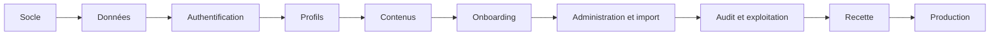

---

## 14. Risques de roadmap

| ID | Risque | Impact | Mesure |
|---|---|---:|---|
| ROAD-RSK-001 | Le séquencement strict augmente le délai global | Élevé | Lots démontrables, périmètres fermes et validation rapide |
| ROAD-RSK-002 | Un lot validé doit être rouvert après découverte tardive | Élevé | Tests d’intégration précoces et analyse d’impact |
| ROAD-RSK-003 | Le lot collaborateurs devient trop volumineux | Moyen | Sous-démonstrations internes sans changer la porte de validation |
| ROAD-RSK-004 | Le vrai CSV arrive tardivement | Élevé | Schéma et données fictives préparés dès le LOT 0 |
| ROAD-RSK-005 | L’hébergement final retarde l’ouverture | Très élevé | Production temporaire locale et chantier infrastructure parallèle |
| ROAD-RSK-006 | La charte officielle tarde | Moyen | Design tokens provisoires remplaçables sans refonte |
| ROAD-RSK-007 | Les dépendances Microsoft perturbent le MVP | Élevé | Maintien strict en V2 |
| ROAD-RSK-008 | Les exigences de performance sont vérifiées trop tard | Élevé | Jeu de 5 000 profils dès le LOT 2 et mesures régulières |
| ROAD-RSK-009 | La conformité vidéo reste incomplète | Moyen | Dérogation documentée et support facultatif des sous-titres en V1 |
| ROAD-RSK-010 | Jonathan devient un goulot de validation | Élevé | Démonstration structurée et checklist concise à chaque porte |
| ROAD-RSK-011 | Un lot technique ne produit aucun résultat visible | Moyen | Démonstration obligatoire même pour le socle |
| ROAD-RSK-012 | Une fonction V1 est ajoutée prématurément | Moyen | Liste d’exclusion MVP et contrôle du backlog |

---

## 15. Indicateurs de progression du projet

La progression ne sera pas mesurée uniquement par le nombre de tâches terminées.

Les indicateurs recommandés sont :

- lots validés sur lots planifiés ;
- portes de validation franchies ;
- exigences Must couvertes ;
- scénarios critiques automatisés ;
- anomalies bloquantes, critiques et majeures ouvertes ;
- décisions ouvertes bloquantes ;
- migrations appliquées et testées ;
- couverture des rôles et permissions ;
- conformité aux budgets de performance ;
- dernier test de sauvegarde et restauration ;
- état des dépendances externes.

---

## 16. Arbitrages validés par Jonathan

### ARB-ROAD-001 — Nombre de lots MVP

**Décision validée :** conserver 15 lots numérotés de 0 à 14. Ce découpage maintient des livrables démontrables sans regrouper l’ensemble du métier dans un seul lot incontrôlable.

### ARB-ROAD-002 — Position du lot médias

**Décision validée :** amorcer le stockage MinIO dès le LOT 1, utiliser les médias simples dans les lots métier, puis finaliser la sécurité, les variantes et les traitements asynchrones dans le LOT 11.

Cela évite de bloquer les profils et contenus tout en conservant une validation spécialisée de la chaîne média.

### ARB-ROAD-003 — Production temporaire avant production générale

**Décision validée :** rendre obligatoire la validation du MVP sur la production temporaire locale avant toute migration vers l’hébergement permanent.

### ARB-ROAD-004 — V1 après usage réel du MVP

**Décision validée :** ne pas démarrer la V1 immédiatement après le développement. Le MVP doit d’abord être exploité et avoir exécuté au moins un parcours d’arrivée réel.

### ARB-ROAD-005 — V2 conditionnée par la DSI

**Décision validée :** considérer tous les lots Microsoft comme conditionnels. Aucun engagement de réalisation V2 ne doit être pris avant validation des accès, scopes, responsabilités et sources de vérité.

---

## 17. Décisions validées

| ID | Décision validée |
|---|---|
| ROAD-001 | Le MVP est réalisé en 15 lots séquentiels de 0 à 14. |
| ROAD-002 | Chaque lot possède une démonstration et une validation explicite. |
| ROAD-003 | Aucun lot dépendant ne commence avant validation du précédent. |
| ROAD-004 | Le socle MinIO est installé tôt et la chaîne média est finalisée dans un lot spécialisé. |
| ROAD-005 | Le MVP inclut la production temporaire et la préparation de la production générale. |
| ROAD-006 | La production générale reste conditionnée aux dépendances externes validées. |
| ROAD-007 | La V1 commence après une période d’usage réel du MVP. |
| ROAD-008 | La V2 est conditionnée aux autorisations de la DSI. |
| ROAD-009 | Les intégrations Microsoft ne sont pas sur le chemin critique du MVP ou de la V1. |
| ROAD-010 | Les fonctions explicitement différées ne doivent pas être ajoutées silencieusement au MVP. |
| ROAD-011 | Les tests de performance commencent avant la recette finale. |
| ROAD-012 | Une exigence Must non terminée empêche la validation du lot concerné. |

---

## 18. Statut du livrable

Cette roadmap a été validée par Jonathan sur les cinq arbitrages `ARB-ROAD-001` à `ARB-ROAD-005`.

Elle devient la référence validée pour :

1. la construction du backlog initial priorisé ;
2. la définition des epics et user stories ;
3. l’ordre de réalisation par les agents IA ;
4. les portes de validation ;
5. le suivi du MVP, de la V1 et de la V2 ;
6. le cahier des charges consolidé.


---

# Annexe D — Backlog initial priorisé

## Backlog initial priorisé — eXalt Onboarding Digital

**Version :** 1.0 — livrable de cadrage 4/6  
**Date :** 25 juillet 2026  
**Statut :** validé par Jonathan le 25 juillet 2026  
**Références :**

- `MATRICE_ROLES_PERMISSIONS_EXALT.md` version 1.1 validée ;
- `MODELE_DONNEES_EXALT.md` version 1.0 validée ;
- `ROADMAP_MVP_V1_V2_EXALT.md` version 1.0 validée ;
- décisions `DEC-001` à `DEC-417` et arbitrages validés des ateliers 1 à 34.

---

## 1. Objet du document

Ce backlog transforme la roadmap validée en unités de réalisation testables et ordonnées. Il constitue la référence initiale pour les agents IA, les revues de Jonathan et le futur suivi GitHub.

Il ne remplace ni la matrice des permissions, ni le modèle de données, ni les critères de sortie des lots. En cas de divergence, la décision validée la plus récente et le document spécialisé correspondant prévalent.

## 2. Règles de structuration

### 2.1 Hiérarchie

```text
Version → Lot / Epic → User story → Tâches techniques → Tests et preuves
```

- un lot correspond à une porte de validation de la roadmap ;
- une user story produit une valeur démontrable ou garantit un invariant technique indispensable ;
- les tâches techniques sont créées au moment de préparer le lot ;
- une story ne peut pas être déclarée terminée sans ses tests et sa documentation utile.

### 2.2 Priorités

| Priorité | Sens | Règle |
|---|---|---|
| `P0` | Bloquant de lot ou de sécurité | Doit être terminé pour franchir la porte |
| `P1` | Important dans le périmètre validé | Doit normalement être terminé dans le lot, sauf arbitrage explicite |
| `P2` | Amélioration différable | Ne commence qu’après les P0 et P1 du lot |

Une exigence de sécurité, d’intégrité, d’isolation multi-entités ou de protection des données est toujours au minimum `P0`.

### 2.3 Tailles relatives

| Taille | Interprétation |
|---|---|
| `S` | Changement local, peu de dépendances |
| `M` | Plusieurs composants ou règles simples |
| `L` | Fonction complète avec tests de bout en bout |
| `XL` | Sujet transversal à découper en sous-tâches avant réalisation |

Ces tailles servent à détecter la complexité. Elles ne constituent pas une promesse de durée.

### 2.4 États

| État | Usage |
|---|---|
| `Planned` | Définie mais lot non ouvert |
| `Ready` | Critères d’entrée remplis et lot ouvert par Jonathan |
| `In progress` | Réalisation commencée |
| `Review` | Démonstration, tests et revue en cours |
| `Done` | Critères d’acceptation et définition de terminé satisfaits |
| `Blocked` | Dépendance ou décision empêche d’avancer |
| `Deferred` | Déplacée par décision formelle |

Seul le lot actuellement validé pour réalisation peut contenir des stories `Ready` ou `In progress`.

## 3. Définition de Ready

Une story peut passer à `Ready` lorsque :

- son besoin et son périmètre sont compris ;
- ses critères d’acceptation sont vérifiables ;
- ses dépendances obligatoires sont terminées ;
- les règles de droits et de données concernées sont identifiées ;
- les maquettes ou contenus indispensables sont disponibles, ou une solution provisoire validée existe ;
- une story `XL` a été découpée en tâches ou sous-stories ;
- Jonathan a ouvert le lot correspondant.

## 4. Définition de Done

Une story est `Done` lorsque :

- tous ses critères d’acceptation réussissent ;
- les tests unitaires, intégration, API, UI et sécurité pertinents sont présents ;
- les permissions autorisées et refusées sont testées ;
- les migrations et données de test sont incluses si nécessaire ;
- l’accessibilité et le responsive sont vérifiés pour toute interface ;
- les logs, audits, métriques et erreurs utiles sont ajoutés ;
- aucun secret ni donnée réelle n’est versionné ;
- la documentation d’exploitation ou d’usage est mise à jour ;
- la CI est verte ;
- la démonstration est acceptée dans la revue du lot.

## 5. Vue synthétique du MVP

| Lot | Epic | Porte | Stories | P0 | P1 |
|---:|---|---|---:|---:|---:|
| 0 | Référentiel projet et préparation | G0 | 7 | 6 | 1 |
| 1 | Monorepo, qualité et environnement local | G1 | 8 | 7 | 1 |
| 2 | Socle de données et isolation multi-entités | G2 | 8 | 7 | 1 |
| 3 | Authentification, sessions et sécurité applicative | G3 | 8 | 7 | 1 |
| 4 | Portail national, sélection d’entité et navigation | G4 | 7 | 5 | 2 |
| 5 | Collaborateurs, profils et organisation | G5 | 8 | 7 | 1 |
| 6 | Framework, cercles, bureaux et contenus éditoriaux | G6 | 7 | 5 | 2 |
| 7 | Fiches d’arrivée et onboarding | G7 | 8 | 8 | 0 |
| 8 | Événements et accueil dynamique | G8 | 6 | 4 | 2 |
| 9 | Back-office, administration et import CSV | G9 | 8 | 6 | 2 |
| 10 | Audit, reporting, supervision fonctionnelle et support | G10 | 8 | 5 | 3 |
| 11 | Médias, worker et tâches planifiées | G11 | 8 | 7 | 1 |
| 12 | Qualité transversale, sécurité, accessibilité et performance | G12 | 8 | 8 | 0 |
| 13 | Production temporaire locale | G13 | 6 | 5 | 1 |
| 14 | Préparation et ouverture de la production générale | G14 | 7 | 7 | 0 |

Le backlog MVP initial contient **112 user stories**, dont **94 P0**. Les stories P0 matérialisent principalement les exigences Must, la sécurité, les données, l’isolation, la recette et l’exploitation.

## 6. Backlog MVP détaillé

## EPIC MVP-L00 — Référentiel projet et préparation

**Porte de validation :** `G0`  
**État initial :** `Planned`  
**Dépendance principale :** Aucune.

| ID | Priorité | Persona | User story / résultat attendu | Critères d’acceptation synthétiques | Dépendances | Taille |
|---|---|---|---|---|---|---|
| `MVP-L00-US001` | P0 | Jonathan | Créer le dépôt GitHub privé et l’arborescence documentaire de référence. | Le dépôt est privé; les dossiers produit, architecture, décisions et opérations existent; les droits sont limités aux personnes autorisées. | — | S |
| `MVP-L00-US002` | P0 | Équipe projet | Versionner la matrice des droits, le modèle de données, la roadmap et le backlog validés. | Chaque document possède une version, un statut, une date et des références croisées; aucune décision n’est perdue. | US001 | S |
| `MVP-L00-US003` | P0 | Jonathan | Définir les conventions Git, branches, commits, tags et revues. | Les règles sont documentées; une PR est obligatoire; les branches et tags suivent une convention stable. | US001 | S |
| `MVP-L00-US004` | P0 | Jonathan/ESM | Définir le schéma initial du CSV collaborateurs. | Les colonnes, formats, valeurs obligatoires, listes contrôlées et erreurs sont documentés; l’e-mail officiel est obligatoire. | US002 | M |
| `MVP-L00-US005` | P1 | Tess/Léa/Diane | Inventorier les contenus du prototype à reprendre. | Les textes de présentation, descriptions de cercles, descriptions de bureaux et liens sont listés avec propriétaire et statut de relecture. | US002 | M |
| `MVP-L00-US006` | P0 | Jonathan | Créer le registre des dépendances externes et des questions ouvertes. | Chaque dépendance possède responsable, échéance, impact, statut et caractère bloquant. | US002 | S |
| `MVP-L00-US007` | P0 | Développeur | Fournir les modèles de configuration sans secrets. | Un `.env.example` documenté existe; aucune valeur réelle ni donnée collaborateur n’est versionnée. | US001 | S |

### Validation du lot

- toutes les stories `P0` ci-dessus sont `Done` ;
- les stories `P1` non terminées ont fait l’objet d’un arbitrage explicite ;
- les critères de sortie du lot dans la roadmap sont satisfaits ;
- la démonstration et les preuves sont présentées à Jonathan ;
- Jonathan valide explicitement la porte `G0` avant l’ouverture du lot suivant.

---

## EPIC MVP-L01 — Monorepo, qualité et environnement local

**Porte de validation :** `G1`  
**État initial :** `Planned`  
**Dépendance principale :** lot précédent validé et dépendances de la roadmap.

| ID | Priorité | Persona | User story / résultat attendu | Critères d’acceptation synthétiques | Dépendances | Taille |
|---|---|---|---|---|---|---|
| `MVP-L01-US001` | P0 | Développeur | Initialiser le monorepo avec les applications et packages validés. | Les répertoires web, api, worker, ui, contracts, infra et docs sont exécutables et documentés. | L00 | M |
| `MVP-L01-US002` | P0 | Développeur | Démarrer la stack Docker locale complète sur le Mac M5. | PostgreSQL, Redis, MinIO, Mailpit, Caddy, web, API et worker démarrent avec une commande; les volumes survivent au redémarrage. | US001 | L |
| `MVP-L01-US003` | P0 | Exploitant | Exposer les endpoints de santé live, ready et version. | Chaque endpoint retourne un statut explicite; readiness vérifie les dépendances nécessaires; la version correspond au build. | US002 | M |
| `MVP-L01-US004` | P0 | Exploitant | Produire des logs JSON corrélés. | Chaque requête et job possède un correlation_id; aucun secret n’est journalisé; la rotation est configurable. | US002 | M |
| `MVP-L01-US005` | P0 | Équipe projet | Mettre en place la CI de qualité et sécurité. | Lint, formatage, types, tests, migrations, secrets et vulnérabilités sont contrôlés; une erreur bloque la PR. | US001 | L |
| `MVP-L01-US006` | P0 | Exploitant | Construire et publier des images ARM64/AMD64 dans GHCR privé. | Une même version immuable fonctionne sur Apple Silicon et AMD64; l’accès au registre est authentifié. | US005 | L |
| `MVP-L01-US007` | P1 | Développeur | Créer le socle du design system et du contrat API. | Les tokens, composants de base et génération/partage des contrats sont initialisés sans dépendance visuelle arbitraire. | US001 | M |
| `MVP-L01-US008` | P0 | Jonathan | Documenter lancement, arrêt, réinitialisation et diagnostic local. | Les procédures fonctionnent depuis une machine propre et identifient les ports, volumes et commandes utiles. | US002 | M |

### Validation du lot

- toutes les stories `P0` ci-dessus sont `Done` ;
- les stories `P1` non terminées ont fait l’objet d’un arbitrage explicite ;
- les critères de sortie du lot dans la roadmap sont satisfaits ;
- la démonstration et les preuves sont présentées à Jonathan ;
- Jonathan valide explicitement la porte `G1` avant l’ouverture du lot suivant.

---

## EPIC MVP-L02 — Socle de données et isolation multi-entités

**Porte de validation :** `G2`  
**État initial :** `Planned`  
**Dépendance principale :** lot précédent validé et dépendances de la roadmap.

| ID | Priorité | Persona | User story / résultat attendu | Critères d’acceptation synthétiques | Dépendances | Taille |
|---|---|---|---|---|---|---|
| `MVP-L02-US001` | P0 | Super-administrateur | Créer et configurer une entité. | Une entité possède UUID, nom, statut, paramètres et domaines autorisés; l’archivage ne supprime pas l’historique. | L01 | L |
| `MVP-L02-US002` | P0 | Administrateur | Créer une personne et son appartenance principale. | Une personne globale possède un e-mail normalisé unique; une seule appartenance principale active est possible. | US001 | L |
| `MVP-L02-US003` | P0 | Administrateur | Gérer les catalogues métier et clients. | Métiers, statuts, clients globaux, activations locales et alias sont historisables; les rapprochements ne fusionnent rien automatiquement. | US001 | L |
| `MVP-L02-US004` | P0 | ESM | Historiser DSM, client, cercle et responsabilités. | Toute modification clôture la relation précédente et crée une nouvelle période; les chevauchements interdits sont rejetés. | US002,US003 | XL |
| `MVP-L02-US005` | P0 | Plateforme | Faire respecter les contraintes de rôles et périmètres. | Un seul Booster actif par cercle; DG implique DSM local; aucune responsabilité métier active dans plusieurs entités. | US004 | L |
| `MVP-L02-US006` | P0 | Plateforme | Bloquer toute référence croisée non autorisée entre entités. | Les contraintes SQL et services refusent les relations incohérentes; les tests démontrent l’absence de fuite. | US001-US005 | L |
| `MVP-L02-US007` | P1 | Développeur | Générer un jeu de données fictif représentatif. | Le générateur produit jusqu’à 25 entités et 5 000 profils avec historiques cohérents et cas limites. | US001-US006 | M |
| `MVP-L02-US008` | P0 | Développeur | Créer et tester les migrations Alembic initiales. | Une base vide est construite uniquement par migrations; les migrations sont testées sur PostgreSQL réel. | US001-US006 | L |

### Validation du lot

- toutes les stories `P0` ci-dessus sont `Done` ;
- les stories `P1` non terminées ont fait l’objet d’un arbitrage explicite ;
- les critères de sortie du lot dans la roadmap sont satisfaits ;
- la démonstration et les preuves sont présentées à Jonathan ;
- Jonathan valide explicitement la porte `G2` avant l’ouverture du lot suivant.

---

## EPIC MVP-L03 — Authentification, sessions et sécurité applicative

**Porte de validation :** `G3`  
**État initial :** `Planned`  
**Dépendance principale :** lot précédent validé et dépendances de la roadmap.

| ID | Priorité | Persona | User story / résultat attendu | Critères d’acceptation synthétiques | Dépendances | Taille |
|---|---|---|---|---|---|---|
| `MVP-L03-US001` | P0 | Collaborateur | Demander un magic link sans révéler l’existence du compte. | La réponse est générique; seuls les profils actifs et autorisés reçoivent un lien; Mailpit capte le message en recette. | L02 | L |
| `MVP-L03-US002` | P0 | Collaborateur | Consommer un magic link à usage unique. | Le lien expire après 15 minutes; le dernier invalide les précédents; un second usage échoue sans exposer le jeton. | US001 | L |
| `MVP-L03-US003` | P0 | Administrateur | Se connecter avec un compte local sécurisé. | Le mot de passe est correctement haché; les tentatives sont limitées; le verrouillage et la récupération sont audités. | L02 | L |
| `MVP-L03-US004` | P0 | Utilisateur | Utiliser une session sécurisée et se déconnecter. | Cookie HttpOnly/Secure/SameSite; inactivité 7 jours; durée absolue 30 jours; déconnexion et révocation effectives. | US002,US003 | L |
| `MVP-L03-US005` | P0 | Plateforme | Protéger les écritures contre CSRF et doubles soumissions. | Les requêtes sensibles exigent la protection prévue; les clés d’idempotence empêchent les effets multiples. | US004 | M |
| `MVP-L03-US006` | P0 | Administrateur | Révoquer immédiatement les accès au départ. | L’archivage d’un collaborateur invalide sessions, invitations et futurs magic links dans la même action métier. | US004 | M |
| `MVP-L03-US007` | P1 | Intégration interne | Utiliser un compte de service à périmètre minimal. | Le jeton est révocable, expirant et limité à des scopes; chaque appel est audité. | US004 | M |
| `MVP-L03-US008` | P0 | Jonathan | Auditer les événements d’authentification et alertes. | Succès, échecs, limitations, verrouillages et révocations sont tracés sans mot de passe ni lien complet. | US001-US007 | M |

### Validation du lot

- toutes les stories `P0` ci-dessus sont `Done` ;
- les stories `P1` non terminées ont fait l’objet d’un arbitrage explicite ;
- les critères de sortie du lot dans la roadmap sont satisfaits ;
- la démonstration et les preuves sont présentées à Jonathan ;
- Jonathan valide explicitement la porte `G3` avant l’ouverture du lot suivant.

---

## EPIC MVP-L04 — Portail national, sélection d’entité et navigation

**Porte de validation :** `G4`  
**État initial :** `Planned`  
**Dépendance principale :** lot précédent validé et dépendances de la roadmap.

| ID | Priorité | Persona | User story / résultat attendu | Critères d’acceptation synthétiques | Dépendances | Taille |
|---|---|---|---|---|---|---|
| `MVP-L04-US001` | P0 | Employé | Choisir une entité depuis la page nationale. | La liste accessible précède la carte sur mobile; seules les entités actives sont proposées; le choix est mémorisé pour la session. | L03 | L |
| `MVP-L04-US002` | P0 | Employé | Changer d’entité consultée à tout moment. | L’entité active reste visible; le changement recharge les données autorisées; aucune permission locale n’est transférée. | US001 | M |
| `MVP-L04-US003` | P0 | Utilisateur mobile | Naviguer avec une barre inférieure responsive. | Les rubriques principales restent accessibles à 320 et 390 px; le focus et les libellés sont corrects. | US001 | L |
| `MVP-L04-US004` | P0 | Utilisateur desktop | Naviguer avec les layouts tablette et bureau. | La navigation est cohérente à 768, 1280 et 1920 px; le clavier permet d’atteindre toutes les actions. | US001 | M |
| `MVP-L04-US005` | P0 | Utilisateur | Voir uniquement les menus correspondant à ses droits. | Les menus masquent les actions non pertinentes; l’API refuse néanmoins toute action non autorisée. | US002 | M |
| `MVP-L04-US006` | P1 | Utilisateur | Comprendre une perte de connexion ou une erreur. | Un état hors connexion après chargement, des pages 403/404/500 et un identifiant de corrélation sont disponibles. | L01 | M |
| `MVP-L04-US007` | P1 | Équipe design | Stabiliser les composants de navigation et retours système. | Boutons, menus, alertes, loaders, états vides et notifications sont documentés et accessibles. | L01 | M |

### Validation du lot

- toutes les stories `P0` ci-dessus sont `Done` ;
- les stories `P1` non terminées ont fait l’objet d’un arbitrage explicite ;
- les critères de sortie du lot dans la roadmap sont satisfaits ;
- la démonstration et les preuves sont présentées à Jonathan ;
- Jonathan valide explicitement la porte `G4` avant l’ouverture du lot suivant.

---

## EPIC MVP-L05 — Collaborateurs, profils et organisation

**Porte de validation :** `G5`  
**État initial :** `Planned`  
**Dépendance principale :** lot précédent validé et dépendances de la roadmap.

| ID | Priorité | Persona | User story / résultat attendu | Critères d’acceptation synthétiques | Dépendances | Taille |
|---|---|---|---|---|---|---|
| `MVP-L05-US001` | P0 | Employé | Consulter un trombinoscope paginé. | La pagination propose 25, 50 ou 100 éléments; seules les données autorisées et miniatures sont retournées. | L04 | L |
| `MVP-L05-US002` | P0 | Employé | Rechercher et filtrer les collaborateurs. | La recherche démarre après environ 300 ms; filtres entité, cercle, DSM, client, métier et statut sont combinables et performants. | US001 | L |
| `MVP-L05-US003` | P0 | Employé | Utiliser une carte retournable accessible. | Le recto/verso fonctionne au clic, toucher et clavier; une alternative reduced-motion existe; “Voir plus” ouvre le profil. | US001 | M |
| `MVP-L05-US004` | P0 | Employé | Consulter une fiche profil complète. | Métier, statut, client, DSM, cercles, responsabilités, présentation et fun fact respectent les règles de visibilité. | US001 | L |
| `MVP-L05-US005` | P0 | Collaborateur | Gérer une photo facultative avec autorisation. | Sans autorisation, avatar neutre; retrait possible; la photo originale n’est pas servie dans la liste. | US004 | L |
| `MVP-L05-US006` | P0 | Responsable autorisé | Modifier un profil dans son périmètre. | DSM, ESM, Booster, responsable de bureau et administrateurs sont limités exactement par la matrice; les refus sont testés. | US004 | XL |
| `MVP-L05-US007` | P0 | ESM/Administrateur | Archiver et restaurer un profil. | L’archivage révoque l’accès et clôture les relations; la restauration suit les rôles validés et exige les contrôles nécessaires. | US006 | L |
| `MVP-L05-US008` | P1 | Responsable autorisé | Consulter l’historique organisationnel pertinent. | Les périodes DSM, client, cercle et responsabilités sont lisibles sans exposer les audits techniques. | US006 | M |

### Validation du lot

- toutes les stories `P0` ci-dessus sont `Done` ;
- les stories `P1` non terminées ont fait l’objet d’un arbitrage explicite ;
- les critères de sortie du lot dans la roadmap sont satisfaits ;
- la démonstration et les preuves sont présentées à Jonathan ;
- Jonathan valide explicitement la porte `G5` avant l’ouverture du lot suivant.

---

## EPIC MVP-L06 — Framework, cercles, bureaux et contenus éditoriaux

**Porte de validation :** `G6`  
**État initial :** `Planned`  
**Dépendance principale :** lot précédent validé et dépendances de la roadmap.

| ID | Priorité | Persona | User story / résultat attendu | Critères d’acceptation synthétiques | Dépendances | Taille |
|---|---|---|---|---|---|---|
| `MVP-L06-US001` | P0 | Employé | Découvrir le Framework depuis une page synthétique. | Les catégories et responsabilités sont compréhensibles; les cartes mènent aux pages détaillées. | L05 | M |
| `MVP-L06-US002` | P0 | Employé | Consulter les pages des cercles. | Les huit cercles initiaux sont configurables; couleur, description, membres et Booster sont affichés sans reposer uniquement sur la couleur. | US001 | L |
| `MVP-L06-US003` | P0 | Employé | Consulter les pages des bureaux. | BDS, BDE et BDG sont configurables; un à trois responsables actifs sont affichés. | US001 | L |
| `MVP-L06-US004` | P0 | Responsable autorisé | Éditer un contenu avec des blocs contrôlés. | Aucun HTML arbitraire; les blocs autorisés sont validés; le périmètre suit la matrice. | US002,US003 | XL |
| `MVP-L06-US005` | P0 | ESM | Gérer la présentation et les liens internes de l’entité. | Présentation, Hub, Academy et SharePoint sont modifiables localement; les URL sont validées. | US004 | M |
| `MVP-L06-US006` | P1 | Éditeur | Prévisualiser puis publier un contenu. | Brouillon et publication sont distingués; la version publiée est identifiable; les modifications sont auditées. | US004 | L |
| `MVP-L06-US007` | P1 | Équipe contenu | Reprendre les textes validés du prototype. | Seuls les textes et liens autorisés, relus et attribués à un propriétaire sont publiés. | L00,US004 | M |

### Validation du lot

- toutes les stories `P0` ci-dessus sont `Done` ;
- les stories `P1` non terminées ont fait l’objet d’un arbitrage explicite ;
- les critères de sortie du lot dans la roadmap sont satisfaits ;
- la démonstration et les preuves sont présentées à Jonathan ;
- Jonathan valide explicitement la porte `G6` avant l’ouverture du lot suivant.

---

## EPIC MVP-L07 — Fiches d’arrivée et onboarding

**Porte de validation :** `G7`  
**État initial :** `Planned`  
**Dépendance principale :** lot précédent validé et dépendances de la roadmap.

| ID | Priorité | Persona | User story / résultat attendu | Critères d’acceptation synthétiques | Dépendances | Taille |
|---|---|---|---|---|---|---|
| `MVP-L07-US001` | P0 | Nouveau collaborateur | Compléter sa fiche d’arrivée. | Les champs organisationnels préremplis sont verrouillés; présentation obligatoire; photo et fun fact restent facultatifs. | L05 | L |
| `MVP-L07-US002` | P0 | Responsable autorisé | Valider et publier une fiche d’arrivée. | La publication peut précéder l’arrivée; les corrections ultérieures sont limitées aux rôles autorisés et auditées. | US001 | M |
| `MVP-L07-US003` | P0 | Administrateur onboarding | Créer et versionner un modèle mission ou intercontrat. | Le catalogue de tâches utilise des identifiants stables; duplication, ordre, archivage et version sont gérés. | L02,L05 | XL |
| `MVP-L07-US004` | P0 | Plateforme | Créer un onboarding depuis la date d’arrivée. | Le bon modèle est instancié; les échéances sont calculées; l’instance reste liée à la version utilisée. | US003 | L |
| `MVP-L07-US005` | P0 | Nouveau collaborateur | Terminer et annuler une tâche pendant cinq minutes. | La progression et la prochaine étape sont recalculées; l’annulation n’est possible que pendant la fenêtre validée. | US004 | L |
| `MVP-L07-US006` | P0 | ESM/Administrateur/Superadmin | Réouvrir une tâche après cinq minutes. | Seuls les trois rôles validés peuvent agir; le motif et l’ancien/nouvel état sont audités. | US005 | M |
| `MVP-L07-US007` | P0 | Plateforme | Changer automatiquement de parcours mission/intercontrat. | Les tâches communes terminées sont conservées par identifiant stable; l’ancien parcours est archivé sans perte d’historique. | US003-US005 | XL |
| `MVP-L07-US008` | P0 | Responsable autorisé | Suivre les onboardings dans son périmètre. | ESM, DSM et Booster voient uniquement leur périmètre; les onboardings terminés sont archivés et consultables selon droits. | US004-US007 | L |

### Validation du lot

- toutes les stories `P0` ci-dessus sont `Done` ;
- les stories `P1` non terminées ont fait l’objet d’un arbitrage explicite ;
- les critères de sortie du lot dans la roadmap sont satisfaits ;
- la démonstration et les preuves sont présentées à Jonathan ;
- Jonathan valide explicitement la porte `G7` avant l’ouverture du lot suivant.

---

## EPIC MVP-L08 — Événements et accueil dynamique

**Porte de validation :** `G8`  
**État initial :** `Planned`  
**Dépendance principale :** lot précédent validé et dépendances de la roadmap.

| ID | Priorité | Persona | User story / résultat attendu | Critères d’acceptation synthétiques | Dépendances | Taille |
|---|---|---|---|---|---|---|
| `MVP-L08-US001` | P0 | Employé | Consulter l’accueil d’une entité dans l’ordre validé. | Présentation, Framework, arrivées récentes, événements et liens apparaissent dans l’ordre défini. | L06,L07 | L |
| `MVP-L08-US002` | P0 | Employé | Voir les arrivées récentes pendant un mois. | Une fiche validée apparaît immédiatement; elle quitte automatiquement la section un mois après la date d’arrivée. | L07 | M |
| `MVP-L08-US003` | P0 | Employé | Consulter les événements à venir et passés. | Les onglets sont distincts; le classement bascule après la fin; un événement annulé reste visible avec badge. | L06 | L |
| `MVP-L08-US004` | P0 | Responsable autorisé | Créer, modifier, annuler et archiver un événement. | Les rôles et périmètres suivent la matrice; début/fin sont validés; aucune inscription ou participant n’est géré. | US003 | L |
| `MVP-L08-US005` | P1 | Employé | Lire une vidéo d’accueil uniquement sur action. | Aucun autoplay; commandes lecture et volume; chargement complet différé; sous-titres facultatifs si fournis. | L06 | M |
| `MVP-L08-US006` | P1 | Employé | Accéder rapidement aux ressources internes. | Les cartes Hub, Academy et SharePoint utilisent les liens configurés et indiquent clairement l’ouverture externe. | L06 | S |

### Validation du lot

- toutes les stories `P0` ci-dessus sont `Done` ;
- les stories `P1` non terminées ont fait l’objet d’un arbitrage explicite ;
- les critères de sortie du lot dans la roadmap sont satisfaits ;
- la démonstration et les preuves sont présentées à Jonathan ;
- Jonathan valide explicitement la porte `G8` avant l’ouverture du lot suivant.

---

## EPIC MVP-L09 — Back-office, administration et import CSV

**Porte de validation :** `G9`  
**État initial :** `Planned`  
**Dépendance principale :** lot précédent validé et dépendances de la roadmap.

| ID | Priorité | Persona | User story / résultat attendu | Critères d’acceptation synthétiques | Dépendances | Taille |
|---|---|---|---|---|---|---|
| `MVP-L09-US001` | P0 | Administrateur d’entité | Consulter un tableau de bord administratif. | Profils actifs, arrivées futures, onboardings, retards, profils incomplets et derniers imports sont comptabilisés dans son entité. | L05-L08 | L |
| `MVP-L09-US002` | P0 | Administrateur | Gérer collaborateurs et affectations individuellement. | CRUD, archivage, restauration et changements structurants respectent transactions, historique et matrice. | L05 | XL |
| `MVP-L09-US003` | P1 | Administrateur | Effectuer des opérations de masse contrôlées. | La prévisualisation indique l’impact; les opérations sont idempotentes et auditées; les erreurs partielles sont explicites. | US002 | L |
| `MVP-L09-US004` | P0 | Administrateur | Téléverser et prévisualiser un CSV réel. | Le fichier est analysé sans écrire en base; erreurs, avertissements, doublons et rapprochements sont détaillés. | L00,L02 | XL |
| `MVP-L09-US005` | P0 | Administrateur | Valider les rapprochements de clients et corrections de mapping. | Aucune fusion automatique; chaque décision humaine est mémorisée dans le lot d’import. | US004 | L |
| `MVP-L09-US006` | P0 | Administrateur | Importer uniquement les lignes valides et obtenir un rapport. | Créations, mises à jour, rejets et avertissements sont comptés; les lignes sans e-mail sont bloquées; le fichier a une empreinte. | US004,US005 | XL |
| `MVP-L09-US007` | P0 | Super-administrateur | Créer une nouvelle entité depuis des modèles génériques. | Aucune donnée Bordeaux n’est copiée; rôles, contenus et onboarding génériques sont initialisés puis configurables. | L02,L06,L07 | L |
| `MVP-L09-US008` | P1 | Administrateur | Restaurer les ressources archivées autorisées. | Les restaurations simples suivent la matrice; les restaurations techniques ou massives restent réservées aux rôles prévus. | US002 | M |

### Validation du lot

- toutes les stories `P0` ci-dessus sont `Done` ;
- les stories `P1` non terminées ont fait l’objet d’un arbitrage explicite ;
- les critères de sortie du lot dans la roadmap sont satisfaits ;
- la démonstration et les preuves sont présentées à Jonathan ;
- Jonathan valide explicitement la porte `G9` avant l’ouverture du lot suivant.

---

## EPIC MVP-L10 — Audit, reporting, supervision fonctionnelle et support

**Porte de validation :** `G10`  
**État initial :** `Planned`  
**Dépendance principale :** lot précédent validé et dépendances de la roadmap.

| ID | Priorité | Persona | User story / résultat attendu | Critères d’acceptation synthétiques | Dépendances | Taille |
|---|---|---|---|---|---|---|
| `MVP-L10-US001` | P0 | Administrateur autorisé | Consulter un journal d’audit filtrable. | Résumé lisible, données structurées, ancien/nouveau pertinent, motif et corrélation sont disponibles selon le périmètre. | L03-L09 | XL |
| `MVP-L10-US002` | P0 | Plateforme | Appliquer la politique de contenu et conservation de l’audit. | Aucun secret, magic link, CSV complet ou e-mail brut; conservation un an; accès et export eux-mêmes audités. | US001 | L |
| `MVP-L10-US003` | P0 | Responsable autorisé | Consulter les indicateurs collaborateurs et onboarding. | Compteurs et tableaux respectent ESM, DSM, Booster, admin et superadmin; aucun graphique ni export reporting au MVP. | L05,L07,L09 | XL |
| `MVP-L10-US004` | P1 | Administrateur | Exporter l’audit en CSV. | Seuls les administrateurs autorisés peuvent exporter; le périmètre est respecté; l’export est journalisé et limité. | US001 | M |
| `MVP-L10-US005` | P0 | Utilisateur | Reporter un bug depuis l’application. | Description, action, contexte technique non sensible, version et corrélation sont enregistrés; aucune saisie métier n’est jointe automatiquement. | L04 | L |
| `MVP-L10-US006` | P1 | Jonathan | Traiter les signalements utilisateurs. | États nouveau, en analyse, corrigé et rejeté; compteur back-office; commentaires et historique. | US005 | M |
| `MVP-L10-US007` | P1 | Administrateur | Suivre les alertes fonctionnelles importantes. | Ouverture, acquittement, commentaire, résolution et réouverture sont gérés; Jonathan est affecté par défaut en local. | L01,L11 | L |
| `MVP-L10-US008` | P0 | Responsable RGPD | Suivre une demande de droit. | Réception, vérification d’identité, export structuré, actions, délais et clôture sont tracés sans créer un faux consentement global. | L02,L05 | L |

### Validation du lot

- toutes les stories `P0` ci-dessus sont `Done` ;
- les stories `P1` non terminées ont fait l’objet d’un arbitrage explicite ;
- les critères de sortie du lot dans la roadmap sont satisfaits ;
- la démonstration et les preuves sont présentées à Jonathan ;
- Jonathan valide explicitement la porte `G10` avant l’ouverture du lot suivant.

---

## EPIC MVP-L11 — Médias, worker et tâches planifiées

**Porte de validation :** `G11`  
**État initial :** `Planned`  
**Dépendance principale :** lot précédent validé et dépendances de la roadmap.

| ID | Priorité | Persona | User story / résultat attendu | Critères d’acceptation synthétiques | Dépendances | Taille |
|---|---|---|---|---|---|---|
| `MVP-L11-US001` | P0 | Développeur | Exécuter des jobs Dramatiq persistés. | Les files validées existent; PostgreSQL conserve état et tentatives; Redis n’est pas la source de vérité. | L01 | XL |
| `MVP-L11-US002` | P0 | Plateforme | Publier les effets externes via une outbox transactionnelle. | L’action métier et l’outbox sont atomiques; une reprise ne produit pas de doublon. | US001 | L |
| `MVP-L11-US003` | P0 | Plateforme | Envoyer les e-mails via une interface fournisseur. | Mailpit est exclusif en recette; les templates texte/HTML sont versionnés; les échecs sont rejouables et supervisés. | L03,US001 | L |
| `MVP-L11-US004` | P0 | Éditeur | Téléverser un média en quarantaine. | MIME réel, taille, extension, dimensions/durée, empreinte et nom serveur sont contrôlés; seul `ready` est servi. | L06,L08 | XL |
| `MVP-L11-US005` | P0 | Plateforme | Générer miniatures et variantes sans doublon. | La relance est idempotente; les variantes respectent les budgets; l’original reste protégé. | US004 | L |
| `MVP-L11-US006` | P0 | Exploitant | Planifier les tâches périodiques avec verrou. | Expiration, événements passés, anonymisation, purge, nettoyage et jobs bloqués s’exécutent une seule fois logiquement. | US001 | XL |
| `MVP-L11-US007` | P1 | Exploitant | Nettoyer les médias rejetés, temporaires et orphelins. | La politique de délai est appliquée; aucun média encore référencé n’est supprimé; chaque suppression sensible est auditable. | US004-US006 | M |
| `MVP-L11-US008` | P0 | Jonathan | Superviser files, workers et tâches par Uptime Kuma. | Healthchecks et heartbeats Push détectent absence, retard et échec; les seuils validés sont appliqués. | US001-US007 | L |

### Validation du lot

- toutes les stories `P0` ci-dessus sont `Done` ;
- les stories `P1` non terminées ont fait l’objet d’un arbitrage explicite ;
- les critères de sortie du lot dans la roadmap sont satisfaits ;
- la démonstration et les preuves sont présentées à Jonathan ;
- Jonathan valide explicitement la porte `G11` avant l’ouverture du lot suivant.

---

## EPIC MVP-L12 — Qualité transversale, sécurité, accessibilité et performance

**Porte de validation :** `G12`  
**État initial :** `Planned`  
**Dépendance principale :** lot précédent validé et dépendances de la roadmap.

| ID | Priorité | Persona | User story / résultat attendu | Critères d’acceptation synthétiques | Dépendances | Taille |
|---|---|---|---|---|---|---|
| `MVP-L12-US001` | P0 | Équipe projet | Atteindre la couverture de tests obligatoire. | Couverture globale ≥80%; scénarios complets pour permissions, isolation, transactions et opérations sensibles. | L01-L11 | XL |
| `MVP-L12-US002` | P0 | Jonathan | Valider la sécurité applicative. | Secrets, dépendances, images, CSRF, cookies, rate limits, révocations, exports et multi-entités sont contrôlés sans défaut critique. | L03,L10,L11 | XL |
| `MVP-L12-US003` | P0 | Utilisateur en situation de handicap | Utiliser les parcours essentiels conformément à la cible AA. | Clavier, focus, contraste, zoom, lecteur d’écran, reduced-motion et axe sont validés; dérogation vidéo documentée. | L04-L10 | XL |
| `MVP-L12-US004` | P0 | Utilisateur mobile | Exécuter les parcours sur la matrice d’appareils. | Chrome/Safari Mac, Edge, Firefox, iOS, Android et largeurs 320 à 1920 sont couverts. | L04-L10 | L |
| `MVP-L12-US005` | P0 | Jonathan | Valider les performances et la charge. | 25 entités, 5 000 profils, 100 utilisateurs; P95 API/recherche conforme; taux d’erreur <1% hors erreurs voulues. | L02,L05,L11 | XL |
| `MVP-L12-US006` | P0 | Administrateur | Répéter l’import du vrai CSV en recette. | Le fichier versionné et hashé produit un rapport conforme; les rejets sont expliqués; les contrôles métier réussissent. | L09 | L |
| `MVP-L12-US007` | P0 | Exploitant | Tester sauvegarde, restauration et rollback. | PostgreSQL, MinIO et configuration sont restaurés isolément; le rollback respecte la compatibilité du schéma. | L01,L11 | XL |
| `MVP-L12-US008` | P0 | Validateurs | Clôturer la recette sans défaut bloquant. | Tess, Léa, Diane et Jonathan valident leurs périmètres; aucune anomalie critique/bloquante ou majeure centrale. | US001-US007 | L |

### Validation du lot

- toutes les stories `P0` ci-dessus sont `Done` ;
- les stories `P1` non terminées ont fait l’objet d’un arbitrage explicite ;
- les critères de sortie du lot dans la roadmap sont satisfaits ;
- la démonstration et les preuves sont présentées à Jonathan ;
- Jonathan valide explicitement la porte `G12` avant l’ouverture du lot suivant.

---

## EPIC MVP-L13 — Production temporaire locale

**Porte de validation :** `G13`  
**État initial :** `Planned`  
**Dépendance principale :** lot précédent validé et dépendances de la roadmap.

| ID | Priorité | Persona | User story / résultat attendu | Critères d’acceptation synthétiques | Dépendances | Taille |
|---|---|---|---|---|---|---|
| `MVP-L13-US001` | P0 | Jonathan | Déployer une stack prod-local isolée. | Volumes, réseaux, secrets, bases et buckets diffèrent de dev/recette; HTTPS local et version sont visibles. | L12 | L |
| `MVP-L13-US002` | P0 | Jonathan | Déployer depuis un tag et des images GHCR immuables. | La CI construit; une approbation manuelle précède le déploiement; aucun `latest` seul n’est utilisé. | L01,US001 | L |
| `MVP-L13-US003` | P0 | Exploitant | Sauvegarder avant migration et quotidiennement. | Dump PostgreSQL, MinIO et configuration sont chiffrés; RPO 24 h; rétention 14/8/6 appliquée. | US001 | XL |
| `MVP-L13-US004` | P0 | Exploitant | Restaurer la production temporaire dans un environnement isolé. | Profils, événement, onboarding, média et compte de test sont vérifiés; le test est documenté. | US003 | L |
| `MVP-L13-US005` | P0 | Jonathan | Exécuter smoke tests et rollback de version. | Healthchecks, auth, lecture et écriture critique réussissent; la version précédente peut redémarrer si le schéma le permet. | US002-US004 | L |
| `MVP-L13-US006` | P1 | Jonathan | Superviser la prod-local depuis une machine distincte. | Uptime Kuma externe ou Beelink détecte les pannes; sauvegardes et tâches émettent des heartbeats. | US001-US005 | M |

### Validation du lot

- toutes les stories `P0` ci-dessus sont `Done` ;
- les stories `P1` non terminées ont fait l’objet d’un arbitrage explicite ;
- les critères de sortie du lot dans la roadmap sont satisfaits ;
- la démonstration et les preuves sont présentées à Jonathan ;
- Jonathan valide explicitement la porte `G13` avant l’ouverture du lot suivant.

---

## EPIC MVP-L14 — Préparation et ouverture de la production générale

**Porte de validation :** `G14`  
**État initial :** `Planned`  
**Dépendance principale :** lot précédent validé et dépendances de la roadmap.

| ID | Priorité | Persona | User story / résultat attendu | Critères d’acceptation synthétiques | Dépendances | Taille |
|---|---|---|---|---|---|---|
| `MVP-L14-US001` | P0 | Jonathan/eXalt | Provisionner l’hébergement permanent et les secrets. | Hôte disponible, sauvegardé et supervisé; séparation des environnements; accès d’administration sécurisé. | L13 | XL |
| `MVP-L14-US002` | P0 | Jonathan/DSI | Configurer domaine, DNS, HTTPS et e-mails réels. | Le certificat est valide; le fournisseur transactionnel délivre les magic links; aucun Mailpit ni contournement. | US001 | XL |
| `MVP-L14-US003` | P0 | Exploitant | Migrer la version et les données validées. | Migration ou restauration répétable; sauvegarde préalable; contrôles d’intégrité; version et schéma identifiés. | US001,US002 | XL |
| `MVP-L14-US004` | P0 | Administrateur | Importer le CSV final validé. | Empreinte attendue, critères qualité, rapport complet et validation Léa/Jonathan; aucun doublon ou incohérence critique. | L09,L12,US003 | L |
| `MVP-L14-US005` | P0 | Jonathan | Valider charge, sauvegarde et supervision sur l’hôte final. | 100 utilisateurs, RPO 24 h, restauration, alertes externes et disponibilité mesurable sont validés. | US001-US004 | XL |
| `MVP-L14-US006` | P0 | Léa/Jonathan | Autoriser l’ouverture immédiate à tous. | Produit et technique sont approuvés; toutes les dépendances bloquantes sont fermées; aucune anomalie interdite. | US001-US005 | M |
| `MVP-L14-US007` | P0 | Exploitant | Surveiller le lancement et déclencher un rollback si nécessaire. | Les critères validés sont automatisés/documentés; auth, isolation, intégrité et disponibilité sont surveillées renforcées. | US006 | L |

### Validation du lot

- toutes les stories `P0` ci-dessus sont `Done` ;
- les stories `P1` non terminées ont fait l’objet d’un arbitrage explicite ;
- les critères de sortie du lot dans la roadmap sont satisfaits ;
- la démonstration et les preuves sont présentées à Jonathan ;
- Jonathan valide explicitement la porte `G14` avant l’ouverture du lot suivant.

---

## 7. Backlog V1

La V1 reste à l’état `Planned` puis `Blocked` tant que le MVP n’est pas en production générale et qu’au moins un parcours d’arrivée réel n’a pas été exécuté. Les stories ci-dessous structurent le futur travail sans autoriser son démarrage anticipé.

### EPIC V1-01 — Événements récurrents

| ID | Priorité | Persona | Résultat attendu | Critères d’acceptation | Dépendances | Taille |
|---|---|---|---|---|---|---|
| `V1-L01-US001` | P0 | Créateur d’événement | Définir une règle de récurrence validée. | Fréquence, intervalle, fin et fuseau sont contrôlés; aperçu des occurrences. | MVP G14 | L |
| `V1-L01-US002` | P0 | Créateur d’événement | Modifier une occurrence, une série ou les suivantes. | Les trois portées sont explicites; aucune occurrence passée n’est modifiée silencieusement. | US001 | XL |
| `V1-L01-US003` | P0 | Plateforme | Générer les occurrences de façon idempotente. | Une relance ne crée aucun doublon; annulations et exceptions restent stables. | US001,US002 | L |

### EPIC V1-02 — Médiathèque avancée

| ID | Priorité | Persona | Résultat attendu | Critères d’acceptation | Dépendances | Taille |
|---|---|---|---|---|---|---|
| `V1-L02-US001` | P0 | Éditeur | Rechercher et réutiliser un média existant. | Filtres entité, type, statut et usage; droits respectés; aucune copie inutile. | MVP G14 | L |
| `V1-L02-US002` | P0 | Éditeur | Remplacer ou archiver un média en connaissant ses usages. | Les contenus impactés sont listés; aucune référence active n’est cassée. | US001 | L |
| `V1-L02-US003` | P1 | Administrateur | Configurer des quotas si la mesure le justifie. | Alerte avant blocage; quotas globaux ou par type; aucune rétroactivité destructive. | US001 | M |

### EPIC V1-03 — Import avancé et rollback complet

| ID | Priorité | Persona | Résultat attendu | Critères d’acceptation | Dépendances | Taille |
|---|---|---|---|---|---|---|
| `V1-L03-US001` | P0 | Administrateur | Prévisualiser le rollback d’un lot d’import. | Toutes les modifications et conflits postérieurs sont identifiés avant action. | MVP G14 | XL |
| `V1-L03-US002` | P0 | Administrateur | Exécuter un rollback avec motif obligatoire. | Les opérations compatibles sont transactionnelles; aucune modification métier postérieure n’est supprimée sans décision. | US001 | XL |
| `V1-L03-US003` | P0 | Auditeur | Vérifier le résultat et l’historique du rollback. | Contrôles d’intégrité, rapport et audit complet sont disponibles. | US002 | L |

### EPIC V1-04 — Reporting visuel et exports

| ID | Priorité | Persona | Résultat attendu | Critères d’acceptation | Dépendances | Taille |
|---|---|---|---|---|---|---|
| `V1-L04-US001` | P0 | Responsable autorisé | Consulter des graphiques accessibles et filtrables. | Le périmètre correspond aux tableaux MVP; une alternative textuelle existe; couleurs non exclusives. | MVP G14 | L |
| `V1-L04-US002` | P0 | Responsable autorisé | Demander un export CSV ou PDF asynchrone. | Le worker génère le fichier; permissions revalidées; expiration et téléchargement sécurisé. | US001 | XL |
| `V1-L04-US003` | P0 | Jonathan | Surveiller et auditer les exports. | Débit limité; alertes anormales; contenu, demandeur et périmètre journalisés sans données excessives. | US002 | M |

### EPIC V1-05 — Fiches d’arrivée multicanales

| ID | Priorité | Persona | Résultat attendu | Critères d’acceptation | Dépendances | Taille |
|---|---|---|---|---|---|---|
| `V1-L05-US001` | P0 | Éditeur | Prévisualiser et générer une fiche 16:9. | La charte, les zones sûres et l’autorisation photo sont respectées. | MVP G14 | L |
| `V1-L05-US002` | P0 | Éditeur | Générer un texte prêt à copier dans Teams. | Le texte correspond à la fiche publiée et reste modifiable avant copie. | US001 | M |
| `V1-L05-US003` | P1 | Administrateur | Historiser les exports multicanaux. | Version source, auteur, date et canal sont conservés. | US001,US002 | S |

### EPIC V1-06 — Compléments éditoriaux et vidéos

| ID | Priorité | Persona | Résultat attendu | Critères d’acceptation | Dépendances | Taille |
|---|---|---|---|---|---|---|
| `V1-L06-US001` | P0 | Équipe contenu | Ajouter les vidéos métier manquantes. | Chaque vidéo possède propriétaire, durée, texte alternatif contextuel et statut de validation. | MVP G14 | M |
| `V1-L06-US002` | P1 | Éditeur | Joindre et activer des fichiers de sous-titres facultatifs. | Formats acceptés validés; activation utilisateur; aucune lecture automatique. | US001 | M |
| `V1-L06-US003` | P1 | Référent accessibilité | Suivre les écarts vidéo restants. | Chaque écart possède justification, portée et plan éventuel de correction. | US001,US002 | S |

## 8. Backlog V2 conditionnel

La V2 reste `Blocked` jusqu’à validation de la DSI, des accès Microsoft, des scopes, des responsabilités et des sources de vérité. La présence de ces stories ne constitue pas un engagement de réalisation.

### EPIC V2-01 — Microsoft Entra ID

| ID | Priorité | Persona | Résultat attendu | Critères d’acceptation | Dépendances | Taille |
|---|---|---|---|---|---|---|
| `V2-L01-US001` | P0 | Employé | Se connecter par SSO Entra ID. | Identité immuable associée à `person`; comptes désactivés refusés; audit complet. | Autorisation DSI | XL |
| `V2-L01-US002` | P0 | Administrateur | Conserver un accès de secours contrôlé. | Le mécanisme est limité, surveillé et documenté; il ne contourne pas les politiques DSI. | US001 | L |
| `V2-L01-US003` | P0 | Jonathan/DSI | Migrer progressivement depuis les magic links. | Coexistence temporaire, métriques, rollback et date de retrait sont définis. | US001,US002 | L |

### EPIC V2-02 — Microsoft Graph et synchronisation

| ID | Priorité | Persona | Résultat attendu | Critères d’acceptation | Dépendances | Taille |
|---|---|---|---|---|---|---|
| `V2-L02-US001` | P0 | Administrateur | Prévisualiser les changements Graph avant application. | Créations, modifications, départs et conflits sont listés; aucune suppression automatique incontrôlée. | V2-01 | XL |
| `V2-L02-US002` | P0 | Plateforme | Rapprocher les personnes par identifiant immuable. | Aucun rapprochement uniquement par nom; les conflits exigent une décision humaine. | US001 | L |
| `V2-L02-US003` | P0 | Administrateur | Définir la source de vérité par champ. | Graph n’écrase que les champs explicitement gouvernés; les données métier locales restent protégées. | US001,US002 | L |

### EPIC V2-03 — Intégration Teams

| ID | Priorité | Persona | Résultat attendu | Critères d’acceptation | Dépendances | Taille |
|---|---|---|---|---|---|---|
| `V2-L03-US001` | P0 | Éditeur | Prévisualiser puis publier une fiche dans un canal Teams. | Canal, contenu et photo sont confirmés; les scopes sont minimaux. | V2-01 | XL |
| `V2-L03-US002` | P0 | Plateforme | Rendre la publication Teams idempotente. | Une relance ne crée pas de doublon; erreurs et destination sont auditées. | US001 | L |
| `V2-L03-US003` | P1 | Administrateur | Gérer l’identité technique Teams. | Secret, expiration, scopes et révocation sont supervisés. | US001 | M |

### EPIC V2-04 — Automatisation des arrivées et départs

| ID | Priorité | Persona | Résultat attendu | Critères d’acceptation | Dépendances | Taille |
|---|---|---|---|---|---|---|
| `V2-L04-US001` | P0 | Plateforme | Préparer automatiquement fiche et onboarding à l’arrivée. | Date et données sources déclenchent une proposition contrôlée; les cas ambigus sont bloqués. | V2-02 | XL |
| `V2-L04-US002` | P0 | Plateforme | Révoquer et archiver automatiquement au départ. | Sessions immédiatement révoquées; visibilité retirée; conservation trois mois puis anonymisation selon règles. | US001 | L |
| `V2-L04-US003` | P0 | Administrateur | Traiter les conflits d’automatisation. | Une file de validation explique le conflit et permet décision/audit sans perte. | US001,US002 | M |

### EPIC V2-05 — Intégrations Hub et eXalt Academy

| ID | Priorité | Persona | Résultat attendu | Critères d’acceptation | Dépendances | Taille |
|---|---|---|---|---|---|---|
| `V2-L05-US001` | P1 | Employé | Accéder à des ressources contextualisées. | Les liens ou ressources proviennent d’une API officielle et respectent les droits. | API disponibles | L |
| `V2-L05-US002` | P1 | Employé | Consulter une progression externe autorisée. | Seules les données validées sont synchronisées; source et fraîcheur sont visibles. | US001 | XL |
| `V2-L05-US003` | P0 | Jonathan/DSI | Auditer les échanges avec les plateformes externes. | Scopes, erreurs, corrélation et conservation sont définis. | US001,US002 | M |

### EPIC V2-06 — Renforcement de l’authentification

| ID | Priorité | Persona | Résultat attendu | Critères d’acceptation | Dépendances | Taille |
|---|---|---|---|---|---|---|
| `V2-L06-US001` | P0 | Administrateur | Utiliser MFA ou politiques conditionnelles. | Les politiques DSI s’appliquent; récupération et secours sont documentés. | V2-01 | L |
| `V2-L06-US002` | P0 | Administrateur | Se réauthentifier avant une action sensible. | La liste des actions et durée d’élévation sont configurées; abandon sans effet. | US001 | L |
| `V2-L06-US003` | P1 | Super-administrateur | Obtenir une élévation temporaire de privilège. | Durée courte, motif, approbation éventuelle et audit renforcé. | US001,US002 | L |

## 9. Règles de gestion des anomalies et de la dette

- une anomalie bloquante ou critique interrompt la préparation de la porte ;
- une anomalie de sécurité, de données ou d’isolation devient prioritaire sur toute story fonctionnelle ;
- une anomalie majeure sur un parcours central doit être corrigée dans le lot ;
- une anomalie mineure peut être reportée uniquement selon les règles de recette validées ;
- une dette technique créée volontairement doit être enregistrée avec cause, impact, propriétaire et lot de résolution ;
- aucune dette ne peut contourner migration, tests, permissions, sauvegarde ou audit.

## 10. Préparation opérationnelle de chaque lot

Avant le démarrage d’un lot, l’agent chef de projet devra produire une fiche de lot contenant :

1. les stories sélectionnées ;
2. leur ordre interne ;
3. les sous-tâches techniques ;
4. les fichiers et modules probablement affectés ;
5. les migrations prévues ;
6. les tests à écrire avant ou avec l’implémentation ;
7. la démonstration attendue ;
8. les risques propres au lot ;
9. les décisions encore nécessaires ;
10. la checklist de validation de Jonathan.

## 11. Traçabilité GitHub recommandée

- un epic GitHub par lot ;
- une issue par user story ;
- sous-issues ou checklist pour les tâches techniques ;
- labels de version : `mvp`, `v1`, `v2` ;
- labels de priorité : `p0`, `p1`, `p2` ;
- labels de domaine : `frontend`, `backend`, `data`, `infra`, `security`, `a11y`, `content` ;
- milestone correspondant à la porte de validation ;
- lien obligatoire vers la décision ou le document source ;
- PR liée à l’issue et preuve de test dans la description.

## 12. Critères globaux empêchant la clôture d’une porte

Une porte ne peut pas être validée si :

- une story P0 du lot n’est pas terminée ;
- une permission critique n’est pas testée ;
- une migration ne fonctionne pas sur une base propre ;
- un secret ou une donnée réelle a été versionné ;
- une anomalie bloquante ou critique reste ouverte ;
- un comportement mobile ou clavier essentiel est inutilisable ;
- la démonstration ne correspond pas aux critères de la roadmap ;
- la documentation minimale de reprise ou d’exploitation manque ;
- Jonathan n’a pas donné sa validation explicite.

## 13. Arbitrages validés par Jonathan

### ARB-BACK-001 — Priorités

**Décision validée :** retenir `P0`, `P1` et `P2`, avec interdiction de franchir une porte tant qu’une story `P0` reste ouverte.

### ARB-BACK-002 — Tailles

**Décision validée :** utiliser les tailles relatives `S`, `M`, `L` et `XL`, sans convertir ces tailles en délais. Toute story `XL` doit être découpée avant réalisation.

### ARB-BACK-003 — Ouverture des lots

**Décision validée :** seul le lot explicitement ouvert par Jonathan peut passer à `Ready` ou `In progress`. Les lots suivants restent `Planned`, même si un agent pourrait techniquement les commencer.

### ARB-BACK-004 — V1 et V2

**Décision validée :** conserver les stories V1 et V2 dans le backlog pour la traçabilité, mais les laisser `Blocked` jusqu’aux conditions de la roadmap, sans développement anticipé.

### ARB-BACK-005 — Défauts prioritaires

**Décision validée :** tout défaut critique de sécurité, de données, d’isolation ou d’accessibilité essentielle devient immédiatement prioritaire sur les fonctionnalités du lot en cours.

## 14. Décisions validées

| ID | Décision validée |
|---|---|
| BACKLOG-001 | Le backlog est structuré par les 15 lots MVP validés. |
| BACKLOG-002 | Les priorités P0, P1 et P2 gouvernent l’ordre de réalisation. |
| BACKLOG-003 | Une story P0 ouverte empêche la validation de sa porte. |
| BACKLOG-004 | Les tailles relatives ne constituent pas des estimations de délai. |
| BACKLOG-005 | Toute story XL est découpée avant implémentation. |
| BACKLOG-006 | Seul le lot ouvert par Jonathan peut être réalisé. |
| BACKLOG-007 | Les stories V1 et V2 ne sont pas développées avant leurs conditions d’entrée. |
| BACKLOG-008 | Les défauts critiques préemptent les fonctions prévues. |
| BACKLOG-009 | Une story n’est Done qu’avec tests, documentation et démonstration. |
| BACKLOG-010 | GitHub conserve la traçabilité entre story, décision, PR, tests et porte. |

## 15. Statut du livrable

Les cinq arbitrages `ARB-BACK-001` à `ARB-BACK-005` ont été validés par Jonathan le 25 juillet 2026. Ce backlog constitue désormais la référence de découpage des lots, des epics et des user stories.

Il sert d’entrée obligatoire au cahier des charges consolidé et à la préparation du premier agent IA de réalisation. Toute modification de priorité, de lot ou de porte de validation devra être explicitement tracée et approuvée.
