# Modèle de données complet et diagrammes Mermaid — eXalt Onboarding Digital

**Version :** 1.0 — livrable de cadrage 2/6  
**Date :** 25 juillet 2026  
**Statut :** validé par Jonathan le 25 juillet 2026  
**Entrée de référence :** `MATRICE_ROLES_PERMISSIONS_EXALT.md` version 1.1 validée  
**Périmètre :** MVP, avec structures préparant la V1 et la V2

---

# 1. Objet du document

Ce document définit le modèle de données cible de la plateforme eXalt Onboarding Digital.

Il couvre :

- les personnes et leur identité globale ;
- les appartenances aux entités ;
- les métiers, statuts, clients, DSM, cercles et bureaux ;
- les responsabilités Framework et rôles techniques ;
- les comptes, sessions, magic links et comptes de service ;
- les fiches d’arrivée ;
- les modèles et instances d’onboarding ;
- les contenus éditoriaux, liens, médias et événements ;
- les imports CSV ;
- les traitements asynchrones ;
- les audits, alertes, signalements et exports ;
- les obligations RGPD et politiques de conservation ;
- les contraintes d’isolation multi-entités ;
- les index, historiques et règles d’intégrité.

Le modèle vise un **monolithe modulaire** utilisant PostgreSQL comme source de vérité.

---

# 2. Principes structurants

## 2.1 Identité globale, contexte local

Une personne existe une seule fois dans la plateforme, dans la table `person`.

Ses informations propres à une entité sont portées par `entity_membership` :

- date d’arrivée ;
- date de départ ;
- métier ;
- catégorie professionnelle ;
- statut mission ou intercontrat ;
- client actif ;
- DSM ;
- cercles ;
- responsabilités locales ;
- profil local et onboarding.

Cette séparation évite de dupliquer une personne lorsqu’elle change d’entité.

## 2.2 Une seule entité principale active

Une personne peut avoir plusieurs appartenances historiques, mais une seule appartenance active à une entité principale.

Une consultation d’une autre entité ne crée pas une appartenance supplémentaire.

## 2.3 Historisation plutôt qu’écrasement

Les relations importantes comportent une période de validité :

- appartenance à une entité ;
- métier ;
- situation mission/intercontrat ;
- client ;
- DSM ;
- cercle principal ou secondaire ;
- responsabilité Framework ;
- rôle technique ;
- responsabilité de bureau.

Une modification clôture la relation active et crée une nouvelle relation.

## 2.4 Archivage fonctionnel

Les ressources métier sont archivées par `archived_at` et `archived_by`.

La suppression physique est réservée :

- aux données temporaires ;
- aux purges RGPD ;
- aux opérations explicitement autorisées au super-administrateur.

## 2.5 Refus par défaut et isolation multi-entités

Toutes les tables propres à une entité portent un `entity_id` non nul.

Les références entre deux ressources locales doivent vérifier que les deux ressources appartiennent à la même entité.

Le modèle prévoit :

- des clés étrangères composites lorsque pertinent ;
- des contraintes SQL ;
- des validations de service ;
- des tests d’isolation ;
- une compatibilité future avec PostgreSQL Row-Level Security.

## 2.6 Source de vérité PostgreSQL

Redis ne stocke aucune donnée métier durable.

MinIO stocke les fichiers, mais PostgreSQL conserve :

- les métadonnées ;
- les droits ;
- les usages ;
- les états ;
- les historiques ;
- les empreintes ;
- les traitements associés.

## 2.7 Transactions et effets externes

Une action métier écrit dans une transaction PostgreSQL :

- la modification métier ;
- l’audit ;
- les messages à envoyer dans une table d’outbox ;
- les traitements à déclencher si nécessaire.

Le worker exécute ensuite les effets externes sans garder une transaction SQL ouverte.

---

# 3. Conventions techniques

| Élément | Convention |
|---|---|
| Clé primaire | UUID immuable |
| Horodatage | `timestamptz` en UTC |
| Nom SQL | `snake_case` |
| E-mail | stocké original + version normalisée unique |
| Archivage | `archived_at`, `archived_by_person_id`, `archive_reason` |
| Concurrence optimiste | colonne `version` entière |
| Audit | `created_at`, `created_by`, `updated_at`, `updated_by` selon ressource |
| Période active | `starts_at`, `ends_at`, avec `ends_at IS NULL` pour l’état courant |
| Énumérations | contraintes PostgreSQL ou tables de référence selon configurabilité |
| Fichiers | objets MinIO référencés par `object_key`, jamais Base64 |
| Données flexibles | `jsonb` uniquement pour métadonnées non structurantes |

## 3.1 Champs communs recommandés

Les principales tables métier utilisent :

```text
id uuid primary key
entity_id uuid not null              -- si la ressource est locale
created_at timestamptz not null
created_by_person_id uuid null
updated_at timestamptz not null
updated_by_person_id uuid null
version integer not null default 1
archived_at timestamptz null
archived_by_person_id uuid null
archive_reason text null
```

`jsonb` ne doit pas remplacer une vraie relation métier.

---

# 4. Carte des domaines

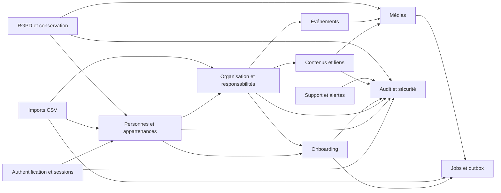

---

# 5. Référentiels globaux et entités

## 5.1 `entity`

Représente une implantation eXalt.

| Champ | Type | Règle |
|---|---|---|
| `id` | UUID | Clé primaire |
| `code` | texte | Unique, stable, par exemple `BORDEAUX` |
| `display_name` | texte | Nom présenté à l’utilisateur |
| `city` | texte | Ville principale |
| `country_code` | texte | `FR` dans le MVP |
| `status` | enum | `draft`, `active`, `suspended`, `archived` |
| `timezone` | texte | IANA, par exemple `Europe/Paris` |
| `created_at` | timestamptz | Obligatoire |
| `activated_at` | timestamptz | Nullable |
| `archived_at` | timestamptz | Nullable |

Contraintes :

- `code` immuable après activation ;
- une entité suspendue reste consultable par le super-administrateur ;
- une entité archivée ne reçoit plus de nouveaux membres.

## 5.2 `platform_setting`

Paramètres globaux :

- identité visuelle ;
- domaines e-mail autorisés ;
- durées de session ;
- seuils de sécurité ;
- versions des mentions légales ;
- paramètres de conservation.

Les secrets ne sont jamais enregistrés dans cette table.

## 5.3 `entity_setting`

Paramètres locaux :

- textes d’accueil ;
- présentateur ;
- liens internes ;
- contact RGPD ;
- informations juridiques ;
- options fonctionnelles activées ;
- configuration locale de l’onboarding.

Chaque clé est validée par un schéma connu. Aucun stockage arbitraire de secrets.

## 5.4 `allowed_email_domain`

| Champ | Règle |
|---|---|
| `domain` | Normalisé sans `@`, par exemple `exalt-company.com` |
| `entity_id` | Nullable pour un domaine global |
| `active` | Contrôle l’usage lors de l’authentification |
| `starts_at`, `ends_at` | Historisation |

---

# 6. Personnes et appartenance aux entités

## 6.1 `person`

Identité globale de la personne.

| Champ | Type | Règle |
|---|---|---|
| `id` | UUID | Interne et immuable |
| `email` | texte | Valeur d’affichage |
| `email_normalized` | texte | Unique globalement |
| `first_name` | texte | Obligatoire |
| `last_name` | texte | Obligatoire |
| `preferred_name` | texte | Facultatif |
| `account_state` | enum | `pending`, `active`, `suspended`, `departed`, `anonymized` |
| `created_at` | timestamptz | Obligatoire |
| `anonymized_at` | timestamptz | Nullable |

Contraintes :

- unicité insensible à la casse de `email_normalized` ;
- une personne anonymisée ne peut pas être réactivée sans création d’une nouvelle identité ;
- le nom et l’e-mail ne sont pas dupliqués dans les tables d’appartenance.

## 6.2 `entity_membership`

Profil d’une personne dans une entité.

| Champ | Type | Règle |
|---|---|---|
| `id` | UUID | Clé primaire |
| `person_id` | UUID | FK `person` |
| `entity_id` | UUID | FK `entity` |
| `arrival_date` | date | Référence de l’onboarding |
| `departure_date` | date | Nullable |
| `membership_state` | enum | `future`, `active`, `departed`, `archived` |
| `professional_category` | enum | `consultant`, `dg`, autre catégorie configurable ultérieure |
| `short_bio` | texte | Présentation professionnelle |
| `fun_fact` | texte | Facultatif |
| `profile_visibility` | enum | `draft`, `published`, `hidden` |
| `profile_published_at` | timestamptz | Nullable |
| `version` | entier | Concurrence optimiste |

Contraintes :

- une seule appartenance active ou future principale par personne ;
- pas de chevauchement temporel entre deux appartenances principales ;
- `departure_date >= arrival_date` ;
- l’archivage d’une appartenance révoque les accès et clôture les relations actives.

## 6.3 `job_catalog`

Catalogue de métiers configurable par entité.

Champs principaux :

- `entity_id` ;
- `code` stable ;
- `label` ;
- `description` ;
- `display_order` ;
- `active`.

## 6.4 `membership_job_assignment`

Historise le métier d’une appartenance.

Contraintes :

- une seule affectation métier active ;
- le métier appartient à la même entité que l’appartenance ;
- les périodes ne se chevauchent pas.

## 6.5 `professional_status_assignment`

Historise la situation professionnelle.

| Champ | Règle |
|---|---|
| `status` | `mission` ou `intercontract` |
| `client_id` | Obligatoire en mission, nul en intercontrat |
| `starts_at`, `ends_at` | Période |
| `reason` | Facultatif, audit fonctionnel |

Contraintes :

- une seule situation active par appartenance ;
- `mission` exige un client actif pour l’entité ;
- `intercontract` interdit un client actif ;
- un changement de statut déclenche l’évaluation du parcours d’onboarding.

---

# 7. Clients et alias

## 7.1 `client`

Référentiel global des clients.

| Champ | Règle |
|---|---|
| `canonical_name` | Nom officiel unique selon normalisation |
| `display_name` | Nom présenté |
| `status` | `active` ou `archived` |

## 7.2 `entity_client`

Active un client global dans une entité.

Cette table permet :

- de partager le même client entre plusieurs entités ;
- de ne pas afficher tous les clients partout ;
- d’archiver localement une relation sans supprimer le client global.

## 7.3 `client_alias`

| Champ | Règle |
|---|---|
| `alias_normalized` | Valeur détectée dans un import |
| `client_id` | Client canonique |
| `entity_id` | Nullable si alias global |
| `validated_by_person_id` | Validation humaine obligatoire |
| `validated_at` | Obligatoire avant usage automatique |

Aucune proposition de rapprochement n’écrit directement dans cette table sans validation humaine.

---

# 8. Organisation, cercles, bureaux et responsabilités

## 8.1 `circle`

| Champ | Règle |
|---|---|
| `entity_id` | Obligatoire |
| `code` | Unique dans l’entité |
| `name` | Nom affiché |
| `color_token` | Référence de couleur locale |
| `description` | Contenu court |
| `display_order` | Ordre |
| `archived_at` | Nullable |

Contraintes :

- impossible d’archiver avec des membres actifs ;
- la couleur ne constitue jamais la seule information visuelle.

## 8.2 `circle_membership`

Historise l’appartenance d’une personne à un cercle.

| Champ | Règle |
|---|---|
| `entity_membership_id` | Appartenance de la personne |
| `circle_id` | Cercle de la même entité |
| `membership_type` | `principal` ou `secondary` |
| `starts_at`, `ends_at` | Période |

Contraintes :

- un seul cercle principal actif par appartenance ;
- plusieurs cercles secondaires actifs autorisés ;
- une même personne ne peut pas avoir deux relations actives identiques au même cercle ;
- le Booster d’un cercle secondaire ne modifie pas le cercle principal, le DSM, le client ou le statut de la personne.

## 8.3 `office`

| Champ | Règle |
|---|---|
| `entity_id` | Obligatoire |
| `code` | Unique dans l’entité |
| `name` | Nom affiché |
| `description` | Contenu |
| `location_text` | Facultatif |
| `display_order` | Ordre |

## 8.4 `framework_responsibility_assignment`

Table générique historisant les responsabilités Framework.

| Champ | Règle |
|---|---|
| `person_id` | Personne responsable |
| `entity_id` | Entité de responsabilité |
| `responsibility_type` | `DSM`, `ESM`, `BOOSTER`, `OFFICE_MANAGER` |
| `circle_id` | Obligatoire uniquement pour `BOOSTER` |
| `office_id` | Obligatoire uniquement pour `OFFICE_MANAGER` |
| `starts_at`, `ends_at` | Période |
| `assigned_by_person_id` | ESM ou super-administrateur |
| `assignment_reason` | Obligatoire pour changement sensible |

Contraintes :

- `BOOSTER` exige `circle_id` et interdit `office_id` ;
- `OFFICE_MANAGER` exige `office_id` et interdit `circle_id` ;
- `DSM` et `ESM` interdisent les deux scopes ;
- un cercle possède un seul Booster actif ;
- un bureau possède entre un et trois responsables actifs lorsqu’il est publié ;
- une personne peut être Booster de plusieurs cercles d’une même entité ;
- une personne ne peut pas être Booster active dans plusieurs entités simultanément ;
- l’administrateur d’entité ne peut pas créer ou clôturer ces affectations ;
- un DG reçoit automatiquement une responsabilité DSM dans la même transaction que son attribution de catégorie.

## 8.5 `dsm_assignment`

Relation entre un consultant et son DSM.

| Champ | Règle |
|---|---|
| `consultant_membership_id` | Appartenance du consultant |
| `dsm_person_id` | Personne possédant une responsabilité DSM active |
| `entity_id` | Même entité |
| `starts_at`, `ends_at` | Période |

Contraintes :

- un consultant actif possède un seul DSM actif ;
- le DSM doit avoir une responsabilité DSM active dans la même entité ;
- un DSM peut suivre plusieurs consultants ;
- les périodes ne se chevauchent pas pour le consultant.

## 8.6 `technical_role_assignment`

Rôles techniques séparés du Framework.

| `role_type` | Portée |
|---|---|
| `ENTITY_ADMIN` | Une entité |
| `SUPER_ADMIN` | Globale, `entity_id` nul |

Toute création ou clôture est auditée. L’attribution d’un super-administrateur déclenche une alerte de sécurité.

---

# 9. Diagramme personnes et organisation

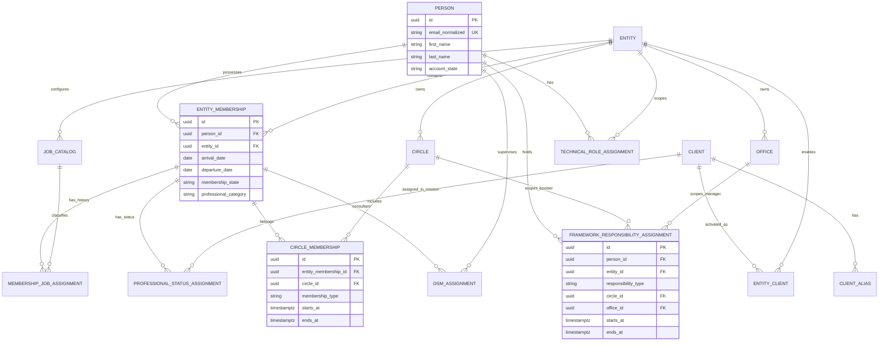

---

# 10. Authentification et sécurité

## 10.1 `user_account`

Compte permettant l’authentification.

| Champ | Règle |
|---|---|
| `person_id` | Obligatoire pour les comptes humains |
| `account_type` | `EMPLOYEE_MAGIC_LINK` ou `ADMIN_LOCAL` |
| `state` | `active`, `locked`, `disabled` |
| `last_login_at` | Nullable |
| `failed_login_count` | Compteur courant |
| `locked_until` | Nullable |

Une personne peut disposer d’un compte employé et, si nécessaire, d’un compte administrateur local distinct, sans multiplier son identité métier.

## 10.2 `admin_password_credential`

Réservé aux comptes `ADMIN_LOCAL`.

Champs :

- `user_account_id` ;
- `password_hash` ;
- `algorithm` ;
- `parameters` ;
- `changed_at` ;
- `must_change` ;
- `revoked_at`.

Aucun mot de passe brut ni historique réversible.

## 10.3 `magic_link_request`

| Champ | Règle |
|---|---|
| `person_id` | Personne active existante |
| `token_hash` | Hash uniquement |
| `requested_at` | Obligatoire |
| `expires_at` | 15 minutes après émission |
| `used_at` | Nullable |
| `invalidated_at` | Nullable |
| `request_origin_hash` | Valeur minimisée pour la limitation |

Contraintes :

- usage unique ;
- le dernier lien invalide les précédents encore actifs ;
- réponse publique générique, que l’e-mail existe ou non ;
- aucun lien complet dans les logs ou l’audit.

## 10.4 `user_session`

| Champ | Règle |
|---|---|
| `session_token_hash` | Unique |
| `person_id` | Compte humain |
| `created_at` | Début |
| `last_activity_at` | Expiration inactive après 7 jours |
| `absolute_expires_at` | Maximum 30 jours |
| `revoked_at` | Nullable |
| `revoke_reason` | Nullable |

Le départ d’un collaborateur ou le retrait d’un rôle sensible peut révoquer immédiatement les sessions concernées.

## 10.5 `service_account` et `service_token`

`service_account` porte :

- un nom ;
- une description ;
- une entité facultative ;
- un état ;
- un propriétaire technique.

`service_token` porte :

- un hash du jeton ;
- une expiration ;
- une révocation ;
- les scopes ;
- la dernière utilisation.

La durée maximale des jetons reste configurable avant leur création réelle.

## 10.6 `auth_event`

Historique spécialisé des événements d’authentification :

- succès ;
- échec ;
- magic link demandé ;
- magic link utilisé ;
- compte verrouillé ;
- session révoquée ;
- mot de passe administrateur modifié.

Les données sensibles sont exclues.

---

# 11. Diagramme authentification

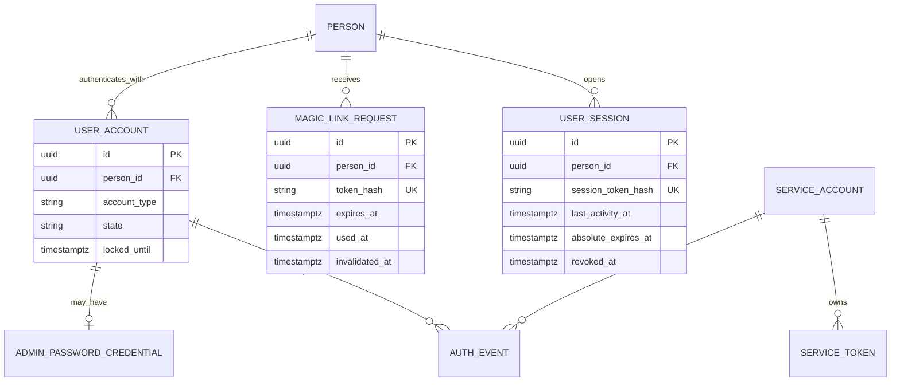

---

# 12. Fiche d’arrivée et profil publié

## 12.1 `arrival_profile`

| Champ | Règle |
|---|---|
| `entity_membership_id` | Une fiche par appartenance |
| `state` | `draft`, `validated`, `published`, `archived` |
| `short_intro` | Obligatoire avant validation |
| `fun_fact` | Facultatif |
| `photo_media_id` | Facultatif |
| `validated_at` | Date de validation par le nouvel arrivant |
| `published_at` | Publication immédiate après validation |
| `recent_until` | Un mois après la date d’arrivée |

Les données organisationnelles affichées sont lues depuis les relations actives de l’appartenance et ne sont pas dupliquées dans la fiche.

## 12.2 `photo_authorization`

| Champ | Règle |
|---|---|
| `person_id` | Personne concernée |
| `media_asset_id` | Photo autorisée |
| `granted_at` | Autorisation explicite |
| `withdrawn_at` | Retrait éventuel |
| `source` | `self_service`, `admin_support`, `migration` |
| `evidence_reference` | Référence minimale, sans document sensible inutile |

Une photo ne peut être utilisée publiquement sans autorisation active.

---

# 13. Onboarding

## 13.1 `onboarding_task_reference`

Catalogue stable des tâches réutilisables.

| Champ | Règle |
|---|---|
| `entity_id` | Nullable pour une tâche générique globale |
| `code` | Stable et unique dans son périmètre |
| `title` | Libellé |
| `description` | Instructions |
| `category` | Catégorie d’affichage |
| `active` | État |

Le `code` ou l’UUID permet de reconnaître une tâche commune lors d’un changement de parcours.

## 13.2 `onboarding_template`

Conteneur logique d’un modèle.

| Champ | Règle |
|---|---|
| `entity_id` | Nullable uniquement pour les modèles globaux |
| `name` | Nom |
| `target_status` | `mission` ou `intercontract` |
| `scope_type` | `GLOBAL`, `ENTITY`, `DSM`, `CIRCLE` |
| `scope_person_id` | DSM si scope `DSM` |
| `scope_circle_id` | Cercle si scope `CIRCLE` |
| `state` | `draft`, `active`, `archived` |

Contraintes :

- un scope `DSM` exige un DSM actif dans l’entité ;
- un scope `CIRCLE` exige un cercle de la même entité ;
- un modèle global est géré uniquement par le super-administrateur ;
- les modèles DSM et Booster ne deviennent pas transverses sans recréation par un rôle autorisé.

## 13.3 `onboarding_template_version`

Chaque publication crée une version immuable.

Champs :

- `template_id` ;
- `version_number` ;
- `state` : `draft`, `published`, `retired` ;
- `published_at` ;
- `published_by_person_id` ;
- `change_summary`.

Une instance existante garde sa version, sauf remplacement métier explicite.

## 13.4 `onboarding_template_task`

Associe une tâche à une version.

| Champ | Règle |
|---|---|
| `template_version_id` | Version |
| `task_reference_id` | Tâche stable |
| `display_order` | Unique dans la version |
| `required` | Obligatoire ou facultative |
| `due_offset_days` | Échéance relative à l’arrivée |
| `title_override` | Facultatif |
| `description_override` | Facultatif |

## 13.5 `onboarding_instance`

Parcours affecté à une appartenance.

| Champ | Règle |
|---|---|
| `entity_membership_id` | Nouvel arrivant |
| `template_version_id` | Version d’origine |
| `reference_date` | Date d’arrivée |
| `state` | `active`, `completed`, `archived`, `replaced` |
| `started_at` | Début |
| `completed_at` | Nullable |
| `replaced_by_instance_id` | Nullable |
| `replacement_reason` | Nullable |

Contraintes :

- une seule instance active par appartenance ;
- le statut cible du modèle correspond au statut professionnel actif ;
- l’archivage automatique intervient après complétion totale des tâches obligatoires.

## 13.6 `onboarding_instance_task`

Snapshot des tâches affectées.

| Champ | Règle |
|---|---|
| `onboarding_instance_id` | Instance |
| `task_reference_id` | Référence stable |
| `title_snapshot` | Texte au moment de l’affectation |
| `description_snapshot` | Texte au moment de l’affectation |
| `required` | Snapshot |
| `due_at` | Échéance calculée |
| `state` | `todo`, `completed`, `reopened`, `cancelled` |
| `completed_at` | Nullable |
| `completed_by_person_id` | Le nouvel arrivant |
| `reopened_at` | Nullable |
| `reopened_by_person_id` | ESM, administrateur d’entité ou super-administrateur après 5 minutes |
| `reopen_reason` | Obligatoire après 5 minutes |

## 13.7 `onboarding_task_event`

Journal métier détaillé des changements d’état :

- affectation ;
- complétion ;
- annulation dans les cinq minutes ;
- réouverture administrative ;
- conservation lors d’un remplacement ;
- annulation lors d’un changement de parcours.

Cette table complète l’audit global et permet de reconstruire la progression.

---

# 14. Diagramme onboarding

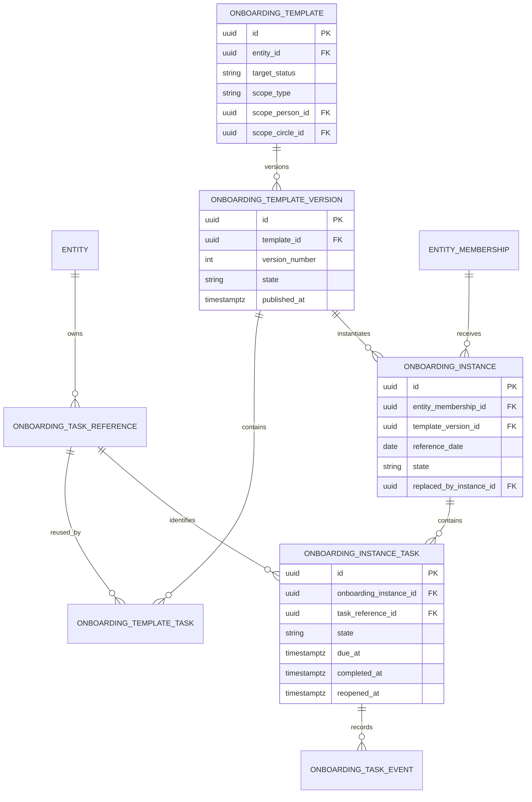

## 14.1 Changement mission/intercontrat

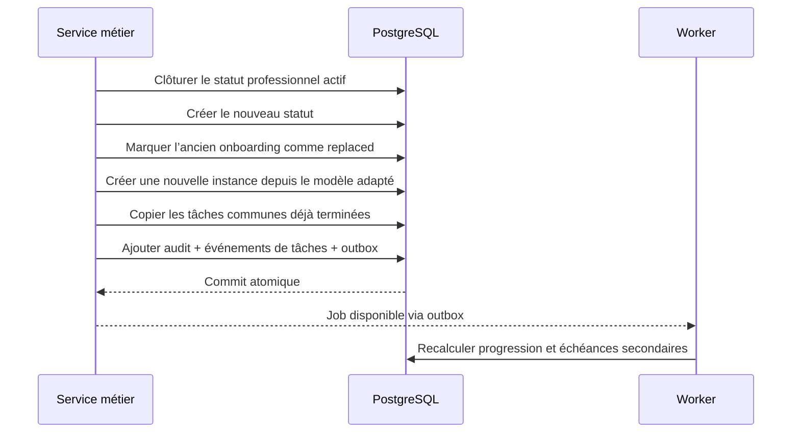

---

# 15. Contenus éditoriaux et liens

Le produit n’a pas besoin d’un CMS généraliste. Le modèle retenu est hybride :

- tables métier explicites pour les ressources structurées ;
- pages typées et blocs éditoriaux limités pour les contenus variables.

## 15.1 `content_page`

| Champ | Règle |
|---|---|
| `entity_id` | Entité |
| `page_type` | `HOME`, `FRAMEWORK`, `CIRCLE`, `OFFICE`, `LEGAL`, autre type contrôlé |
| `circle_id` | Requis pour une page de cercle |
| `office_id` | Requis pour une page de bureau |
| `title` | Titre |
| `slug` | Unique dans l’entité et le type |
| `state` | `draft`, `published`, `archived` |
| `published_at` | Nullable |

## 15.2 `content_block`

Blocs autorisés :

- texte riche limité ;
- titre ;
- image ;
- vidéo ;
- carte de lien ;
- citation ;
- liste ;
- appel à l’action interne.

Chaque bloc possède :

- `content_page_id` ;
- `block_type` ;
- `display_order` ;
- des champs structurés ;
- un `payload_json` validé par type lorsque nécessaire.

Aucun HTML arbitraire ni script n’est accepté.

## 15.3 `internal_link`

Liens Hub, Academy, SharePoint ou autres ressources internes.

Champs :

- `entity_id` ;
- `label` ;
- `url` ;
- `link_type` ;
- `description` ;
- `icon_reference` ;
- `display_order` ;
- `active`.

Les URL sont validées selon une liste de protocoles autorisés.

---

# 16. Médias

## 16.1 `media_asset`

| Champ | Règle |
|---|---|
| `entity_id` | Entité propriétaire |
| `uploaded_by_person_id` | Auteur |
| `state` | `pending`, `processing`, `ready`, `rejected`, `archived`, `deleted` |
| `media_type` | `image`, `video`, `document` si autorisé ultérieurement |
| `original_filename` | Valeur d’affichage nettoyée |
| `object_key` | Nom généré côté serveur |
| `mime_declared` | MIME reçu |
| `mime_detected` | MIME réel |
| `size_bytes` | Taille |
| `checksum_sha256` | Empreinte |
| `width`, `height` | Images et vidéos |
| `duration_seconds` | Vidéos |
| `rejection_code` | Nullable |
| `ready_at` | Nullable |

Contraintes :

- aucun `object_key` fourni par le client ;
- seuls les médias `ready` peuvent être affichés ;
- photo 10 Mo maximum ;
- image 20 Mo maximum ;
- vidéo 1 Go et 20 minutes maximum ;
- vérification du contenu réel obligatoire.

## 16.2 `media_variant`

Versions générées :

- miniature trombinoscope ;
- carte ;
- pleine largeur ;
- aperçu vidéo ;
- format optimisé.

Chaque variante porte :

- dimensions ;
- format ;
- taille ;
- checksum ;
- `object_key` propre.

## 16.3 `media_usage`

Référence les usages d’un média afin d’empêcher une suppression invalide.

| Champ | Exemple |
|---|---|
| `usage_type` | `PROFILE_PHOTO`, `CONTENT_BLOCK`, `EVENT`, `ENTITY_HERO`, `CIRCLE`, `OFFICE` |
| `resource_id` | UUID de la ressource |
| `field_name` | Champ logique |

Une purge est interdite tant que des usages actifs existent, sauf opération globale contrôlée remplaçant ou supprimant les références.

---

# 17. Événements

## 17.1 `event`

| Champ | Règle |
|---|---|
| `entity_id` | Entité |
| `title` | Obligatoire |
| `description` | Facultatif |
| `starts_at`, `ends_at` | Date et heure |
| `location_text` | Facultatif |
| `state` | `draft`, `published`, `cancelled`, `archived` |
| `cancelled_at` | Nullable |
| `cancellation_reason` | Facultatif |
| `created_by_person_id` | Auteur |

L’état « passé » est dérivé de `ends_at`, pas stocké comme état métier principal.

## 17.2 `event_circle_scope` et `event_office_scope`

Relations facultatives permettant de rattacher un événement :

- à toute l’entité ;
- à un ou plusieurs cercles ;
- à un ou plusieurs bureaux.

Le périmètre doit rester dans la même entité.

## 17.3 `event_media`

Associe un ou plusieurs médias, avec un ordre et un rôle d’affichage.

La récurrence sera ajoutée en V1 avec une règle et des occurrences matérialisées, sans modifier la table principale.

---

# 18. Diagramme contenus, médias et événements

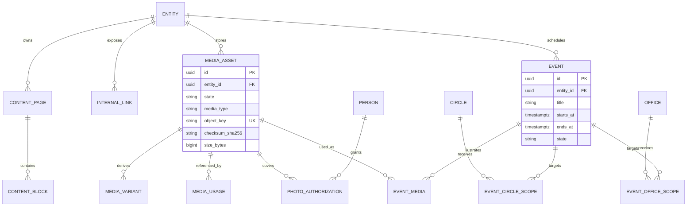

---

# 19. Imports CSV et qualité des données

## 19.1 `import_batch`

| Champ | Règle |
|---|---|
| `entity_id` | Entité cible |
| `source_filename` | Nom nettoyé |
| `source_checksum_sha256` | Empreinte du fichier |
| `state` | `uploaded`, `analyzing`, `preview_ready`, `approved`, `importing`, `completed`, `failed`, `cancelled` |
| `total_rows` | Nombre total |
| `valid_rows` | Nombre valide |
| `warning_rows` | Nombre avec avertissement |
| `rejected_rows` | Nombre rejeté |
| `created_by_person_id` | Auteur |
| `approved_by_person_id` | Validation du lancement |

Le CSV brut est conservé temporairement dans MinIO avec un usage restreint, puis supprimé selon la durée de conservation validée.

## 19.2 `import_row`

| Champ | Règle |
|---|---|
| `import_batch_id` | Lot |
| `row_number` | Numéro du CSV |
| `raw_data` | `jsonb` temporaire et minimisé |
| `normalized_data` | Valeurs normalisées |
| `state` | `valid`, `warning`, `needs_decision`, `rejected`, `imported`, `updated` |
| `target_person_id` | Nullable |
| `target_membership_id` | Nullable |
| `error_codes` | Liste structurée |

Le contenu ne doit jamais être recopié dans les logs.

## 19.3 `import_row_issue`

Une erreur ou un avertissement par ligne :

- code stable ;
- champ ;
- message utilisateur ;
- niveau ;
- valeur normalisée éventuellement sûre ;
- résolution.

## 19.4 `import_decision`

Décisions humaines :

- fusion avec une personne ;
- réactivation d’un profil archivé ;
- création d’un alias client ;
- sélection du client canonique ;
- rejet volontaire.

La décision conserve l’auteur, la date et le motif.

## 19.5 Atomicité

L’import des lignes valides utilise des transactions par lot maîtrisé, tout en garantissant pour chaque ligne :

- aucune mise à jour partielle ;
- audit cohérent ;
- identifiant de résultat ;
- capacité de rejouer une ligne rejetée.

Le rollback intégral reste V1.

---

# 20. Jobs, planification et outbox

## 20.1 `async_job`

Source durable de suivi des traitements.

| Champ | Règle |
|---|---|
| `entity_id` | Nullable pour job global |
| `job_type` | Import, média, export, purge, e-mail, maintenance |
| `state` | `queued`, `running`, `succeeded`, `failed`, `cancelled` |
| `progress_current`, `progress_total` | Facultatifs |
| `requested_by_person_id` | Nullable pour tâche système |
| `idempotency_key` | Unique dans son périmètre |
| `attempt_count` | Nombre d’essais |
| `max_attempts` | Limite |
| `started_at`, `finished_at` | Suivi |
| `last_heartbeat_at` | Détection des jobs bloqués |
| `error_code` | Nullable |
| `result_reference` | Nullable |

## 20.2 `outbox_message`

Message technique enregistré dans la même transaction que l’action métier.

Types :

- envoi d’e-mail ;
- génération de média ;
- recalcul de progression ;
- notification de supervision ;
- préparation d’export.

Champs :

- `topic` ;
- `payload_json` validé ;
- `available_at` ;
- `processed_at` ;
- `attempt_count` ;
- `last_error_code` ;
- `deduplication_key`.

## 20.3 `scheduled_task_run`

Historique des exécutions périodiques :

- expiration des liens ;
- sessions ;
- événements passés ;
- anonymisation à trois mois ;
- purge d’audit à un an ;
- nettoyage ;
- contrôle des jobs bloqués.

Un verrou PostgreSQL ou distribué garantit une seule exécution logique.

---

# 21. Audit, alertes, signalements et exports

## 21.1 `audit_event`

| Champ | Règle |
|---|---|
| `entity_id` | Nullable pour événement global |
| `actor_person_id` | Nullable pour système |
| `actor_service_account_id` | Nullable |
| `action_code` | Code stable |
| `resource_type` | Type de ressource |
| `resource_id` | UUID concerné |
| `summary` | Résumé lisible |
| `old_values` | `jsonb` filtré |
| `new_values` | `jsonb` filtré |
| `reason` | Obligatoire pour actions sensibles |
| `correlation_id` | Traçabilité technique |
| `occurred_at` | Date |
| `retention_until` | Un an par défaut |

Exclusions absolues : mots de passe, jetons, magic links complets, secrets, CSV brut, e-mail brut complet.

## 21.2 `operational_alert`

Représentation interne des alertes importantes, distincte d’Uptime Kuma.

| Champ | Règle |
|---|---|
| `severity` | `INFO`, `WARNING`, `ERROR`, `CRITICAL` |
| `source` | API, worker, security, backup, Uptime Kuma |
| `state` | `open`, `acknowledged`, `resolved` |
| `assigned_to_person_id` | Jonathan pendant la phase locale |
| `opened_at`, `acknowledged_at`, `resolved_at` | Cycle |
| `fingerprint` | Permet la réouverture et la déduplication |

## 21.3 `alert_comment`

Commentaires d’acquittement et de résolution.

## 21.4 `bug_report`

| Champ | Règle |
|---|---|
| `reported_by_person_id` | Auteur |
| `entity_id` | Entité consultée |
| `state` | `new`, `investigating`, `fixed`, `rejected` |
| `description` | Saisie utilisateur |
| `reproduction_steps` | Facultatif |
| `page_path` | Ajout automatique |
| `application_version` | Ajout automatique |
| `environment` | Ajout automatique |
| `browser_summary` | Minimisé |
| `correlation_id` | Facultatif |

Aucun contenu de formulaire métier n’est joint automatiquement.

## 21.5 `export_request`

Suit les exports CSV/PDF :

- type d’export ;
- filtre et périmètre normalisés ;
- demandeur ;
- job ;
- média ou objet généré ;
- date d’expiration ;
- audit.

---

# 22. RGPD et conservation

## 22.1 `privacy_notice_version`

Versionne les notices d’information :

- numéro de version ;
- date d’effet ;
- contenu ;
- entité juridique responsable ;
- contact RGPD ;
- état publié.

## 22.2 `privacy_notice_acknowledgement`

Trace la présentation et la prise de connaissance d’une version, sans présenter cette action comme un consentement global.

## 22.3 `data_subject_request`

Suit les demandes d’accès, rectification, effacement ou opposition :

- personne concernée ;
- type ;
- canal ;
- date de réception ;
- vérification d’identité ;
- responsable ;
- échéance ;
- état ;
- réponse ;
- date de clôture.

## 22.4 `retention_action`

Journal des actions automatiques ou manuelles :

- masquage au départ ;
- archivage ;
- anonymisation à trois mois ;
- purge d’audit à un an ;
- suppression d’un export expiré ;
- suppression d’un CSV temporaire.

## 22.5 Départ d’un collaborateur

Transaction métier immédiate :

1. clôture de l’appartenance ;
2. révocation des sessions ;
3. invalidation des magic links ;
4. clôture des rôles, DSM, client, métier et cercles ;
5. masquage du profil ;
6. archivage de l’onboarding ;
7. planification de l’anonymisation à trois mois ;
8. audit.

L’anonymisation doit préserver uniquement les agrégats nécessaires et supprimer ou remplacer les identifiants personnels.

---

# 23. Diagramme imports, jobs et audit

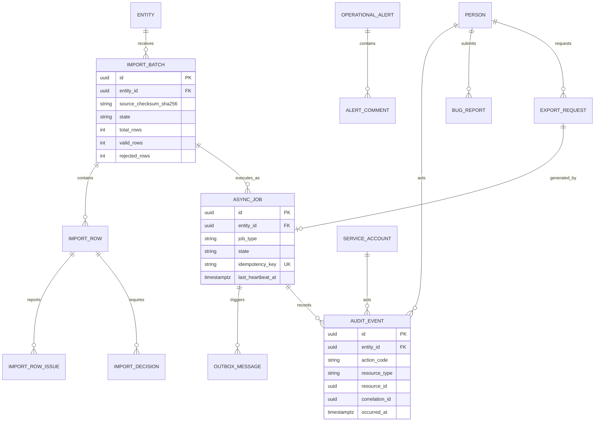

---

# 24. États principaux

## 24.1 Appartenance à une entité

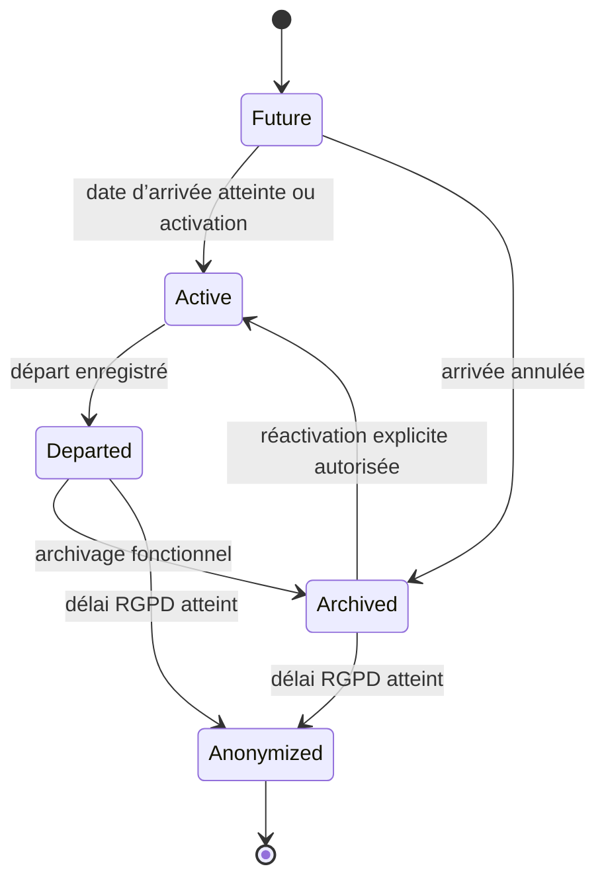

## 24.2 Tâche d’onboarding

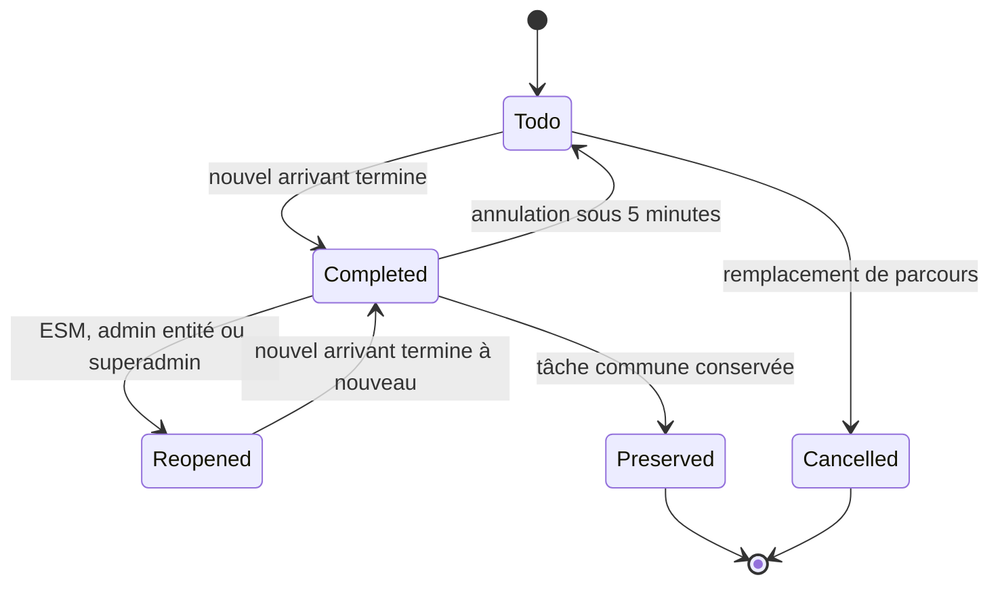

## 24.3 Média

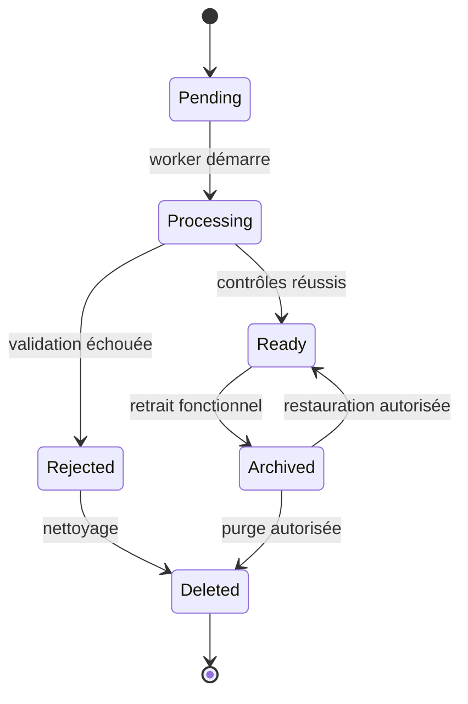

## 24.4 Import

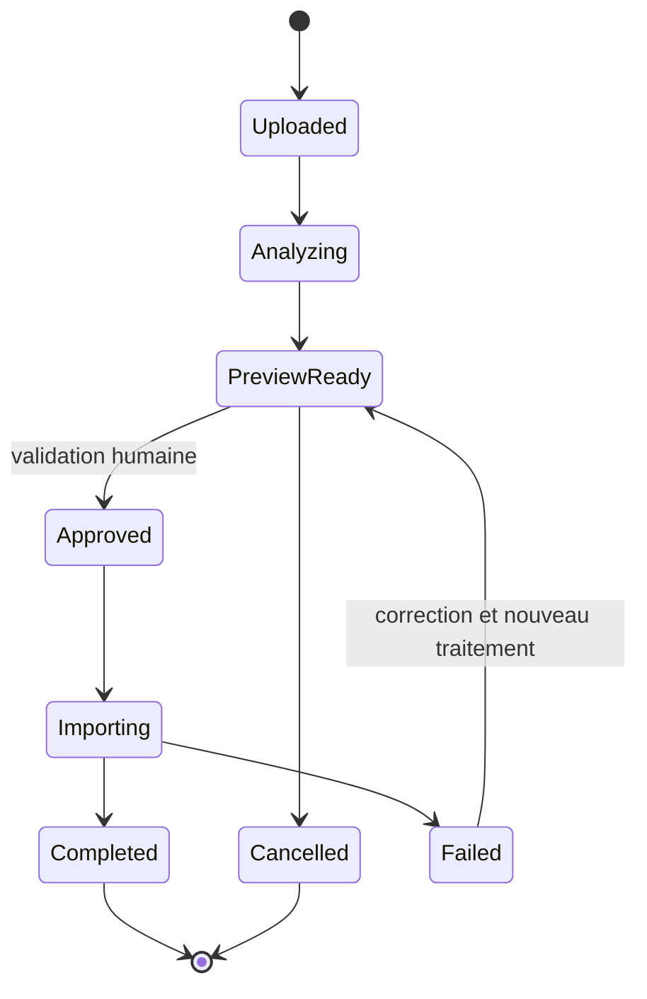

---

# 25. Contraintes SQL critiques

## 25.1 Index uniques partiels

À prévoir notamment :

```text
person(email_normalized) UNIQUE
entity(code) UNIQUE
job_catalog(entity_id, code) UNIQUE WHERE archived_at IS NULL
circle(entity_id, code) UNIQUE WHERE archived_at IS NULL
office(entity_id, code) UNIQUE WHERE archived_at IS NULL
entity_membership(person_id) UNIQUE WHERE membership_state IN ('future','active')
circle_membership(entity_membership_id) UNIQUE WHERE membership_type='principal' AND ends_at IS NULL
dsm_assignment(consultant_membership_id) UNIQUE WHERE ends_at IS NULL
framework_responsibility_assignment(circle_id) UNIQUE WHERE responsibility_type='BOOSTER' AND ends_at IS NULL
onboarding_instance(entity_membership_id) UNIQUE WHERE state='active'
magic_link_request(token_hash) UNIQUE
user_session(session_token_hash) UNIQUE
media_asset(entity_id, checksum_sha256) INDEX
async_job(entity_id, idempotency_key) UNIQUE
```

## 25.2 Contraintes temporelles

Pour empêcher les chevauchements historiques, PostgreSQL pourra utiliser des contraintes d’exclusion sur des plages temporelles, avec contrôle complémentaire dans les services.

Relations concernées :

- appartenance à une entité ;
- métier ;
- statut professionnel ;
- DSM ;
- cercle principal ;
- responsabilités Framework ;
- rôles techniques.

## 25.3 Clés étrangères composites

Pour empêcher les références inter-entités accidentelles, les tables locales exposent un couple unique `(id, entity_id)`.

Exemple : une relation entre un événement et un cercle porte `event_id`, `circle_id` et `entity_id`, avec deux clés étrangères composites garantissant que l’événement et le cercle appartiennent à cette même entité.

## 25.4 Contraintes métier nécessitant service ou trigger contrôlé

Certaines règles ne sont pas exprimables par une simple contrainte :

- une personne Booster dans une seule entité mais éventuellement plusieurs cercles de cette entité ;
- un bureau publié avec un à trois responsables actifs ;
- l’attribution automatique DSM au DG ;
- la vérification du rôle actif du DSM cible ;
- la conservation des tâches communes lors d’un changement de parcours ;
- le refus d’archiver un cercle comportant des membres actifs ;
- la publication d’une photo uniquement avec autorisation active.

Elles seront appliquées par un service transactionnel et couvertes par des tests d’intégration. Une contrainte ou un trigger défensif pourra être ajouté lorsque le risque le justifie.

---

# 26. Index de recherche et performance

## 26.1 Trombinoscope

Index recommandés :

- `person.email_normalized` ;
- normalisation et index de recherche sur prénom et nom ;
- `entity_membership(entity_id, membership_state)` ;
- affectation métier active ;
- statut professionnel actif ;
- DSM actif ;
- cercle principal actif ;
- client actif.

Une colonne de recherche dénormalisée ou un index PostgreSQL adapté pourra être utilisé pour la recherche tolérante, sans remplacer les données sources.

## 26.2 Événements

Index :

- `(entity_id, starts_at)` ;
- `(entity_id, ends_at)` ;
- état publié/annulé ;
- scopes cercle et bureau.

## 26.3 Onboarding

Index :

- instance active par appartenance ;
- tâches par échéance ;
- tâches en retard ;
- progression par DSM, cercle et entité.

## 26.4 Audit

Partitionnement temporel envisageable si le volume le justifie. Il n’est pas obligatoire au lancement.

---

# 27. Données dérivées et non stockées

Les éléments suivants doivent être calculés, sauf mesure de performance contraire :

- statut « événement passé » depuis `ends_at` ;
- progression d’un onboarding depuis les tâches ;
- rôle effectif d’une personne depuis ses affectations actives ;
- droits effectifs depuis les rôles et le périmètre ;
- affichage « arrivée récente » depuis `arrival_date` et `recent_until` ;
- nombre de profils par cercle, client ou DSM ;
- indicateurs de reporting.

Des vues SQL ou vues matérialisées pourront être ajoutées après mesure, sans devenir la source de vérité.

---

# 28. Ordre recommandé des migrations initiales

1. extensions PostgreSQL strictement nécessaires ;
2. `entity`, paramètres globaux et domaines e-mail ;
3. `person` et authentification ;
4. `entity_membership` ;
5. métiers et statuts ;
6. clients et alias ;
7. cercles et bureaux ;
8. responsabilités et rôles techniques ;
9. médias ;
10. contenus et événements ;
11. fiches d’arrivée ;
12. tâches, modèles et instances d’onboarding ;
13. imports ;
14. jobs et outbox ;
15. audit, alertes, support et RGPD ;
16. index de recherche et contraintes temporelles ;
17. vues de reporting.

Chaque migration devra être testée :

- sur une base vide ;
- depuis la version précédente ;
- avec un rollback applicatif compatible lorsque possible.

---

# 29. Tables MVP, V1 et V2

## 29.1 MVP

Tables indispensables :

- entités et paramètres ;
- personnes et appartenances ;
- métiers, statuts, clients, DSM, cercles, bureaux ;
- responsabilités Framework et rôles techniques ;
- authentification, magic links, sessions ;
- fiches d’arrivée et autorisations photo ;
- médias et variantes ;
- contenus et liens ;
- événements ;
- onboarding complet ;
- imports CSV et décisions ;
- jobs, outbox et planification ;
- audit ;
- signalements de bugs ;
- notices RGPD et conservation.

## 29.2 V1

Extensions :

- récurrence des événements ;
- médiathèque avancée ;
- rollback complet d’import ;
- exports CSV/PDF avancés ;
- exports 16:9 et texte Teams ;
- tableaux et vues matérialisées de reporting si nécessaires.

## 29.3 V2

Extensions :

- identités Microsoft Entra ID ;
- synchronisation Graph ;
- publication Teams ;
- synchronisation automatisée des arrivées et départs ;
- intégrations Hub et Academy ;
- MFA éventuelle.

Les tables MVP sont conçues pour recevoir ces extensions sans refonte des identités ou de l’organisation.

---

# 30. Contrôles de recette du modèle

Le modèle sera accepté si les tests démontrent notamment que :

1. un e-mail normalisé ne peut correspondre qu’à une personne ;
2. une personne ne peut avoir qu’une entité principale active ;
3. les historiques ne se chevauchent pas ;
4. un consultant actif possède un DSM actif ;
5. une mission possède un client et un intercontrat n’en possède pas ;
6. un cercle possède au maximum un Booster actif ;
7. une personne n’est pas Booster active dans plusieurs entités ;
8. un bureau publié possède entre un et trois responsables ;
9. une personne possède au maximum un cercle principal actif ;
10. un cercle avec des membres actifs ne peut être archivé ;
11. un profil archivé ne reçoit pas de magic link ;
12. une photo sans autorisation ne peut pas être publiée ;
13. une seule instance d’onboarding est active ;
14. les tâches communes sont conservées lors d’un changement de statut ;
15. une réouverture après cinq minutes exige un acteur autorisé et un motif ;
16. une référence d’une entité vers une autre est refusée ;
17. un import n’écrit aucune ligne avant approbation ;
18. une ligne invalide n’empêche pas les lignes valides d’être importées ;
19. un job rejoué avec la même clé ne crée pas de doublon ;
20. une action métier et son audit sont atomiques ;
21. une purge ne laisse aucun média ou lien orphelin ;
22. le départ révoque immédiatement les sessions et rôles ;
23. l’anonymisation respecte les durées validées ;
24. les exports respectent le même périmètre que la consultation ;
25. les 5 000 profils et 25 entités restent exploitables avec les index définis.

---

# 31. Arbitrages validés par Jonathan

## ARB-DATA-001 — Séparation `person` / `entity_membership`

**Décision validée :** conserver une identité globale unique et placer toutes les données locales dans l’appartenance à l’entité.

Cela facilite les changements d’entité, l’historisation et la future synchronisation Microsoft.

## ARB-DATA-002 — Table générique des responsabilités Framework

**Décision validée :** utiliser une table unique `framework_responsibility_assignment` avec un type et un scope contrôlés, plutôt que quatre tables totalement séparées.

Les contraintes spécifiques restent explicites et testées.

## ARB-DATA-003 — Modèle éditorial hybride

**Décision validée :** éviter un CMS libre et utiliser des pages typées composées de blocs autorisés, associées aux tables métier `circle`, `office`, `event` et `internal_link`.

Cela préserve la créativité visuelle sans permettre de HTML arbitraire.

## ARB-DATA-004 — Historisation temporelle systématique

**Décision validée :** ne jamais écraser les affectations structurantes. Les relations actives sont clôturées puis recréées, avec contraintes empêchant les chevauchements.

## ARB-DATA-005 — Outbox transactionnelle et jobs PostgreSQL

**Décision validée :** enregistrer l’audit, les messages d’outbox et les jobs dans PostgreSQL dans la même transaction que l’action métier. Redis sert uniquement au transport et à l’exécution.

---

# 32. Décisions de modèle validées

| ID | Décision validée |
|---|---|
| DATA-001 | Une personne possède une identité globale unique. |
| DATA-002 | Les données propres à une entité sont portées par une appartenance historisée. |
| DATA-003 | Les responsabilités Framework et les rôles techniques sont séparés. |
| DATA-004 | Les clients sont globaux et activés par entité. |
| DATA-005 | Les alias clients exigent une validation humaine. |
| DATA-006 | Les modèles d’onboarding sont versionnés et les versions publiées sont immuables. |
| DATA-007 | Les instances conservent des snapshots des tâches. |
| DATA-008 | Les fichiers sont stockés dans MinIO et leurs métadonnées dans PostgreSQL. |
| DATA-009 | Les contenus utilisent un modèle hybride typé, sans HTML arbitraire. |
| DATA-010 | Les imports passent par une zone d’analyse avant écriture. |
| DATA-011 | Les jobs sont persistés dans PostgreSQL et exécutés par Dramatiq. |
| DATA-012 | Une outbox transactionnelle coordonne les effets externes. |
| DATA-013 | Les actions sensibles produisent un audit atomique. |
| DATA-014 | Les références locales sont protégées contre les liens inter-entités. |
| DATA-015 | Les suppressions physiques sont rares et contrôlées. |
| DATA-016 | Les historiques utilisent des périodes de validité. |
| DATA-017 | Les données dérivées ne deviennent pas la source de vérité. |
| DATA-018 | Le schéma reste compatible avec Entra ID et Graph en V2. |

---

# 33. Statut du livrable

Les cinq arbitrages `ARB-DATA-001` à `ARB-DATA-005` ont été validés par Jonathan le 25 juillet 2026.

Ce document constitue désormais la référence pour :

1. les modèles SQLAlchemy ;
2. les migrations Alembic ;
3. les schémas Pydantic ;
4. les routes et services FastAPI ;
5. les règles de transactions ;
6. les tests d’intégrité et d’isolation ;
7. la roadmap MVP/V1/V2 ;
8. le backlog technique et fonctionnel.

Toute modification structurante ultérieure devra être enregistrée comme une nouvelle décision et ne devra pas écraser silencieusement les règles validées.
