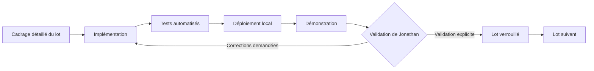
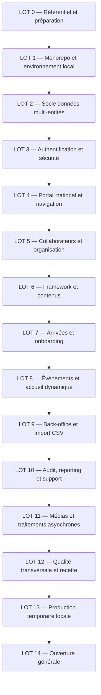
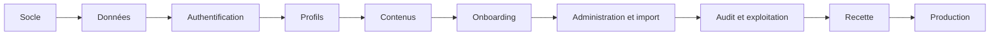

# Roadmap MVP, V1 et V2 — eXalt Onboarding Digital

**Version :** 1.0 — livrable de cadrage 3/6 validé  
**Date :** 25 juillet 2026  
**Statut :** validé par Jonathan le 25 juillet 2026  
**Références :**

- `MATRICE_ROLES_PERMISSIONS_EXALT.md` version 1.1 validée ;
- `MODELE_DONNEES_EXALT.md` version 1.0 validée ;
- décisions `DEC-001` à `DEC-417` issues des ateliers de cadrage.

---

# 1. Objet du document

Cette roadmap transforme le cadrage fonctionnel et technique de la plateforme eXalt Onboarding Digital en une séquence de réalisation contrôlable.

Elle définit :

- le contenu exact du MVP, de la V1 et de la V2 ;
- les lots de réalisation ;
- les dépendances entre les lots ;
- les livrables attendus ;
- les critères de sortie de chaque lot ;
- les validations obligatoires ;
- les fonctions explicitement différées ;
- les conditions de passage à la production générale.

La roadmap ne constitue pas encore le backlog détaillé. Le backlog sera produit après validation de ce document et décomposera chaque lot en epics, fonctionnalités, user stories et tâches techniques.

---

# 2. Principe de réalisation validé

## 2.1 Construction séquentielle

Le projet est construit **un lot à la fois**.

Chaque lot suit le cycle suivant :

Aucun lot dépendant ne commence avant validation explicite du lot précédent.

Une correction urgente de sécurité, de données ou d’architecture peut rouvrir un lot déjà validé. Cette réouverture doit être tracée et accompagnée d’une analyse d’impact sur les lots suivants.

## 2.2 Définition d’un lot terminé

Un lot est terminé uniquement lorsque :

- son périmètre fonctionnel est développé ;
- ses migrations sont applicables depuis l’état précédent ;
- ses permissions sont contrôlées par l’API ;
- ses tests obligatoires réussissent ;
- ses interfaces principales sont utilisables sur mobile et ordinateur ;
- ses erreurs et états vides sont traités ;
- son audit est présent lorsqu’il est requis ;
- sa documentation technique est mise à jour ;
- une démonstration a été réalisée ;
- Jonathan a explicitement validé le lot.

Une fonctionnalité partiellement développée, masquée derrière l’interface ou non testée n’est pas considérée comme terminée.

## 2.3 Refus des raccourcis structurants

Les contraintes suivantes s’appliquent à tous les lots :

- aucune donnée métier durable dans `localStorage` ;
- aucune donnée ou image en Base64 dans PostgreSQL ou le code ;
- aucune règle de permission uniquement côté frontend ;
- aucun secret dans Git ;
- aucune création automatique de table en production ;
- aucune utilisation de données Bordeaux dans une autre entité ;
- aucun contournement manuel du magic link en production ;
- aucune dépendance essentielle à un CDN public ;
- aucune exigence Must supprimée sans décision explicite.

---

# 3. Vue globale des versions

| Version | Finalité | Résultat attendu |
|---|---|---|
| MVP | Mettre à disposition le portail interne complet de découverte et d’onboarding | Produit exploitable pour Bordeaux, architecture multi-entités, administration, sécurité, import et exploitation validés |
| V1 | Enrichir la production, l’administration et le pilotage | Récurrences, médiathèque avancée, exports, reporting visuel et outils éditoriaux supplémentaires |
| V2 | Intégrer la plateforme au système d’information eXalt | Entra ID, Microsoft Graph, Teams, synchronisations automatiques et intégrations internes |

## 3.1 Règle de version

- Le MVP doit constituer un produit cohérent et exploitable, pas une maquette.
- La V1 ajoute des fonctions importantes mais non indispensables à l’usage initial.
- La V2 dépend de décisions et autorisations externes de la DSI.
- Une fonctionnalité V1 ou V2 peut être préparée dans le modèle ou l’architecture sans être exposée dans le MVP.

---

# 4. Carte des dépendances

Le séquencement est volontairement strict pour respecter la décision de validation lot par lot. Certains composants transversaux sont amorcés tôt puis complétés dans leur lot spécialisé.

---

# 5. Roadmap du MVP

# LOT 0 — Référentiel projet et préparation

## Objectif

Créer le point de départ documentaire et décisionnel utilisé par tous les agents et développeurs.

## Inclus

- dépôt GitHub privé ;
- arborescence documentaire ;
- règles de contribution ;
- registre des décisions ;
- registre des risques ;
- conventions de branches et versions ;
- matrice des rôles validée ;
- modèle de données validé ;
- roadmap validée ;
- futur backlog validé ;
- inventaire des ressources du prototype à reprendre ;
- schéma initial du CSV ;
- liste des dépendances externes.

## Livrables

- `/docs/product/` ;
- `/docs/architecture/` ;
- `/docs/decisions/` ;
- `/docs/operations/` ;
- modèle de fichier `.env.example` sans secrets ;
- conventions de nommage et de version.

## Critères de sortie

- les documents de cadrage sont présents dans le dépôt ;
- chaque décision possède un identifiant stable ;
- les responsabilités produit et techniques sont identifiées ;
- aucun fichier réel de collaborateurs n’est versionné ;
- Jonathan valide le référentiel.

## Dépendances

Aucune.

## Validation

**Validateur principal :** Jonathan.  
**Contributrices :** Léa, Tess et Diane pour les éléments métier et éditoriaux.

---

# LOT 1 — Monorepo, qualité et environnement local

## Objectif

Obtenir une plateforme vide mais exécutable localement sur le MacBook Pro M5, avec une chaîne de qualité opérationnelle.

## Inclus

- monorepo :
  - `/apps/web` ;
  - `/apps/api` ;
  - `/apps/worker` ;
  - `/packages/ui` ;
  - `/packages/contracts` ;
  - `/infra` ;
  - `/docs` ;
- React, TypeScript strict et Vite ;
- FastAPI, SQLAlchemy et Alembic ;
- PostgreSQL ;
- Redis ;
- MinIO ;
- Dramatiq ;
- Caddy ;
- Mailpit ;
- Docker Compose pour développement et recette ;
- images ARM64 et AMD64 ;
- healthchecks `live`, `ready` et `version` ;
- logs JSON avec corrélation ;
- CI GitHub : formatage, lint, types, tests, migrations, secrets et vulnérabilités ;
- publication de premières images techniques dans GHCR privé.

## Hors périmètre

- écrans métier ;
- authentification fonctionnelle ;
- données collaborateurs ;
- déploiement général.

## Démonstration attendue

- lancement complet avec une commande documentée ;
- page web de statut ;
- API répondant aux trois healthchecks ;
- PostgreSQL, Redis, MinIO, worker et Mailpit sains ;
- arrêt et redémarrage sans perte des volumes ;
- pipeline CI réussi.

## Critères de sortie

- tous les services démarrent sur le Mac M5 ;
- les images multiarchitectures sont construites ;
- aucun secret réel n’est présent ;
- une migration Alembic vide ou initiale s’exécute ;
- les logs possèdent un identifiant de corrélation ;
- la CI bloque volontairement une erreur de lint, de test et de secret ;
- Jonathan valide le socle.

## Dépendances

LOT 0.

---

# LOT 2 — Socle de données et isolation multi-entités

## Objectif

Implémenter le noyau relationnel validé avant d’ajouter les écrans métier.

## Inclus

- entités ;
- paramètres globaux et locaux ;
- domaines e-mail autorisés ;
- personnes ;
- appartenances aux entités ;
- métiers ;
- statuts professionnels ;
- clients globaux, clients activés et alias ;
- cercles ;
- bureaux ;
- affectations DSM ;
- responsabilités Framework ;
- rôles techniques ;
- archivage et historisation ;
- contraintes temporelles ;
- contraintes d’unicité ;
- protection des références inter-entités ;
- repositories et services de base ;
- factories de données fictives ;
- jeu de test jusqu’à 25 entités et 5 000 profils.

## Démonstration attendue

- création de Bordeaux et d’une seconde entité fictive ;
- création d’une personne et de son appartenance principale ;
- changement historisé de DSM, client et cercle ;
- refus d’une seconde entité principale active ;
- refus d’un Booster actif dans deux entités ;
- refus d’une relation croisée entre entités.

## Critères de sortie

- toutes les migrations s’appliquent sur une base vide ;
- les migrations sont rejouables dans un environnement de test ;
- les contraintes critiques disposent de tests PostgreSQL ;
- les relations structurantes sont historisées ;
- les tests d’isolation réussissent ;
- aucune dépendance à SQLite n’existe pour les tests d’intégration ;
- Jonathan valide le modèle implémenté.

## Dépendances

LOTS 0 et 1.

---

# LOT 3 — Authentification, sessions et sécurité applicative

## Objectif

Permettre l’accès sécurisé des employés et des administrateurs selon les règles validées.

## Inclus

- comptes utilisateurs liés aux personnes ;
- comptes administrateurs locaux ;
- demande et consommation de magic links ;
- durée de 15 minutes ;
- usage unique ;
- invalidation des anciens liens ;
- domaine `@exalt-company.com` configurable ;
- réponse générique anti-énumération ;
- sessions de 7 jours d’inactivité et 30 jours absolus ;
- cookies `HttpOnly`, `Secure` et `SameSite` ;
- protection CSRF ;
- limitation de débit ;
- verrouillage des comptes administrateurs ;
- révocation immédiate lors d’un départ ;
- comptes de service et scopes ;
- événements d’authentification ;
- Mailpit en développement et recette ;
- aucun contournement de session utilisateur en production.

## Interfaces incluses

- page de connexion ;
- confirmation de demande de lien ;
- lien expiré ou déjà consommé ;
- connexion administrateur ;
- déconnexion ;
- pages `403`, `404` et erreur générale.

## Démonstration attendue

- demande d’un magic link pour une personne active ;
- réception dans Mailpit ;
- connexion avec le lien ;
- rejet d’un second usage ;
- refus d’une adresse absente de la base ;
- révocation d’une session après archivage du collaborateur ;
- verrouillage après échecs administrateur répétés.

## Critères de sortie

- tous les scénarios autorisés et refusés sont testés ;
- aucun jeton n’est stocké dans `localStorage` ;
- aucune adresse absente de la base ne peut se connecter ;
- les magic links ne figurent pas dans les logs ;
- les limites de débit produisent les résultats attendus ;
- Jonathan valide l’authentification.

## Dépendances

LOT 2.

---

# LOT 4 — Portail national, sélection d’entité et navigation

## Objectif

Fournir le squelette utilisateur final et la consultation inter-entités en lecture seule.

## Inclus

- page nationale après authentification ;
- liste accessible des entités ;
- carte de France illustrative ;
- choix de l’entité consultée ;
- visibilité permanente de l’entité active ;
- changement d’entité ;
- layouts desktop, tablette et mobile ;
- navigation principale ;
- barre inférieure mobile ;
- affichage conditionnel de l’administration et de l’onboarding ;
- route guards uniquement ergonomiques ;
- contrôles d’autorisation systématiques dans l’API ;
- page d’absence de connexion après chargement ;
- design tokens et premiers composants du design system.

## Démonstration attendue

- un employé de Bordeaux consulte Bordeaux puis une autre entité ;
- ses responsabilités ne s’appliquent que dans son entité principale ;
- une tentative de modification dans l’autre entité est refusée par l’API ;
- la navigation fonctionne à 320, 390, 768, 1 280 et 1 920 pixels.

## Critères de sortie

- la liste précède la carte sur mobile ;
- la navigation est intégralement utilisable au clavier ;
- l’entité active est visible sur toutes les pages internes ;
- les menus reflètent les permissions sans les remplacer ;
- les erreurs réseau n’indiquent jamais à tort qu’une action est sauvegardée ;
- Jonathan valide les parcours de navigation.

## Dépendances

LOT 3.

---

# LOT 5 — Collaborateurs, profils et organisation

## Objectif

Créer le référentiel humain et le trombinoscope utilisable par tous les employés authentifiés.

## Inclus

- liste des collaborateurs ;
- pagination de 25, 50 ou 100 éléments ;
- recherche avec délai d’environ 300 ms ;
- filtres par entité, cercle, DSM, client, métier et statut ;
- cartes retournables accessibles ;
- page de profil complète ;
- photo facultative et avatar neutre ;
- présentation courte ;
- fun fact facultatif ;
- métier ;
- statut mission ou intercontrat ;
- client actif ;
- DSM ;
- cercle principal et cercles secondaires ;
- responsabilités Framework ;
- gestion des autorisations de photo ;
- création, modification, archivage et restauration selon la matrice ;
- historique des affectations ;
- règles Booster et DG ;
- composants d’administration contextuels du périmètre.

## Démonstration attendue

- affichage du trombinoscope avec données fictives ;
- recherche à chaque frappe ;
- ouverture au clavier d’une carte et d’un profil ;
- modification autorisée par un DSM sur son consultant ;
- refus sur un autre consultant ;
- ajout d’un membre secondaire par un Booster ;
- impossibilité pour le Booster de modifier son cercle principal ou son client ;
- restauration d’un profil par l’ESM.

## Critères de sortie

- les miniatures sont inférieures à la cible de 100 Ko ;
- aucune photo non autorisée n’est publiée ;
- les permissions suivent intégralement la matrice ;
- les recherches respectent l’objectif de performance avec 5 000 profils ;
- aucune requête N+1 critique n’est détectée ;
- les affectations structurantes ne sont jamais écrasées ;
- Jonathan valide le trombinoscope et les profils.

## Dépendances

LOT 4.

---

# LOT 6 — Framework, cercles, bureaux et contenus éditoriaux

## Objectif

Reproduire la dimension de découverte de l’organisation avec un contenu administrable et visuellement cohérent.

## Inclus

- page Framework synthétique ;
- catégories et responsabilités ;
- huit cercles initiaux configurables ;
- pages détaillées des cercles ;
- bureaux initiaux BDS, BDE et BDG configurables ;
- pages détaillées des bureaux ;
- un à trois responsables actifs par bureau ;
- présentation de l’entité ;
- modèle éditorial hybride par pages et blocs ;
- textes, images, vidéos et liens autorisés ;
- liens Hub, eXalt Academy et SharePoint ;
- reprise relue des textes et liens du prototype ;
- édition selon ESM, Booster, responsable de bureau, administrateur et super-administrateur ;
- archivage et restauration des contenus ;
- aucun HTML arbitraire.

## Démonstration attendue

- accueil d’une entité contenant la présentation et les accès au Framework ;
- édition d’un cercle par son Booster ;
- édition d’un bureau par son responsable ;
- refus d’une modification hors périmètre ;
- création d’une nouvelle entité depuis des modèles génériques sans contenu Bordeaux.

## Critères de sortie

- les contenus de Bordeaux sont relus avant publication ;
- le modèle générique ne contient aucune donnée locale ;
- les composants respectent le design system ;
- les couleurs de cercle ne sont jamais l’unique information ;
- les animations respectent `prefers-reduced-motion` ;
- aucun contenu arbitraire ne peut injecter du code ;
- Jonathan valide l’organisation et l’édition.

## Dépendances

LOT 5.

---

# LOT 7 — Fiches d’arrivée et onboarding

## Objectif

Mettre en œuvre le parcours prioritaire des nouveaux arrivants.

## Inclus

### Fiche d’arrivée

- préremplissage des données organisationnelles ;
- champs verrouillés : arrivée, métier, statut, DSM, client et cercle principal ;
- photo facultative ;
- présentation courte obligatoire ;
- fun fact facultatif ;
- validation par le nouvel arrivant ;
- publication immédiate après validation ;
- affichage récent pendant un mois ;
- corrections ultérieures par les rôles autorisés.

### Modèles d’onboarding

- catalogue de références de tâches ;
- modèles mission et intercontrat ;
- versions immuables publiées ;
- duplication, ordre, archivage et restauration ;
- périmètres DSM, Booster et entité conformément à la matrice.

### Instances d’onboarding

- création depuis la date d’arrivée ;
- progression globale ;
- prochaine étape ;
- tâches à terminer ;
- complétion directe ;
- annulation par le nouvel arrivant pendant cinq minutes ;
- réouverture après cinq minutes par ESM, administrateur d’entité ou super-administrateur ;
- motif obligatoire de réouverture ;
- changement mission/intercontrat ;
- préservation des tâches communes grâce aux identifiants stables ;
- archivage du parcours terminé ;
- reporting de base.

## Démonstration attendue

- création d’un futur arrivant ;
- validation de sa fiche ;
- apparition sur l’accueil ;
- génération de son parcours ;
- complétion et annulation d’une tâche ;
- tentative d’annulation après cinq minutes ;
- réouverture autorisée avec motif ;
- passage intercontrat vers mission en conservant les tâches communes.

## Critères de sortie

- les parcours mission et intercontrat sont validés par Tess, Léa, Diane et Jonathan ;
- les règles de périmètre DSM, Booster et ESM sont testées ;
- la progression est calculée et non stockée comme source de vérité ;
- les événements de tâche sont historisés ;
- le départ d’un collaborateur archive le parcours et révoque les sessions ;
- un parcours réel complet est exécuté en recette ;
- Jonathan valide le lot.

## Dépendances

LOTS 5 et 6.

---

# LOT 8 — Événements et accueil dynamique

## Objectif

Compléter la vie interne de l’entité et la page d’accueil finale.

## Inclus

- création d’événements par ESM, DSM, Booster, responsable de bureau, administrateur et super-administrateur ;
- périmètres par entité, cercle ou bureau ;
- titre, description, lieu, début, fin et médias ;
- événements à venir et passés ;
- passage automatique dans les événements passés après la fin ;
- annulation conservée avec badge ;
- aucune inscription ni liste de participants ;
- aucune notification métier d’événement ;
- page d’accueil dans l’ordre validé :
  1. présentation de l’entité ;
  2. Framework ;
  3. arrivées récentes ;
  4. prochains événements ;
  5. liens internes ;
- carrousels manuels et accessibles sur mobile ;
- vidéos sans lecture automatique et avec commandes.

## Démonstration attendue

- création d’un événement par chaque périmètre autorisé ;
- refus hors périmètre ;
- bascule automatique vers le passé ;
- annulation et affichage du badge ;
- affichage complet de l’accueil sur mobile et ordinateur.

## Critères de sortie

- aucune donnée de participants n’existe ;
- aucune vidéo complète n’est téléchargée avant interaction ;
- les événements passés sont calculés de manière cohérente ;
- les règles d’archivage et restauration sont respectées ;
- l’accueil respecte l’ordre et le design validés ;
- Jonathan valide l’accueil et les événements.

## Dépendances

LOT 7.

---

# LOT 9 — Back-office, administration et import CSV

## Objectif

Permettre l’exploitation autonome de la plateforme et le chargement contrôlé des vraies données.

## Inclus

### Back-office

- tableau de bord administratif ;
- profils actifs ;
- futures arrivées ;
- onboardings actifs et en retard ;
- profils incomplets ;
- dernières erreurs d’import ;
- navigation regroupée : Organisation, Onboarding, Contenu, Données, Pilotage, Configuration et Super-administration ;
- création d’une entité ;
- nomination de l’administrateur d’entité ;
- paramètres locaux ;
- catalogues métiers, cercles, bureaux et clients actifs ;
- archives et restaurations ;
- purge réservée au super-administrateur.

### Import CSV

- dépôt sécurisé du fichier ;
- empreinte SHA-256 ;
- schéma de colonnes versionné ;
- zone d’analyse sans écriture métier ;
- normalisation des e-mails ;
- détection des doublons ;
- correspondances de clients proposées ;
- validation humaine avant fusion ou alias ;
- lignes sans e-mail bloquées ;
- prévisualisation complète ;
- import des seules lignes valides ;
- mises à jour par e-mail ;
- confirmation explicite pour réactiver un profil archivé ;
- rapport des créations, mises à jour, avertissements et rejets ;
- journal d’audit ;
- conservation temporaire maîtrisée du fichier.

## Démonstration attendue

- import d’un fichier comportant lignes valides, avertissements et erreurs ;
- aucune écriture avant approbation ;
- validation d’un alias client ;
- rejet d’une ligne sans e-mail ;
- import des lignes valides ;
- rapport totalisant exactement toutes les lignes ;
- création d’une nouvelle entité depuis le super-back-office.

## Critères de sortie

- le CSV réel n’est ni dans Git ni dans une image ;
- les données réelles ne sont chargées qu’après vérification FileVault et sauvegarde ;
- le rapport correspond à l’empreinte du fichier ;
- les règles d’intégrité de la reprise réussissent ;
- aucune ligne rejetée n’est masquée ;
- l’isolation multi-entités est testée pendant l’import ;
- Léa et Jonathan valident le rapport de répétition en recette ;
- Jonathan valide le lot.

## Dépendances

LOTS 2 à 8.

---

# LOT 10 — Audit, reporting, supervision fonctionnelle et support

## Objectif

Rendre les opérations sensibles traçables et fournir les outils de pilotage nécessaires au MVP.

## Inclus

### Audit

- événements d’authentification ;
- modifications, archives, restaurations et purges ;
- rôles, DSM, client, cercle, statut et responsabilités ;
- imports et exports ;
- interventions inter-entités ;
- résumé lisible et données structurées ;
- anciennes et nouvelles valeurs pertinentes ;
- motifs obligatoires ;
- conservation d’un an ;
- export CSV réservé aux administrateurs ;
- audit de l’export lui-même ;
- exclusion des secrets, liens complets, CSV et corps d’e-mail.

### Reporting MVP

- compteurs et tableaux ;
- onboardings actifs et terminés ;
- progression ;
- tâches en retard ;
- durée moyenne ;
- arrivées dans les trente jours ;
- profils actifs, futurs et incomplets ;
- répartitions par cercle, client et DSM ;
- périmètres stricts selon la matrice.

### Support

- bouton « Reporter un bug » ;
- contexte technique non sensible ;
- identifiant de corrélation ;
- états nouveau, en analyse, corrigé ou rejeté ;
- visibilité du super-administrateur ;
- alertes opérationnelles enregistrées ;
- cycle ouverture, acquittement, commentaire, résolution et réouverture.

## Démonstration attendue

- consultation d’un audit selon plusieurs rôles ;
- refus d’un export non autorisé ;
- export d’audit tracé ;
- tableaux de bord filtrés par périmètre ;
- création d’un signalement depuis une page d’erreur ;
- résolution puis réouverture automatique d’une alerte récurrente.

## Critères de sortie

- les événements sensibles sont atomiques avec l’action métier ;
- aucune donnée interdite n’apparaît dans l’audit ;
- les rapports respectent les mêmes droits que les écrans source ;
- les durées de conservation sont configurées ;
- l’identifiant de corrélation relie interface, API et logs ;
- Jonathan valide l’audit et le pilotage.

## Dépendances

LOTS 3 à 9.

---

# LOT 11 — Médias, worker et tâches planifiées

## Objectif

Finaliser la chaîne de traitement des fichiers et des opérations asynchrones du MVP.

## Inclus

- interface générique d’envoi d’e-mails ;
- Dramatiq avec files `default`, `emails`, `imports`, `media`, `exports`, `maintenance` et `security` ;
- jobs persistés dans PostgreSQL ;
- outbox transactionnelle ;
- idempotence ;
- nouvelles tentatives et délais ;
- détection des traitements bloqués ;
- verrous de planification ;
- états de médias `pending`, `processing`, `ready`, `rejected`, `archived` et `deleted` ;
- validation MIME réelle ;
- limites 10 Mo, 20 Mo et 1 Go ;
- durée vidéo maximale de 20 minutes ;
- empreinte ;
- noms générés côté serveur ;
- quarantaine ;
- stockage MinIO ;
- miniatures et variantes ;
- nettoyage des objets orphelins ;
- expiration des invitations et sessions ;
- classement des événements passés ;
- anonymisation après départ ;
- purge de l’audit ;
- suivi Uptime Kuma par healthchecks et heartbeats Push.

## Démonstration attendue

- téléversement d’une image valide ;
- rejet d’un faux type de fichier ;
- génération d’une miniature ;
- redémarrage d’un worker sans perte du job ;
- nouvel essai sans doublon ;
- détection d’un job bloqué ;
- exécution unique d’une tâche planifiée ;
- heartbeat de sauvegarde ou de maintenance reçu dans Uptime Kuma.

## Critères de sortie

- seuls les médias `ready` sont servis ;
- Redis peut être vidé sans perte de la source de vérité métier ;
- un job rejoué ne duplique pas son effet ;
- les tâches planifiées ne s’exécutent pas en parallèle ;
- les fichiers rejetés sont supprimés selon la politique ;
- les workers et files sont supervisés ;
- Jonathan valide les traitements asynchrones.

## Dépendances

LOTS 1 à 10.

---

# LOT 12 — Qualité transversale, sécurité, accessibilité et performance

## Objectif

Prouver que l’ensemble du MVP répond aux exigences non fonctionnelles avant toute production.

## Inclus

### Tests

- couverture globale minimale de 80 % ;
- couverture complète des règles de permission critiques ;
- tests API ;
- tests PostgreSQL ;
- tests Playwright ;
- tests d’isolation avec 25 entités ;
- tests de charge avec 5 000 profils et 100 utilisateurs simultanés ;
- tests de concurrence optimiste ;
- tests de rollback ;
- tests de reprise après redémarrage.

### Accessibilité

- parcours essentiels visant WCAG 2.2 AA ;
- clavier ;
- focus ;
- contraste ;
- zoom ;
- lecteurs d’écran ;
- réduction des mouvements ;
- axe automatisé ;
- dérogation documentée pour les vidéos parlées sans sous-titres ;
- absence de lecture automatique ;
- commandes de lecture et de volume.

### Performance

- API simple sous 500 ms au P95 ;
- recherche sous 800 ms au P95 ;
- action ordinaire sous une seconde ;
- acceptation d’un job sous deux secondes ;
- JavaScript initial compressé visé sous 350 Ko ;
- Lighthouse mobile au moins 80 ;
- absence de téléchargement vidéo anticipé ;
- vérification des index et requêtes lentes.

### Sécurité

- analyse des dépendances et images ;
- détection de secrets ;
- tests de limites de débit ;
- tests CSRF et cookies ;
- tests de révocation ;
- revue des exports ;
- vérification de l’absence de fuite entre entités.

## Démonstration attendue

- rapport consolidé de tests ;
- test de charge ;
- matrice de navigateurs et appareils ;
- démonstration clavier et mobile ;
- rapport de sécurité ;
- liste des anomalies classées ;
- aucune anomalie bloquante ou critique.

## Critères de sortie

- toutes les règles de mise en production de l’atelier 33 sont respectées ;
- aucune anomalie majeure ne touche un parcours central ;
- les anomalies mineures acceptées sont enregistrées ;
- le vrai CSV a été répété en recette ;
- une sauvegarde et une restauration complètes ont réussi ;
- Tess, Léa, Diane et Jonathan valident leurs périmètres ;
- Jonathan valide le lot.

## Dépendances

LOTS 1 à 11.

---

# LOT 13 — Production temporaire locale

## Objectif

Déployer une version stable du MVP sur le MacBook Pro, séparée du développement et de la recette.

## Inclus

- stack `prod-local` isolée ;
- images GHCR immuables ;
- déploiement déclenché par tag et validation manuelle ;
- sauvegarde préalable ;
- migrations explicites ;
- healthchecks ;
- smoke tests ;
- rollback applicatif ;
- PostgreSQL, MinIO, Redis et secrets distincts ;
- Caddy avec HTTPS local ;
- logs et rotation ;
- sauvegarde quotidienne ;
- restic ;
- SSD externe chiffré ;
- rétention 14 quotidiennes, 8 hebdomadaires et 6 mensuelles ;
- test de restauration ;
- supervision depuis Uptime Kuma sur une machine distincte lorsque possible.

## Limite explicite

Cette production temporaire n’est pas la production générale de Bordeaux et ne garantit pas 99,5 % de disponibilité.

## Démonstration attendue

- déploiement d’un tag ;
- sauvegarde automatique avant migration ;
- installation de la version ;
- healthchecks au vert ;
- rollback vers la version précédente ;
- restauration dans un environnement isolé ;
- arrêt du Mac détecté par un moniteur externe si celui-ci est disponible.

## Critères de sortie

- les trois environnements utilisent des volumes et secrets distincts ;
- le RPO de 24 heures est couvert ;
- aucun e-mail réel ne part de la recette ;
- la version déployée est identifiable ;
- la restauration est documentée et réussie ;
- Jonathan valide la production temporaire.

## Dépendances

LOT 12.

---

# LOT 14 — Préparation et ouverture de la production générale

## Objectif

Migrer le MVP validé vers un hébergement permanent et l’ouvrir immédiatement à tous les employés concernés.

## Dépendances externes bloquantes

- hébergement permanent disponible en continu ;
- domaine officiel ;
- DNS et HTTPS ;
- fournisseur d’e-mails transactionnels ;
- charte, logo et typographie autorisés ;
- responsable juridique du traitement ;
- contact RGPD ;
- sauvegarde extérieure à l’hôte ;
- supervision extérieure ;
- domaine `@exalt-company.com` confirmé dans la configuration ;
- CSV final validé ;
- recette sur l’hébergement cible.

## Inclus

- installation de l’infrastructure cible ;
- restauration ou migration depuis la production temporaire ;
- configuration DNS et Caddy ;
- secrets de production ;
- fournisseur d’e-mails réel ;
- test complet du magic link ;
- monitoring externe ;
- sauvegarde hors site ;
- test de charge sur l’hôte final ;
- import final du CSV ;
- contrôles d’intégrité ;
- ouverture immédiate à tous ;
- surveillance renforcée lors du lancement ;
- objectif de disponibilité mensuelle de 99,5 %, hors maintenances annoncées.

## Critères d’ouverture

- toutes les dépendances externes sont résolues ;
- aucune anomalie bloquante ou critique ;
- aucune anomalie majeure sur un parcours central ;
- authentification réelle validée ;
- sauvegarde et restauration validées ;
- permissions et isolation validées ;
- performance validée sur l’hôte final ;
- CSV final validé par Léa et Jonathan ;
- release approuvée par Léa pour le produit et Jonathan pour la technique.

## Critères de rollback

Le retour arrière est déclenché en cas de :

- panne d’authentification ;
- fuite ou suspicion de fuite inter-entités ;
- corruption ou perte de données ;
- indisponibilité durable ;
- erreurs répétées sur une fonction essentielle ;
- migration de données incorrecte ;
- révocation des accès inefficace ;
- vulnérabilité critique active.

## Dépendances

LOT 13 et toutes les dépendances externes.

---

# 6. Définition consolidée du MVP

Le MVP comprend obligatoirement :

## Produit et navigation

- page nationale ;
- sélection et changement d’entité ;
- lecture inter-entités ;
- accueil local ;
- navigation responsive ;
- fonctionnement mobile complet.

## Collaborateurs et organisation

- trombinoscope ;
- profils ;
- métiers, statuts, clients et DSM ;
- cercles principaux et secondaires ;
- responsabilités Framework ;
- bureaux ;
- archivage, restauration et historiques.

## Découverte interne

- Framework ;
- pages cercles ;
- pages bureaux ;
- présentation d’entité ;
- arrivées récentes ;
- événements ;
- liens internes ;
- contenus éditables.

## Onboarding

- fiche d’arrivée web ;
- modèles mission et intercontrat ;
- versions de modèles ;
- instances et tâches ;
- progression et prochaine étape ;
- complétion et annulation de cinq minutes ;
- réouverture contrôlée ;
- changement de parcours ;
- archivage.

## Administration

- back-office ;
- gestion des collaborateurs ;
- gestion de l’organisation ;
- gestion des contenus ;
- import CSV contrôlé ;
- modèles génériques de nouvelle entité ;
- super-administration ;
- création d’une nouvelle entité.

## Pilotage et exploitation

- reporting par tableaux et compteurs ;
- audit ;
- alertes ;
- signalement de bugs ;
- worker ;
- traitements asynchrones ;
- supervision ;
- sauvegardes ;
- restauration ;
- CI/CD ;
- production temporaire puis générale.

## Sécurité et conformité

- magic links ;
- comptes administrateurs ;
- sessions sécurisées ;
- permissions côté API ;
- isolation multi-entités ;
- photo facultative et autorisée ;
- notice d’information ;
- droits RGPD ;
- conservation et anonymisation ;
- parcours essentiels visant WCAG 2.2 AA avec dérogation vidéo documentée.

---

# 7. Fonctions explicitement exclues du MVP

Les fonctions suivantes ne doivent pas être intégrées discrètement au MVP :

- PWA ;
- fonctionnement métier hors ligne ;
- SSO Microsoft Entra ID ;
- synchronisation Microsoft Graph ;
- publication directe dans Teams ;
- synchronisation automatique des employés ;
- MFA ;
- réauthentification avant action sensible ;
- inscriptions aux événements ;
- liste de participants ;
- notifications métier d’événements ;
- récurrence des événements ;
- médiathèque avancée ;
- rollback complet d’un import ;
- graphiques de reporting ;
- exports CSV de reporting ;
- synthèses PDF ;
- export 16:9 de fiche d’arrivée ;
- génération de texte Teams ;
- sous-titres obligatoires ;
- mode maintenance applicatif ;
- quotas médias bloquants par entité ;
- CMS libre ;
- API publique externe ;
- Kubernetes.

---

# 8. Roadmap V1

La V1 commence uniquement après stabilisation du MVP en production générale.

# V1-LOT 1 — Événements récurrents

## Inclus

- règles de récurrence ;
- génération des occurrences ;
- modification d’une occurrence, de la série ou de cette occurrence et des suivantes ;
- annulation d’une occurrence ou d’une série ;
- prévention des doublons ;
- tâches planifiées associées.

## Critères de sortie

- les règles temporelles sont testées ;
- aucune occurrence dupliquée n’est créée après relance ;
- les permissions restent identiques aux événements simples ;
- Jonathan valide le lot.

---

# V1-LOT 2 — Médiathèque avancée

## Inclus

- bibliothèque de médias ;
- recherche et filtres ;
- réutilisation d’un média existant ;
- détection des usages ;
- remplacement contrôlé ;
- suppression empêchée lorsqu’un usage actif existe ;
- quotas configurables si la mesure le justifie ;
- outils de nettoyage et d’archivage.

## Critères de sortie

- aucun contenu ne référence un média supprimé ;
- les droits suivent la matrice ;
- les volumes sont supervisés ;
- Jonathan valide le lot.

---

# V1-LOT 3 — Import avancé et rollback complet

## Inclus

- lot d’import réversible ;
- journal de toutes les modifications produites ;
- aperçu du rollback ;
- validation humaine ;
- motif obligatoire ;
- restauration transactionnelle lorsque possible ;
- traitement des dépendances créées après l’import ;
- audit complet.

## Critères de sortie

- le rollback ne supprime pas une modification métier postérieure sans alerte ;
- les conflits sont présentés avant exécution ;
- le résultat est vérifié par contrôles d’intégrité ;
- Jonathan valide le lot.

---

# V1-LOT 4 — Reporting visuel et exports

## Inclus

- graphiques ;
- filtres avancés ;
- export CSV des rapports ;
- synthèse PDF ;
- demandes d’export asynchrones ;
- respect strict du périmètre d’autorisation ;
- journalisation des exports ;
- limitation de débit et alertes.

## Critères de sortie

- un export ne contient jamais plus que l’écran source autorisé ;
- les graphiques restent accessibles sans dépendre uniquement des couleurs ;
- les exports volumineux passent par le worker ;
- Jonathan valide le lot.

---

# V1-LOT 5 — Fiches d’arrivée multicanales

## Inclus

- export 16:9 pour écran TV ;
- texte prêt à copier dans Teams ;
- modèles éditables ;
- aperçu avant génération ;
- historique des exports ;
- contrôle des données et de l’autorisation photo.

## Critères de sortie

- l’export respecte la charte ;
- la photo n’est utilisée que si elle est autorisée ;
- le contenu généré correspond à la fiche publiée ;
- Jonathan valide le lot.

---

# V1-LOT 6 — Compléments éditoriaux et vidéos

## Inclus

- ajout des vidéos métier encore manquantes ;
- amélioration du lecteur ;
- gestion facultative de fichiers de sous-titres ;
- suivi des écarts d’accessibilité ;
- amélioration des contenus de toutes les entités actives.

## Critères de sortie

- aucune lecture automatique ;
- commandes accessibles ;
- les sous-titres fournis peuvent être activés ;
- les écarts restent documentés ;
- Jonathan valide le lot.

---

# 9. Roadmap V2

La V2 dépend de la DSI, des autorisations Microsoft et des validations de sécurité.

# V2-LOT 1 — Microsoft Entra ID

## Inclus

- connexion SSO ;
- association d’identité Entra à `person` ;
- conservation d’un mécanisme administrateur de secours contrôlé ;
- gestion des comptes désactivés ;
- groupes ou claims validés ;
- audit des connexions ;
- stratégie de migration depuis les magic links.

## Conditions préalables

- tenant et application enregistrée ;
- autorisations DSI ;
- URLs officielles ;
- politique de sécurité ;
- stratégie de secours.

---

# V2-LOT 2 — Microsoft Graph et synchronisation des collaborateurs

## Inclus

- synchronisation contrôlée des identités ;
- arrivées, changements et départs ;
- rapprochement par identifiant immuable ;
- prévisualisation des modifications ;
- gestion des conflits ;
- aucune suppression automatique non contrôlée ;
- audit et reprise sur erreur.

## Règle

Graph ne doit pas écraser automatiquement les données métier propres au portail lorsque la source de vérité n’a pas été explicitement définie.

---

# V2-LOT 3 — Intégration Teams

## Inclus

- publication directe des fiches d’arrivée ;
- sélection du canal ;
- aperçu ;
- validation avant publication ;
- identité technique dédiée ;
- scopes minimaux ;
- audit du contenu et de la destination ;
- gestion des erreurs et répétitions idempotentes.

---

# V2-LOT 4 — Automatisation des arrivées et départs

## Inclus

- déclenchement des fiches et onboardings ;
- planification depuis la date d’arrivée ;
- révocation immédiate au départ ;
- archivage à trois mois ;
- anonymisation et conservation ;
- notifications techniques en cas de conflit ;
- validation des cas ambigus.

---

# V2-LOT 5 — Intégrations Hub et eXalt Academy

## Inclus possibles

- liens contextualisés ;
- remontée de ressources ;
- état de progression si une API officielle existe ;
- authentification fédérée ;
- synchronisation limitée à des données explicitement validées.

Ce lot reste conditionnel à l’existence d’API, aux droits d’accès et aux décisions de propriété des données.

---

# V2-LOT 6 — Renforcement de l’authentification

## Inclus possibles

- MFA pour administrateurs ;
- MFA ou politiques conditionnelles via Entra ;
- réauthentification avant certaines actions sensibles ;
- élévation temporaire de privilège ;
- règles de session pilotées par la DSI.

Ce lot doit réévaluer les risques explicitement acceptés dans le MVP et la V1.

---

# 10. Portes de validation

| Porte | Moment | Validation obligatoire |
|---|---|---|
| G0 | Fin du référentiel | Jonathan confirme les documents et conventions |
| G1 | Fin du socle local | Stack, CI et images validées |
| G2 | Fin du modèle implémenté | Contraintes et isolation validées |
| G3 | Fin de l’authentification | Sécurité et sessions validées |
| G4 | Fin du portail national | Navigation et lecture inter-entités validées |
| G5 | Fin du trombinoscope | Profils et permissions validés |
| G6 | Fin du Framework | Contenus et périmètres éditoriaux validés |
| G7 | Fin de l’onboarding | Tess, Léa, Diane et Jonathan valident les parcours |
| G8 | Fin de l’accueil | Événements et page d’accueil validés |
| G9 | Fin du back-office | Import réel répété et validé |
| G10 | Fin du pilotage | Audit, reporting et support validés |
| G11 | Fin des traitements | Médias, worker et planification validés |
| G12 | Fin de recette | Aucun défaut bloquant selon les règles convenues |
| G13 | Production temporaire | Déploiement, sauvegarde et restauration validés |
| G14 | Production générale | Léa valide le produit, Jonathan la technique |

---

# 11. Critères de passage du MVP à la V1

La V1 ne commence que lorsque :

- le MVP est en production générale ;
- les parcours essentiels sont stables ;
- les alertes critiques sont maîtrisées ;
- au moins un cycle réel d’arrivée a été exécuté ;
- les sauvegardes quotidiennes sont régulières ;
- une restauration périodique a réussi ;
- les besoins V1 sont réévalués à partir de l’usage ;
- aucun correctif critique du MVP n’est masqué dans un lot V1.

---

# 12. Critères de passage de la V1 à la V2

La V2 ne commence que lorsque :

- la DSI a validé le principe des intégrations Microsoft ;
- les responsabilités de source de vérité sont définies ;
- les scopes Entra et Graph sont approuvés ;
- les comptes de service et secrets disposent d’un hébergement approprié ;
- la production est stable ;
- la stratégie de migration d’identité est testée ;
- les obligations RGPD associées aux nouvelles sources sont évaluées.

---

# 13. Dépendances externes et chemin critique

## Dépendances non bloquantes pour le développement local

- domaine web public ;
- fournisseur d’e-mails réel ;
- hébergement final ;
- Microsoft Entra ID ;
- Microsoft Graph ;
- Teams.

## Dépendances bloquantes avant production générale

- hébergement permanent ;
- domaine officiel et HTTPS ;
- fournisseur transactionnel ;
- charte et ressources officielles ;
- fichier CSV final ;
- responsables juridiques et contact RGPD ;
- sauvegarde extérieure ;
- supervision extérieure ;
- test de charge sur l’hôte final.

## Chemin critique produit

---

# 14. Risques de roadmap

| ID | Risque | Impact | Mesure |
|---|---|---:|---|
| ROAD-RSK-001 | Le séquencement strict augmente le délai global | Élevé | Lots démontrables, périmètres fermes et validation rapide |
| ROAD-RSK-002 | Un lot validé doit être rouvert après découverte tardive | Élevé | Tests d’intégration précoces et analyse d’impact |
| ROAD-RSK-003 | Le lot collaborateurs devient trop volumineux | Moyen | Sous-démonstrations internes sans changer la porte de validation |
| ROAD-RSK-004 | Le vrai CSV arrive tardivement | Élevé | Schéma et données fictives préparés dès le LOT 0 |
| ROAD-RSK-005 | L’hébergement final retarde l’ouverture | Très élevé | Production temporaire locale et chantier infrastructure parallèle |
| ROAD-RSK-006 | La charte officielle tarde | Moyen | Design tokens provisoires remplaçables sans refonte |
| ROAD-RSK-007 | Les dépendances Microsoft perturbent le MVP | Élevé | Maintien strict en V2 |
| ROAD-RSK-008 | Les exigences de performance sont vérifiées trop tard | Élevé | Jeu de 5 000 profils dès le LOT 2 et mesures régulières |
| ROAD-RSK-009 | La conformité vidéo reste incomplète | Moyen | Dérogation documentée et support facultatif des sous-titres en V1 |
| ROAD-RSK-010 | Jonathan devient un goulot de validation | Élevé | Démonstration structurée et checklist concise à chaque porte |
| ROAD-RSK-011 | Un lot technique ne produit aucun résultat visible | Moyen | Démonstration obligatoire même pour le socle |
| ROAD-RSK-012 | Une fonction V1 est ajoutée prématurément | Moyen | Liste d’exclusion MVP et contrôle du backlog |

---

# 15. Indicateurs de progression du projet

La progression ne sera pas mesurée uniquement par le nombre de tâches terminées.

Les indicateurs recommandés sont :

- lots validés sur lots planifiés ;
- portes de validation franchies ;
- exigences Must couvertes ;
- scénarios critiques automatisés ;
- anomalies bloquantes, critiques et majeures ouvertes ;
- décisions ouvertes bloquantes ;
- migrations appliquées et testées ;
- couverture des rôles et permissions ;
- conformité aux budgets de performance ;
- dernier test de sauvegarde et restauration ;
- état des dépendances externes.

---

# 16. Arbitrages validés par Jonathan

## ARB-ROAD-001 — Nombre de lots MVP

**Décision validée :** conserver 15 lots numérotés de 0 à 14. Ce découpage maintient des livrables démontrables sans regrouper l’ensemble du métier dans un seul lot incontrôlable.

## ARB-ROAD-002 — Position du lot médias

**Décision validée :** amorcer le stockage MinIO dès le LOT 1, utiliser les médias simples dans les lots métier, puis finaliser la sécurité, les variantes et les traitements asynchrones dans le LOT 11.

Cela évite de bloquer les profils et contenus tout en conservant une validation spécialisée de la chaîne média.

## ARB-ROAD-003 — Production temporaire avant production générale

**Décision validée :** rendre obligatoire la validation du MVP sur la production temporaire locale avant toute migration vers l’hébergement permanent.

## ARB-ROAD-004 — V1 après usage réel du MVP

**Décision validée :** ne pas démarrer la V1 immédiatement après le développement. Le MVP doit d’abord être exploité et avoir exécuté au moins un parcours d’arrivée réel.

## ARB-ROAD-005 — V2 conditionnée par la DSI

**Décision validée :** considérer tous les lots Microsoft comme conditionnels. Aucun engagement de réalisation V2 ne doit être pris avant validation des accès, scopes, responsabilités et sources de vérité.

---

# 17. Décisions validées

| ID | Décision validée |
|---|---|
| ROAD-001 | Le MVP est réalisé en 15 lots séquentiels de 0 à 14. |
| ROAD-002 | Chaque lot possède une démonstration et une validation explicite. |
| ROAD-003 | Aucun lot dépendant ne commence avant validation du précédent. |
| ROAD-004 | Le socle MinIO est installé tôt et la chaîne média est finalisée dans un lot spécialisé. |
| ROAD-005 | Le MVP inclut la production temporaire et la préparation de la production générale. |
| ROAD-006 | La production générale reste conditionnée aux dépendances externes validées. |
| ROAD-007 | La V1 commence après une période d’usage réel du MVP. |
| ROAD-008 | La V2 est conditionnée aux autorisations de la DSI. |
| ROAD-009 | Les intégrations Microsoft ne sont pas sur le chemin critique du MVP ou de la V1. |
| ROAD-010 | Les fonctions explicitement différées ne doivent pas être ajoutées silencieusement au MVP. |
| ROAD-011 | Les tests de performance commencent avant la recette finale. |
| ROAD-012 | Une exigence Must non terminée empêche la validation du lot concerné. |

---

# 18. Statut du livrable

Cette roadmap a été validée par Jonathan sur les cinq arbitrages `ARB-ROAD-001` à `ARB-ROAD-005`.

Elle devient la référence validée pour :

1. la construction du backlog initial priorisé ;
2. la définition des epics et user stories ;
3. l’ordre de réalisation par les agents IA ;
4. les portes de validation ;
5. le suivi du MVP, de la V1 et de la V2 ;
6. le cahier des charges consolidé.
