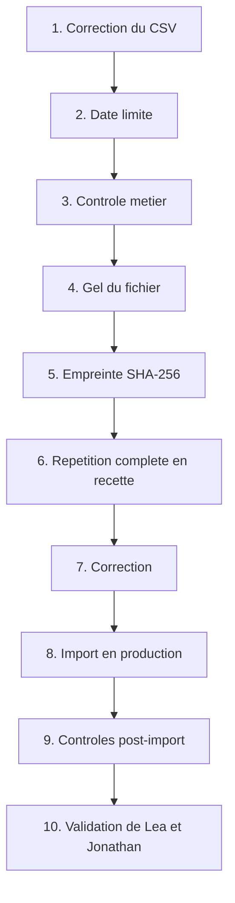

# Critères de qualité et séquence de validation de l'import

**Version :** `1.0-initiale`
**Produit en :** LOT 0, sous-étape S6 — story `MVP-L00-US004`
**Fondement :** cahier des charges §12.5 et §12.6 ; modèle de données §19 et §30 ; matrice §14

---

## 1. Les huit critères de qualité

Repris du cahier des charges §12.6. Chacun est rattaché au code qui le détecte et au contrôle
de recette du modèle qui le vérifie.

| # | Critère | Code détecteur | Contrôle de recette du modèle |
|---:|---|---|---|
| 1 | Aucun doublon d'e-mail | `E-EMAIL-004`, `D-PERSONNE-001` | n°1 : un e-mail normalisé ne peut correspondre qu'à une personne |
| 2 | Aucun profil actif sans entité | `E-ENTITE-001`, `E-ENTITE-002` | n°2 : une seule entité principale active |
| 3 | Aucun consultant actif sans DSM | `E-DSM-001` à `E-DSM-005` | n°4 : un consultant actif possède un DSM actif |
| 4 | Aucun profil en mission sans client | `E-SIT-003` | n°5 : une mission possède un client |
| 5 | Aucun intercontrat avec client actif | `E-SIT-004` | n°5 : un intercontrat n'en possède pas |
| 6 | Aucun cercle principal invalide | `E-CERCLE-001` à `E-CERCLE-005` | n°9 : au maximum un cercle principal actif |
| 7 | Aucun Booster multiple | `E-RESP-007`, `E-RESP-008` | n°6 et n°7 : un seul Booster actif par cercle, pas de Booster dans plusieurs entités |
| 8 | Total des lignes réconcilié avec les créations, mises à jour et rejets | contrôle du rapport, §4 | — |

Ces huit critères sont des **conditions de sortie du LOT 9**. Aucun n'est négociable.

---

## 2. Contrôles complémentaires issus du modèle de données

Le cahier §12.6 énumère huit critères ; le modèle de données §30 en impose d'autres qui
s'appliquent à l'import.

| Contrôle | Code détecteur |
|---|---|
| Aucune référence d'une entité vers une autre | `E-CERCLE-005`, `E-DSM-004`, `E-RESP-008` |
| Un bureau publié possède de un à trois responsables | `E-RESP-009` |
| Une photo sans autorisation ne peut pas être publiée | `F19`, défaut `inconnu` (`DEC-433`) |
| Un import n'écrit aucune ligne avant approbation | séquence §3, étape 4 |
| Une ligne invalide n'empêche pas les lignes valides d'être importées | §5 |
| Une action métier et son audit sont atomiques | `DATA-013` |

---

## 3. Séquence de validation avant l'import final

Reprise du cahier des charges §12.5, sans altération de l'ordre.



| Étape | Contenu | Responsable |
|---:|---|---|
| 1 | Correction du CSV à la source | ESM |
| 2 | Date limite de remise du fichier | Léa, ESM |
| 3 | Contrôle métier des valeurs | ESM, DSM, Boosters selon périmètre (matrice §14.1) |
| 4 | **Gel du fichier** : plus aucune modification | Léa, ESM |
| 5 | **Calcul de l'empreinte SHA-256** du fichier gelé | Jonathan |
| 6 | **Répétition complète en recette** | Jonathan, avec Léa |
| 7 | Correction des anomalies révélées par la répétition | ESM |
| 8 | Import en production | Administrateur d'entité ou super-administrateur |
| 9 | Contrôles post-import | Jonathan |
| 10 | **Validation finale** | **Léa et Jonathan** (matrice §14.1) |

Une correction après l'étape 4 impose de **reprendre à l'étape 4** : le fichier gelé change,
donc son empreinte change, donc la répétition en recette ne vaut plus.

### 3.1 Conditions de manipulation du fichier réel

Le CSV réel peut être utilisé localement uniquement si (cahier §29.2) :

- FileVault est actif — **constaté actif** le 27 juillet 2026 ;
- la session macOS est protégée ;
- l'accès au fichier est restreint ;
- le CSV ne se trouve **ni dans Git ni dans une image** ;
- les sauvegardes sont chiffrées ;
- Mailpit empêche tout envoi réel ;
- les copies temporaires sont supprimées.

Questions ouvertes rattachées, toutes **bloquantes avant données réelles** : `QO-096` schéma
définitif, `QO-097` personne remettant le fichier, `QO-098` preuves d'autorisation des photos,
`QO-099` nombre maximal de lignes rejetées acceptable, `QO-100` durée de conservation du CSV
source.

---

## 4. Réconciliation du rapport d'import

Le critère 8 impose que le rapport totalise **exactement** toutes les lignes. L'égalité à
vérifier :

```text
total_lignes = creations + mises_a_jour + rejets + en_attente_de_decision
```

Avec, pour chaque terme, les états de `import_row` (modèle §19.2) :

| Terme | États |
|---|---|
| `creations` | `imported` sur une personne nouvelle |
| `mises_a_jour` | `updated` sur une personne existante |
| `rejets` | `rejected` |
| `en_attente_de_decision` | `needs_decision` non tranchée |

Le rapport porte également, depuis `import_batch` (modèle §19.1) :

- l'**empreinte SHA-256** du fichier source ;
- le nom de fichier nettoyé ;
- le séparateur et l'encodage retenus ;
- la version du schéma et le profil de correspondance des en-têtes appliqués ;
- l'auteur du dépôt et l'auteur de l'approbation ;
- les compteurs `total_rows`, `valid_rows`, `warning_rows`, `rejected_rows`.

**Aucune ligne rejetée n'est masquée** : critère de sortie du LOT 9. Le rapport doit
correspondre à l'empreinte du fichier : autre critère de sortie.

---

## 5. Règles d'écriture

| Règle | Source |
|---|---|
| L'analyse s'effectue dans une zone dédiée, **sans aucune écriture métier** | `DATA-010`, cahier §9.5 |
| Aucune écriture avant **approbation humaine explicite** | Cahier §9.5, démonstration attendue du LOT 9 |
| Seules les lignes valides sont importées ; les autres restent rejetées et documentées | Cahier §12.4 |
| Une ligne invalide n'empêche pas l'import des lignes valides | Contrôle de recette du modèle n°18 |
| Chaque ligne importée est atomique : aucune mise à jour partielle | Modèle §19.5 |
| Chaque ligne importée produit un audit cohérent | `DATA-013` |
| Une ligne rejetée peut être rejouée après correction | Modèle §19.5 |
| Le rollback intégral d'un lot d'import reste en **V1** | Modèle §19.5, roadmap V1-LOT 3 |
| La réactivation d'un profil archivé exige une **confirmation explicite** | Matrice §14 |
| Aucune fusion ni création d'alias client automatique | Cahier §12.3, `DATA-005` |
| Le rapprochement par nom seul est interdit | Modèle §19, contrôle n°16 |
| L'isolation multi-entités est testée **pendant** l'import | Critère de sortie du LOT 9 |
| Le contenu d'une ligne n'est jamais recopié dans les logs | Modèle §19.2 |
| Le CSV complet est exclu de l'audit | Matrice §16.2 |

---

## 6. Qui valide quoi

Reprise de la matrice §14 et §14.1.

| Action | Rôles autorisés |
|---|---|
| Charger un CSV | ESM, administrateur d'entité, super-administrateur |
| Prévisualiser et corriger les correspondances | ESM, administrateur d'entité, super-administrateur ; DSM et Booster en validation métier de leur périmètre |
| Valider les rapprochements clients | ESM, administrateur d'entité, super-administrateur, DSM sur ses consultants |
| Lancer l'import | ESM, administrateur d'entité, super-administrateur |
| Réactiver un profil archivé | ESM et administrateur d'entité, avec **confirmation explicite** ; super-administrateur |
| Rejouer les lignes rejetées | ESM, administrateur d'entité, super-administrateur |
| Consulter le rapport | ESM, administrateur d'entité, super-administrateur ; DSM et Booster sur leur périmètre |
| Exporter le rapport | ESM, administrateur d'entité, super-administrateur |
| Rollback complet | **V1 uniquement** |

Le DSM et le Booster n'ont **jamais** le droit de charger un fichier ni de lancer un import.

---

## 7. Contrôles post-import

À exécuter après l'étape 8, avant la validation finale.

| Contrôle | Attendu |
|---|---|
| Réconciliation du total | Égalité de la section 4 vérifiée |
| Empreinte | L'empreinte du rapport correspond à celle du fichier gelé |
| Les huit critères de qualité | Aucune violation résiduelle en base |
| Isolation multi-entités | Aucune référence croisée entre entités |
| Unicité des e-mails normalisés | Aucun doublon en base |
| Consultants actifs | Tous disposent d'un DSM actif |
| Missions et intercontrats | Cohérence client respectée |
| Boosters | Un seul actif par cercle ; aucun dans plusieurs entités |
| Photos | Aucune photo publiée sans autorisation active |
| Audit | Un événement d'audit par écriture, atomique avec elle |
| Lignes rejetées | Toutes visibles et expliquées, aucune masquée |

Le nombre de lignes rejetées acceptable au lancement relève de `QO-099`, non tranchée. Aucun
seuil n'est donc fixé ici.
