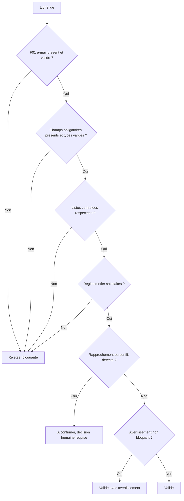

# Schéma du CSV collaborateurs

**Version du schéma :** `1.0-initiale`
**Produit en :** LOT 0, sous-étape S6 — story `MVP-L00-US004`
**Statut :** schéma **initial**. Le schéma définitif relève de `QO-096`, bloquante avant données réelles.
**Fondement :** cahier des charges §12 ; modèle de données §6, §7, §8, §19 ; matrice §2.2 et §14

---

## 1. Objet et portée

Ce document définit le contrat d'entrée des données collaborateurs : champs, formats, valeurs
obligatoires, listes contrôlées et erreurs. Il est la référence de l'analyse d'import du
LOT 9 (`MVP-L09-US004` à `US006`).

Il ne définit **pas** l'implémentation. Aucun code, aucune migration, aucun analyseur n'est
produit au LOT 0.

### 1.1 Ce que ce schéma n'est pas

| Précision | Motif |
|---|---|
| Ce n'est pas le schéma définitif | `QO-096`, « schéma définitif des colonnes du CSV », reste **ouverte**. Ce document est la v1.0 **initiale**, exigée dès le LOT 0 pour ne pas dépendre de l'arrivée du fichier réel (`ROAD-RSK-004`). Voir `ECART-005`. |
| Ce n'est pas la nomenclature des en-têtes | La langue et l'intitulé exact des en-têtes restent **en suspens** : `QO-110`. Voir section 3. |
| Ce n'est pas le catalogue des métiers | Le catalogue métier est configurable par entité et n'est énuméré dans aucun document validé. Il sera établi avec l'ESM à partir des valeurs réelles. Voir [listes contrôlées](listes-controlees.md). |

---

## 2. Format du fichier

**Décision `DEC-432`.**

| Élément | Règle |
|---|---|
| Séparateur de champs | **point-virgule `;`** |
| Séparateur toléré | la virgule `,` est acceptée si elle est détectée de façon non ambiguë, et le séparateur retenu est **consigné dans le rapport d'import** |
| Encodage | **UTF-8** |
| BOM | toléré en tête de fichier, **retiré à la lecture et jamais propagé** |
| Fin de ligne | `LF` ou `CRLF` |
| Guillemets | `"` selon RFC 4180, obligatoires si le champ contient le séparateur, un guillemet ou un saut de ligne |
| Première ligne | ligne d'en-têtes, obligatoire |
| Séparateur intra-champ | **barre verticale `|`** pour les champs multivalués |
| Espaces | supprimés en début et fin de chaque valeur |
| Ligne vide | ignorée, non comptée dans le total |

Motif du point-virgule : les noms et les présentations courtes contiennent des virgules, pas
des points-virgules. Le besoin de guillemets, et donc le risque d'erreur de saisie, s'en
trouve réduit. C'est aussi le séparateur produit nativement par Excel en locale française.

Le séparateur retenu et l'encodage détecté font partie du rapport d'import, aux côtés de
l'empreinte SHA-256 du fichier (modèle §19.1).

---

## 3. En-têtes : profil de correspondance

**En suspens — `QO-110`.** La nomenclature des en-têtes n'est pas arrêtée : la source de
données réelle n'est pas encore connue.

Conception retenue en conséquence, décision `DEC-434` :

1. **ce schéma définit des champs logiques**, identifiés par un code interne stable `F01` à
   `F19`, indépendant de tout intitulé de colonne ;
2. **un profil de correspondance versionné** associe les en-têtes réelles du fichier aux
   champs logiques ;
3. le profil est enregistré avec le lot d'import, comme le sont l'empreinte du fichier et le
   séparateur retenu.

Ce découplage est nécessaire indépendamment de `QO-110` : les en-têtes du fichier réel, quel
qu'il soit, ne correspondront pas exactement à des intitulés inventés à l'avance. Le profil
est le point d'adaptation, et il est tracé.

Un **profil provisoire** est utilisé dans le jeu d'exemple, uniquement pour rendre le schéma
démontrable. Il n'a aucune valeur normative : voir
[exemples/README.md](exemples/README.md).

---

## 4. Principe fondateur : six dimensions, jamais fusionnées

La matrice §2.2 interdit de fusionner ces notions dans un champ `role` unique. Le schéma
applique cette séparation colonne par colonne.

| Dimension | Champs logiques |
|---|---|
| Catégorie professionnelle | `F08` |
| Situation professionnelle | `F12`, `F13` |
| Métier | `F11` |
| Responsabilité Framework | `F17` |
| Autorisation technique | `F18` |
| Rattachement organisationnel | `F05`, `F14`, `F15`, `F16` |

Un fichier qui mélangerait par exemple « consultant », « DSM » et « Booster » dans une seule
colonne serait **non conforme** et devrait être retravaillé à la source.

---

## 5. Champs logiques

Légende de l'obligation : **O** obligatoire, **F** facultatif, **C** conditionnel.

### 5.1 Identité de la personne — table `person`

| Code | Champ logique | Obl. | Type et format | Règles | Cible |
|---|---|:--:|---|---|---|
| `F01` | e-mail professionnel | **O** | texte, adresse e-mail | Normalisé en minuscules, espaces retirés. **Unique dans le fichier et en base.** Domaine parmi les domaines autorisés. **Une ligne sans e-mail est bloquée jusqu'à correction** (cahier §12.2). | `person.email`, `person.email_normalized` |
| `F02` | nom | **O** | texte, 1 à 100 | Non vide après nettoyage. Casse préservée telle que fournie. | `person.last_name` |
| `F03` | prénom | **O** | texte, 1 à 100 | Non vide après nettoyage. | `person.first_name` |
| `F04` | nom d'usage | F | texte, 0 à 100 | Ignoré s'il est identique au nom. | `person.preferred_name` |

L'e-mail normalisé est **l'identifiant fonctionnel unique** de la personne (cahier §11.1).
L'UUID interne est généré par la plateforme et n'apparaît jamais dans le CSV.

### 5.2 Appartenance à l'entité — table `entity_membership`

| Code | Champ logique | Obl. | Type et format | Règles | Cible |
|---|---|:--:|---|---|---|
| `F05` | entité | **O** | code, liste contrôlée | Doit désigner une entité existante et non archivée. | `entity.code` → `entity_membership.entity_id` |
| `F06` | date d'arrivée | **O** | date `AAAA-MM-JJ` | Format ISO 8601 strict. Référence de tout le parcours d'onboarding (cahier §10.4). Une date future produit un profil en état `future`. | `entity_membership.arrival_date` |
| `F07` | date de départ | F | date `AAAA-MM-JJ` | Si renseignée, **supérieure ou égale** à la date d'arrivée. Une date passée produit un profil archivé. | `entity_membership.departure_date` |
| `F08` | catégorie professionnelle | **O** | code, liste contrôlée | `consultant` ou `dg`. **Ce n'est ni le métier, ni une responsabilité.** Un `dg` reçoit automatiquement la responsabilité DSM dans son entité (`RIGHTS-005`), dans la même transaction. | `entity_membership.professional_category` |
| `F09` | présentation courte | F | texte, 0 à 500 | Facultative **à l'import**. Elle devient obligatoire pour que le nouvel arrivant valide sa fiche d'arrivée (cahier §10.5). Son absence produit un avertissement et un profil incomplet. | `entity_membership.short_bio` |
| `F10` | fun fact | F | texte, 0 à 300 | Toujours facultatif. | `entity_membership.fun_fact` |

Une personne ne possède qu'**une seule appartenance principale active** (`RIGHTS-002`,
`DATA-002`). Deux lignes actives pour un même e-mail sont donc un doublon, pas deux
appartenances.

### 5.3 Métier — tables `job_catalog`, `membership_job_assignment`

| Code | Champ logique | Obl. | Type et format | Règles | Cible |
|---|---|:--:|---|---|---|
| `F11` | métier | **C** | code ou libellé, catalogue par entité | Obligatoire pour un profil actif. Le catalogue est propre à l'entité. Une valeur absente du catalogue déclenche une **décision humaine** : création de l'entrée ou correction. Aucune création automatique. | `job_catalog.code` → `membership_job_assignment` |

### 5.4 Situation professionnelle — table `professional_status_assignment`

| Code | Champ logique | Obl. | Type et format | Règles | Cible |
|---|---|:--:|---|---|---|
| `F12` | situation | **O** | code, liste contrôlée | `mission` ou `intercontrat`. Détermine le modèle d'onboarding instancié (cahier §10.4). | `professional_status_assignment.status` |
| `F13` | client | **C** | texte, nom du client | **Obligatoire si `F12` vaut `mission`. Doit être vide si `F12` vaut `intercontrat`.** Un rapprochement avec un client existant peut être proposé, mais **aucune fusion ni création d'alias n'est automatique** : validation humaine obligatoire (cahier §12.3, `DATA-005`). | `client` → `entity_client` → `professional_status_assignment.client_id` |

Ces deux règles sont des critères de qualité du cahier §12.6 : « aucun profil en mission sans
client », « aucun intercontrat avec client actif ».

### 5.5 Rattachement organisationnel — tables `circle`, `circle_membership`, `dsm_assignment`

| Code | Champ logique | Obl. | Type et format | Règles | Cible |
|---|---|:--:|---|---|---|
| `F14` | cercle principal | **C** | code, liste contrôlée | Obligatoire, **sauf pour une personne portant la responsabilité DSM** : « un DSM peut ne pas avoir de cercle principal » (cahier §11.1). Un seul cercle principal actif par appartenance. | `circle_membership` type `principal` |
| `F15` | cercles secondaires | F | codes multivalués, séparés par `\|` | Plusieurs valeurs autorisées. **Ne doit pas répéter `F14`.** Chaque cercle doit appartenir à la même entité. | `circle_membership` type `secondary` |
| `F16` | e-mail du DSM | **C** | adresse e-mail | **Obligatoire pour un consultant actif** (cahier §11.1, §12.6). Doit désigner une personne présente dans le fichier ou en base, portant une **responsabilité DSM active dans la même entité**. Une référence vers une autre entité est refusée. | `dsm_assignment.dsm_person_id` |

`F16` référence une personne par son e-mail, jamais par son nom : le nom n'est pas un
identifiant. Un rapprochement par nom seul est interdit.

### 5.6 Responsabilités Framework — table `framework_responsibility_assignment`

| Code | Champ logique | Obl. | Type et format | Règles | Cible |
|---|---|:--:|---|---|---|
| `F17` | responsabilités Framework | F | codes multivalués, séparés par `\|` | Valeurs : `DSM`, `ESM`, `BOOSTER:<code_cercle>`, `OFFICE_MANAGER:<code_bureau>`. Le scope est **obligatoire** pour `BOOSTER` et `OFFICE_MANAGER`, et **interdit** pour `DSM` et `ESM` (modèle §8.4). | `framework_responsibility_assignment` |

Contraintes vérifiées à l'analyse :

- un cercle ne peut avoir **qu'un seul Booster actif** (`RIGHTS-007`, cahier §12.6) ;
- une personne ne peut pas être Booster active dans **plusieurs entités** (cahier §6.4) ;
- une personne **peut** être Booster de plusieurs cercles d'une même entité (modèle §8.4) ;
- un bureau publié possède **entre un et trois** responsables actifs ;
- les responsabilités **se cumulent** dans l'entité principale (`RIGHTS-004`) : une même ligne
  peut porter `BOOSTER:DATA|OFFICE_MANAGER:BDE`.

### 5.7 Autorisations techniques — table `technical_role_assignment`

| Code | Champ logique | Obl. | Type et format | Règles | Cible |
|---|---|:--:|---|---|---|
| `F18` | rôles techniques | F | codes multivalués, séparés par `\|` | Seule valeur acceptée : `ENTITY_ADMIN`. **`SUPER_ADMIN` est refusé à l'import** et rejette la ligne. | `technical_role_assignment` |

Motif du refus de `SUPER_ADMIN` — **recommandation soumise à validation** : la matrice §21
réserve la création d'un super-administrateur au rôle `SUPER` lui-même, et l'attribution
déclenche une alerte de sécurité (`RIGHTS-016`). Créer ce rôle par dépôt de fichier
contournerait ce contrôle. L'attribution reste possible depuis la super-administration, avec
audit et alerte.

### 5.8 Autorisation de photographie — table `photo_authorization`

| Code | Champ logique | Obl. | Type et format | Règles | Cible |
|---|---|:--:|---|---|---|
| `F19` | autorisation photo | F | code, liste contrôlée | `oui`, `non` ou `inconnu`. **Valeur par défaut en cas d'absence : `inconnu`.** | `photo_authorization` |

**Décision `DEC-433`.** Sans autorisation **active**, aucune photo n'est publiée et l'avatar
neutre est utilisé (cahier §21.2, `ROAD-RSK-018`). `inconnu` et `non` produisent donc le même
effet d'affichage, mais se distinguent au registre : `non` est un refus exprimé, `inconnu` est
une information manquante.

Le CSV ne transporte **aucune photographie**. Il ne porte que l'état de l'autorisation. La
disponibilité de preuves relève de `QO-098`, bloquante avant données réelles.

---

## 6. Synthèse des champs

| Code | Champ | Obligation | Multivalué |
|---|---|---|---|
| `F01` | e-mail professionnel | Obligatoire, **bloquant** | — |
| `F02` | nom | Obligatoire | — |
| `F03` | prénom | Obligatoire | — |
| `F04` | nom d'usage | Facultatif | — |
| `F05` | entité | Obligatoire | — |
| `F06` | date d'arrivée | Obligatoire | — |
| `F07` | date de départ | Facultatif | — |
| `F08` | catégorie professionnelle | Obligatoire | — |
| `F09` | présentation courte | Facultatif à l'import | — |
| `F10` | fun fact | Facultatif | — |
| `F11` | métier | Conditionnel : profil actif | — |
| `F12` | situation | Obligatoire | — |
| `F13` | client | Conditionnel : `mission` | — |
| `F14` | cercle principal | Conditionnel : sauf DSM | — |
| `F15` | cercles secondaires | Facultatif | oui, `\|` |
| `F16` | e-mail du DSM | Conditionnel : consultant actif | — |
| `F17` | responsabilités Framework | Facultatif | oui, `\|` |
| `F18` | rôles techniques | Facultatif | oui, `\|` |
| `F19` | autorisation photo | Facultatif, défaut `inconnu` | — |

19 champs logiques. Aucun champ ne transporte de mot de passe, de jeton, de photographie, de
donnée de santé ni de donnée bancaire.

---

## 7. Ce que le CSV ne contient jamais

| Élément | Motif |
|---|---|
| UUID interne | Généré par la plateforme, immuable |
| Mot de passe, jeton | Les collaborateurs se connectent par magic link (cahier §7.2) |
| Photographie, fichier binaire | Les médias passent par le circuit contrôlé du LOT 11 |
| Rôle `SUPER_ADMIN` | Voir §5.7 |
| Onboarding, tâches, progression | Générés depuis la date d'arrivée (`MVP-L07-US004`) |
| Contenu éditorial | Périmètre du LOT 6 |
| Historique des affectations | Créé par la plateforme : une modification clôture et recrée (`DATA-016`) |

---

## 8. Traitement d'une ligne

Les six états de ligne du cahier §12.4 : `valide`, `valide avec avertissement`, `à confirmer`,
`rejetée`, `importée`, `mise à jour`. Ils correspondent aux états de `import_row` du modèle
§19.2.

**Aucune écriture métier n'a lieu avant approbation humaine** (`DATA-010`, cahier §9.5). Les
lignes valides sont importées, les autres restent rejetées et documentées (cahier §12.4).

---

## 9. Documents liés

| Document | Objet |
|---|---|
| [codes-erreurs-import.md](codes-erreurs-import.md) | Codes stables, niveaux, messages et résolutions |
| [listes-controlees.md](listes-controlees.md) | Valeurs admises pour chaque champ à liste contrôlée |
| [criteres-qualite-import.md](criteres-qualite-import.md) | Les 8 critères de qualité et la séquence de validation |
| [exemples/](exemples/README.md) | Jeu de données **intégralement fictif** couvrant les six états |

---

## 10. Historique des versions du schéma

| Version | Date | Changement |
|---|---|---|
| `1.0-initiale` | 27 juillet 2026 | Création. 19 champs logiques déduits des documents validés. Nomenclature des en-têtes en suspens (`QO-110`). Schéma définitif attendu par `QO-096`. |

Toute évolution de ce schéma exige une nouvelle version, une décision tracée et une
réévaluation des codes d'erreur et du jeu d'exemple.
