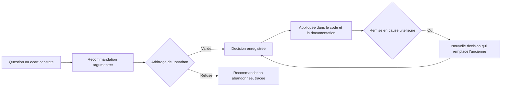

# Registres de décisions et d'écarts

**Produit en :** LOT 0, sous-étape S4 — story `MVP-L00-US006`
**Fondement :** roadmap LOT 0, critère de sortie n°2 « chaque décision possède un identifiant stable »

| Registre | Objet |
|---|---|
| [registre-decisions.md](registre-decisions.md) | Toutes les décisions du projet, reprises et nouvelles |
| [registre-ecarts.md](registre-ecarts.md) | Écarts constatés entre l'existant et les documents validés |

Registres complémentaires dans [`../operations/`](../operations/) : risques, questions
ouvertes, dépendances externes.

---

## 1. Règles de numérotation

| Règle | Détail |
|---|---|
| Unicité absolue | Un identifiant n'est **jamais** réutilisé, même si l'entrée qu'il portait est annulée |
| Continuité | Toute nouvelle entrée poursuit la séquence existante, sans combler un trou |
| Trous conservés | Un trou dans une séquence est documenté, jamais rempli |
| Pas de renumérotation | Une entrée enregistrée ne change jamais d'identifiant |

### 1.1 Séquences en vigueur

| Séquence | Objet | Étendue | Prochain libre |
|---|---|---|---|
| `DEC-nnn` | Décisions du projet | `001` à `417` **réservés** ; `418+` en usage | voir registre |
| `RIGHTS-nnn` | Décisions de droits, matrice §26 | `001` à `025` | `026` |
| `DATA-nnn` | Décisions de modèle, modèle §32 | `001` à `018` | `019` |
| `ROAD-nnn` | Décisions de roadmap, roadmap §17 | `001` à `012` | `013` |
| `BACKLOG-nnn` | Décisions de backlog, backlog §14 | `001` à `010` | `011` |
| `ARB-DROIT / ARB-DATA / ARB-ROAD / ARB-BACK-nnn` | Arbitrages | `001` à `005` chacun | `006` |
| `ECART-nnn` | Écarts — séquence créée par `DEC-431` | voir registre | voir registre |
| `QO-nnn` | Questions ouvertes | `072` à `105`, avec 5 trous | `106` |
| `ROAD-RSK-nnn` | Risques | `001` à `024` | voir registre |
| `DEP-nnn` | Dépendances externes — séquence créée par `DEC-431` | voir registre | voir registre |

### 1.2 Plage `DEC-001` à `DEC-417`

Les cinq documents de cadrage référencent des décisions `DEC-001` à `DEC-417` issues des
ateliers 1 à 34, mais la table correspondante n'est présente dans aucun document du corpus
(`ECART-004`).

Décision `DEC-422` : les **85 décisions et arbitrages consolidés** font foi comme registre
décisionnel. La plage `DEC-001` à `DEC-417` est **réservée**, afin qu'un import ultérieur des
comptes rendus d'ateliers ne produise aucun conflit d'identifiant. Les décisions du projet
démarrent à `DEC-418`.

---

## 2. Cycle de vie d'une décision

Règles :

- une décision validée n'est **jamais** modifiée silencieusement ;
- pour changer une décision, on en enregistre une **nouvelle** qui référence explicitement
  celle qu'elle remplace ; l'ancienne passe au statut `Remplacée` et conserve son texte ;
- une proposition non encore arbitrée est une **recommandation**, jamais une décision ;
- toute décision touchant une exigence `Must`, une story `P0`, la sécurité, l'isolation
  multi-entités, le RGPD ou l'accessibilité essentielle exige un arbitrage explicite de
  Jonathan et une analyse d'impact.

---

## 3. Statuts

| Statut | Sens |
|---|---|
| `Validée` | Arbitrée par Jonathan, applicable |
| `Recommandée` | Proposée, en attente d'arbitrage — n'a aucune valeur normative |
| `Remplacée` | Remplacée par une décision plus récente, texte conservé |
| `Abandonnée` | Écartée après arbitrage, motif conservé |

Pour un écart : `Ouvert`, `Clos`, `Accepté` — un écart accepté reste connu et documenté,
mais n'est pas corrigé.

---

## 4. Champs obligatoires

| Champ | Décision | Écart |
|---|---|---|
| Identifiant | oui | oui |
| Intitulé | oui | oui |
| Date | oui | oui de constat |
| Statut | oui | oui |
| Fondement ou source | oui | oui |
| Motif | oui | — |
| Impact | si structurante | oui |
| Recommandation | — | oui |
| Caractère bloquant | — | oui |
| Résolution | — | si clos |

---

## 5. Où consigner quoi

| Nature | Registre |
|---|---|
| Un choix tranché | `registre-decisions.md` |
| Une différence entre l'existant et un document validé | `registre-ecarts.md` |
| Une menace potentielle avec impact et mesure | `../operations/registre-risques.md` |
| Une interrogation sans réponse, avec un responsable | `../operations/registre-questions-ouvertes.md` |
| Un élément attendu d'un tiers, avec échéance | `../operations/registre-dependances-externes.md` |
| Un raccourci technique assumé | issue GitHub étiquetée `dette`, avec cause, impact, propriétaire et lot de résolution |
